# 🛡️ VitalMind AI — Evidencias del Administrador

<div align="center">


</div>

---

## 📌 Descripción

Este documento contiene las **evidencias visuales de la interfaz administrativa de VitalMind AI**.

El panel administrativo permite supervisar usuarios, consultar indicadores, analizar reportes, gestionar notificaciones y configurar funciones globales del sistema.

Las evidencias están almacenadas en la carpeta hermana:

```text
Evidencias/
├── Evidencias_Usuario/
├── Evidencias_Admin/
├── readme_usuario.md
└── readme_admin.md
```

---

## 👥 Gestión de usuarios

### Usuarios registrados
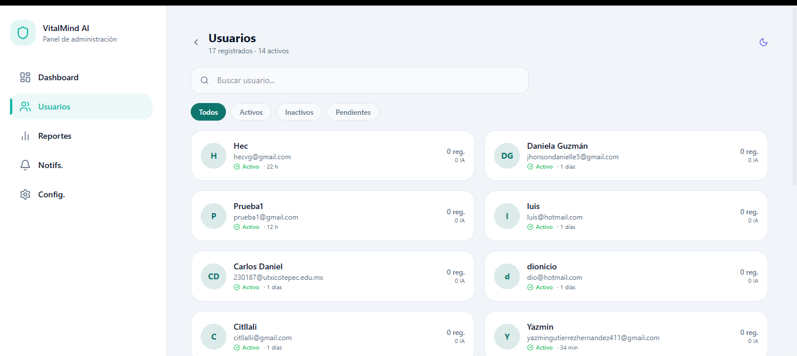

### Usuarios inactivos
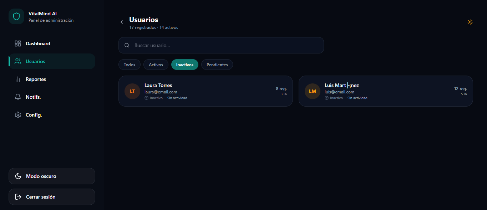

### Usuarios pendientes
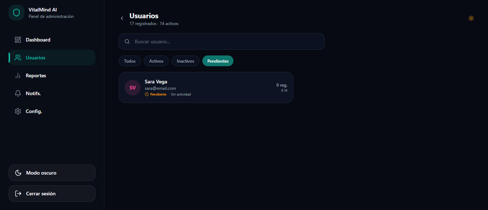

---

## 📊 Dashboard administrativo

### Panel principal
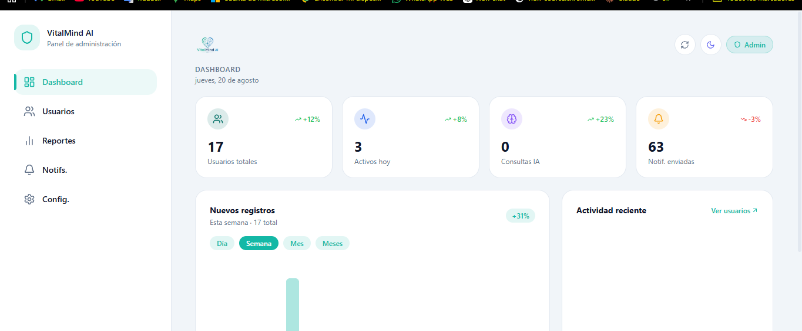

### Dashboard en modo oscuro
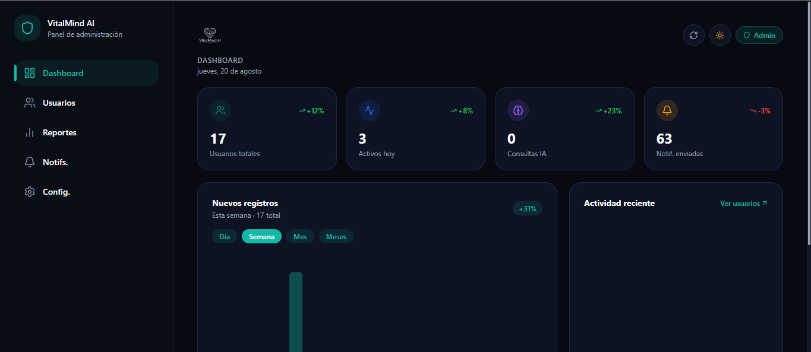

---

## 📈 Reportes y analítica

### Reportes
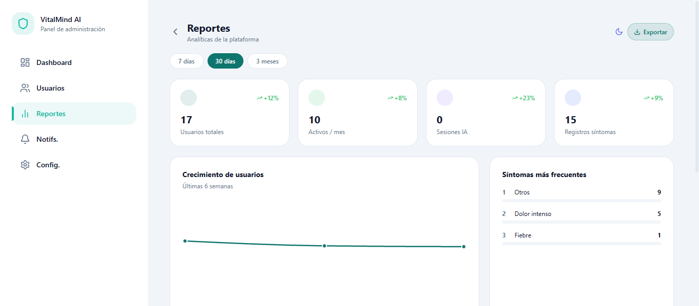

### Detalle de reportes
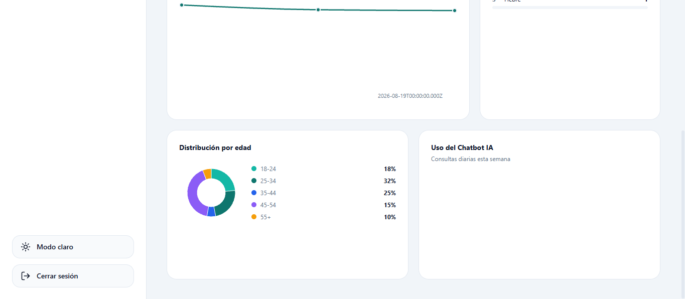

### Reportes en modo oscuro
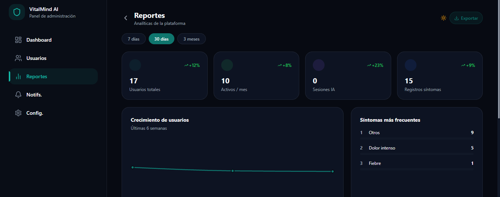

---

## 🔔 Notificaciones administrativas

### Gestión de notificaciones
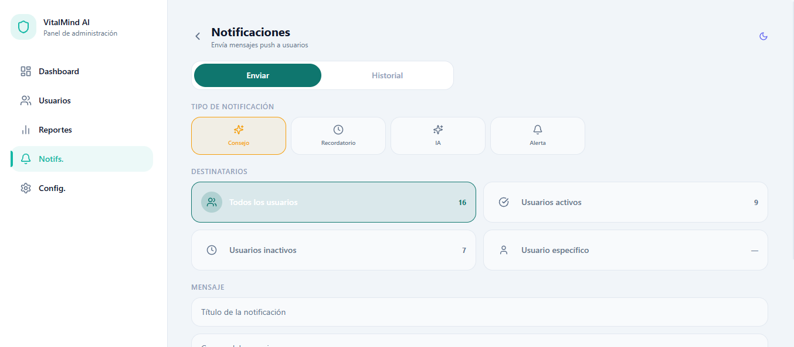

### Notificaciones en modo oscuro
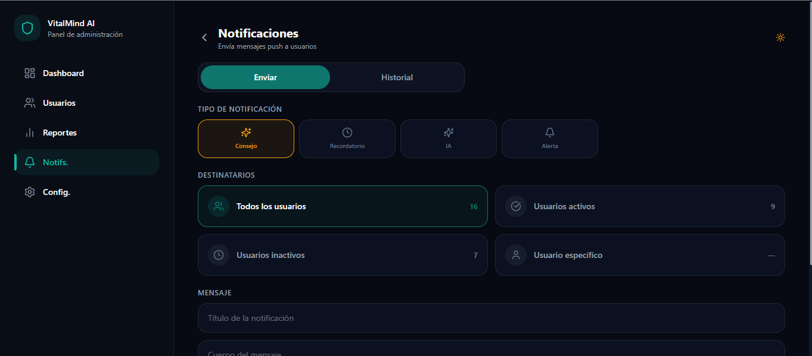

---

## ⚙️ Configuración del sistema

### Configuración administrativa
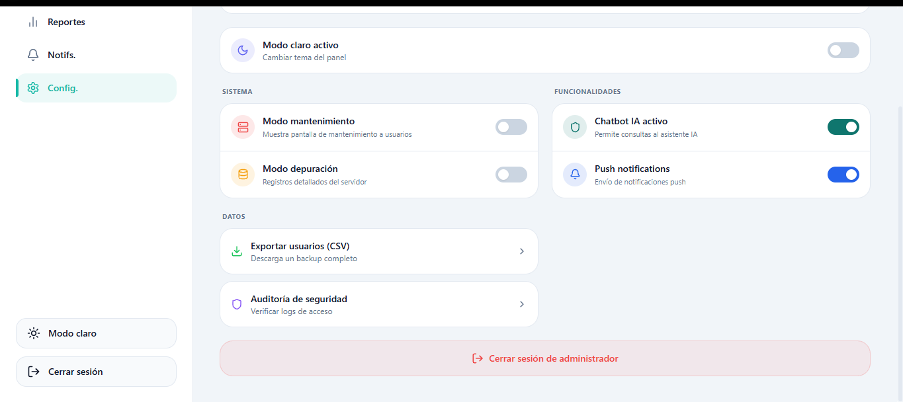

### Configuración en modo oscuro
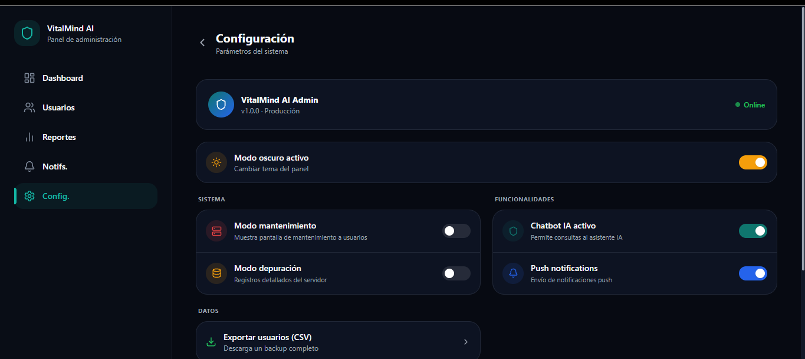

### Configuración — estado avanzado
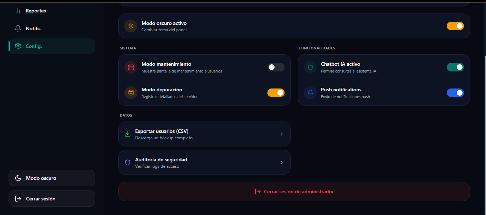

---

## 📁 Evidencias disponibles

```text
Evidencias_Admin/
├── 43-admin-usuarios.png
├── 44-admin-dashboard.png
├── 45-admin-reportes.png
├── 46-admin-reportes-detalle.png
├── 47-admin-notificaciones.png
├── 48-admin-configuracion.png
├── 49-admin-configuracion-modo-oscuro.png
├── 50-admin-notificaciones-modo-oscuro.png
├── 51-admin-reportes-modo-oscuro.png
├── 52-admin-usuarios-inactivos.png
├── 53-admin-usuarios-pendientes.png
├── 54-admin-dashboard-modo-oscuro.png
└── 55-admin-configuracion-modo-oscuro.png
```

---

## 🎯 Módulos documentados

| Módulo | Funcionalidad |
|---|---|
| 👥 Usuarios | Consulta y filtrado de usuarios |
| 📊 Dashboard | Indicadores generales y actividad |
| 📈 Reportes | Analítica de la plataforma |
| 🔔 Notificaciones | Envío y administración de mensajes |
| ⚙️ Configuración | Control de funcionalidades del sistema |
| 🌙 Modo oscuro | Tema alternativo para el panel |

---

<div align="center">

**VitalMind AI — Panel Administrativo**

</div>
