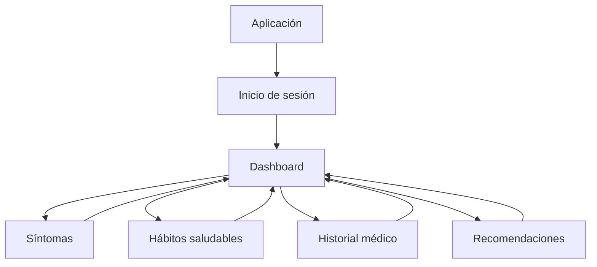

<div align="center">

# VitalMind Mobile

Frontend móvil de la plataforma **VitalMind**, desarrollado con **React** y **Vite** para brindar una experiencia moderna, rápida y accesible enfocada en el monitoreo de la salud y el bienestar.

<br>


<br><br>


</div>

---

# Tabla de Contenidos

* [Descripción](#descripción)
* [Objetivos](#objetivos)
* [Características](#características)
* [Arquitectura](#arquitectura)
* [Tecnologías](#tecnologías)
* [Estructura del Proyecto](#estructura-del-proyecto)
* [Requisitos](#requisitos)
* [Instalación](#instalación)
* [Variables de Entorno](#variables-de-entorno)
* [Docker](#docker)
* [Scripts Disponibles](#scripts-disponibles)
* [Experiencia de Usuario](#experiencia-de-usuario)
* [Flujo de la Aplicación](#flujo-de-la-aplicación)
* [Integración con la API](#integración-con-la-api)
* [Hoja de Ruta](#hoja-de-ruta)
* [Contribución](#contribución)
* [Estado del Proyecto](#estado-del-proyecto)
* [Autor](#autor)
* [Licencia](#licencia)

---

# Descripción

**VitalMind Mobile** es el frontend móvil de la plataforma **VitalMind**, una solución tecnológica orientada al monitoreo de la salud y el bienestar de los usuarios mediante una interfaz intuitiva, moderna y responsiva.

La aplicación permite registrar síntomas, controlar hábitos saludables, consultar el historial médico y visualizar información relevante desde dispositivos móviles.

Este frontend está diseñado para ofrecer una navegación ágil, una experiencia visual clara y una integración eficiente con los servicios del backend de VitalMind.

---

# Objetivos

Los principales objetivos de VitalMind Mobile son:

* Proporcionar una interfaz móvil sencilla e intuitiva.
* Registrar síntomas diarios.
* Dar seguimiento a hábitos saludables.
* Mostrar información médica de forma clara.
* Facilitar el acceso al historial clínico.
* Integrar servicios mediante una API REST.
* Mejorar la experiencia del usuario en dispositivos móviles.
* Mantener una arquitectura modular y escalable.

---

# Características

* Autenticación de usuarios

  * Inicio de sesión
  * Registro

* Panel principal (Dashboard)

* Registro diario de síntomas

* Seguimiento de hábitos saludables

* Consulta del historial médico

* Recomendaciones personalizadas

* Diseño responsive

* Integración con API REST

* Navegación rápida

* Interfaz moderna

* Componentes reutilizables

* Arquitectura organizada por capas

---

# Arquitectura

```text
                 +----------------------+
                 |    API VitalMind     |
                 +----------+-----------+
                            |
                          Axios
                            |
+------------------------------------------------+
|                React + Vite                    |
|------------------------------------------------|
| Pages                                          |
| Components                                     |
| Services                                       |
| Routes                                         |
| Context                                        |
+------------------------------------------------+
                            |
                     Dispositivo móvil
```

La aplicación se comunica con el backend mediante solicitudes HTTP gestionadas con Axios. La lógica de presentación se organiza en páginas, componentes reutilizables, servicios, rutas y contexto global.

---

# Tecnologías

| Tecnología   | Descripción                           |
| ------------ | ------------------------------------- |
| React        | Biblioteca para interfaces de usuario |
| Vite         | Herramienta de desarrollo frontend    |
| JavaScript   | Lenguaje de programación              |
| HTML5        | Lenguaje de marcado                   |
| CSS3         | Hojas de estilo                       |
| React Router | Enrutamiento del cliente              |
| Axios        | Cliente HTTP                          |
| Docker       | Contenerización de la aplicación      |

---

# Estructura del Proyecto

```text
VitalMind-Mobile
│
├── public/
├── src/
│   ├── assets/
│   ├── components/
│   ├── context/
│   ├── hooks/
│   ├── layouts/
│   ├── pages/
│   ├── routes/
│   ├── services/
│   ├── styles/
│   ├── utils/
│   ├── App.jsx
│   └── main.jsx
│
├── Dockerfile
├── docker-compose.yml
├── nginx.conf
├── package.json
├── package-lock.json
├── vite.config.js
├── .gitignore
└── README.md
```

Esta estructura puede variar según la organización interna del proyecto, pero se recomienda mantener una separación clara entre presentación, lógica de negocio y servicios.

---

# Requisitos

Antes de ejecutar el proyecto asegúrate de tener instalado:

* Node.js 18 o superior
* npm 9 o superior
* Git
* Docker Desktop (opcional)

Verifica las versiones:

```bash
node -v
npm -v
git --version
docker --version
```

---

# Instalación

Clona el repositorio:

```bash
git clone https://github.com/tu-usuario/VitalMind-Mobile.git
```

Ingresa al directorio del proyecto:

```bash
cd VitalMind-Mobile
```

Instala las dependencias:

```bash
npm install
```

Ejecuta el servidor de desarrollo:

```bash
npm run dev
```

La aplicación estará disponible en:

```text
http://localhost:5173
```

---

# Variables de Entorno

Si el proyecto utiliza variables de entorno, crea un archivo `.env` en la raíz del proyecto. Un ejemplo básico podría ser:

```env
VITE_API_URL=http://localhost:3000/api
```

Ejemplo de archivo `.env.example`:

```env
VITE_API_URL=
```

Asegúrate de no subir el archivo `.env` al repositorio si contiene datos sensibles.

---

# Docker

El proyecto puede ejecutarse mediante Docker, permitiendo desplegar la aplicación en un entorno aislado y consistente.

## Construir la imagen

```bash
docker build -t vitalmind-mobile .
```

## Ejecutar el contenedor

```bash
docker run -d -p 5173:80 --name vitalmind-mobile vitalmind-mobile
```

La aplicación estará disponible en:

```text
http://localhost:5173
```

## Usando Docker Compose

Construir e iniciar el proyecto:

```bash
docker compose up --build
```

Ejecutar en segundo plano:

```bash
docker compose up -d --build
```

Detener los contenedores:

```bash
docker compose down
```

---

# Scripts Disponibles

| Comando           | Descripción                                      |
| ----------------- | ------------------------------------------------ |
| `npm run dev`     | Inicia el servidor de desarrollo                 |
| `npm run build`   | Genera la versión para producción                |
| `npm run preview` | Ejecuta una vista previa de la versión compilada |

---

# Experiencia de Usuario

VitalMind Mobile sigue la filosofía **Mobile First**, priorizando una experiencia intuitiva, rápida y accesible.

Principios de diseño:

* Interfaz limpia
* Navegación intuitiva
* Componentes reutilizables
* Diseño adaptable
* Tipografía legible
* Alto rendimiento
* Carga rápida
* Consistencia visual

---

# Flujo de la Aplicación



Este flujo representa la navegación principal dentro de la aplicación móvil.

---

# Integración con la API

VitalMind Mobile consume una API REST para gestionar la información del usuario y mostrar los datos en tiempo real o casi en tiempo real, dependiendo de la implementación del backend.

Funciones habituales de integración:

* Inicio de sesión de usuarios
* Registro de cuentas
* Consulta de historial médico
* Envío de síntomas
* Registro de hábitos
* Obtención de recomendaciones personalizadas
* Visualización del dashboard

La comunicación con el backend se realiza mediante Axios, centralizando las peticiones en archivos de servicio para mantener el código ordenado y fácil de mantener.

Ejemplo de estructura recomendada para servicios:

```text
src/
├── services/
│   ├── auth.service.js
│   ├── symptoms.service.js
│   ├── habits.service.js
│   ├── history.service.js
│   └── recommendations.service.js
```

---

# Hoja de Ruta

Funcionalidades previstas para futuras versiones:

* Notificaciones Push
* Modo Oscuro
* Estadísticas de salud
* Recordatorios de medicamentos
* Integración con dispositivos wearables
* Exportación de reportes en PDF
* Modo Offline
* Soporte multilenguaje
* Sincronización en tiempo real

---

# Contribución

Las contribuciones son bienvenidas.

1. Realiza un Fork del repositorio.
2. Crea una nueva rama.

```bash
git checkout -b feature/nueva-funcionalidad
```

3. Realiza tus cambios y crea un commit.

```bash
git commit -m "Agregar nueva funcionalidad"
```

4. Envía los cambios.

```bash
git push origin feature/nueva-funcionalidad
```

5. Abre un Pull Request.

---

# Estado del Proyecto

| Estado        | Descripción                                                                                        |
| ------------- | -------------------------------------------------------------------------------------------------- |
| En desarrollo | El proyecto continúa en desarrollo activo y nuevas funcionalidades son incorporadas continuamente. |

---

# Autor

Desarrollado como parte del proyecto **VitalMind**.

---

# Licencia

Este proyecto tiene fines académicos y de desarrollo interno.

No está permitido su uso comercial sin autorización expresa.

---

<div align="center">

## VitalMind Mobile

Plataforma Inteligente para el Monitoreo de la Salud

Desarrollado con React, Vite y Docker

</div>
````
