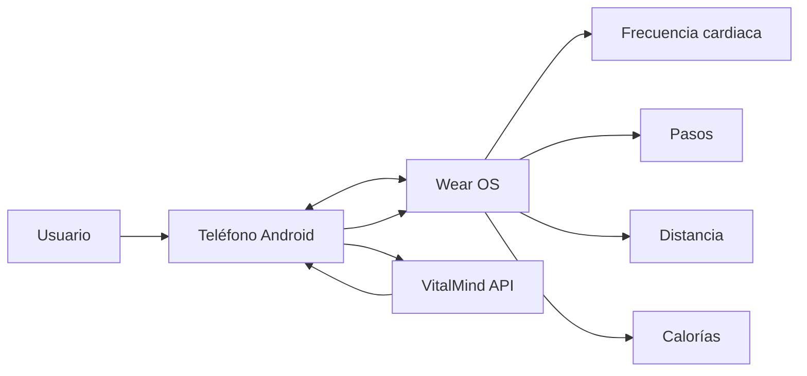

<div align="center">

#  VitalMind Mobile & Wear

Frontend móvil de **VitalMind**, desarrollado como una solución integrada para **teléfono Android y dispositivos Wear OS**.

El proyecto reúne ambos frontends dentro de una misma aplicación Android, permitiendo que la aplicación móvil y el wearable trabajen de forma coordinada y compartan información relacionada con el monitoreo de salud y actividad física.

<br>


<br><br>


</div>

---

#  Tabla de Contenidos

* [Descripción](#-descripción)
* [Objetivo](#-objetivo)
* [Unificación del frontend](#-unificación-del-frontend)
* [Funcionalidades](#-funcionalidades)
* [Arquitectura](#-arquitectura)
* [Comunicación entre teléfono y wearable](#-comunicación-entre-teléfono-y-wearable)
* [Tecnologías](#-tecnologías)
* [Estructura del proyecto](#-estructura-del-proyecto)
* [Requisitos](#-requisitos)
* [Instalación y ejecución](#-instalación-y-ejecución)
* [Ejecución del módulo móvil](#-ejecución-del-módulo-móvil)
* [Ejecución del módulo Wear OS](#-ejecución-del-módulo-wear-os)
* [Compilación por terminal](#-compilación-por-terminal)
* [Flujo de comunicación](#-flujo-de-comunicación)
* [Estado del proyecto](#-estado-del-proyecto)
* [Autor](#-autor)
* [Licencia](#-licencia)

---

#  Descripción

**VitalMind Mobile & Wear** es el frontend móvil de la plataforma **VitalMind**, desarrollado para extender la experiencia de la plataforma hacia dispositivos Android y dispositivos wearables compatibles con Wear OS.

A diferencia de mantener dos aplicaciones independientes, el proyecto integra el frontend del **teléfono** y el frontend del **wearable** dentro de un mismo proyecto Android.

La solución se encuentra organizada en dos módulos:

* **`app`** → aplicación principal para teléfono Android.
* **`wear`** → aplicación complementaria para dispositivos Wear OS.

Ambos módulos comparten la misma base de proyecto y utilizan mecanismos de comunicación entre dispositivos para intercambiar información y mantener una experiencia integrada.

La estructura del repositorio refleja esta integración mediante dos módulos Gradle incluidos en el mismo proyecto.

---

#  Objetivo

El objetivo del frontend móvil y wearable es proporcionar una experiencia integrada de VitalMind donde el usuario pueda interactuar con la plataforma desde su teléfono y desde su smartwatch.

La solución busca:

* Centralizar la experiencia móvil y wearable en un solo proyecto.
* Permitir comunicación entre teléfono y reloj.
* Obtener información relacionada con actividad y salud desde el wearable.
* Enviar información del wearable hacia el teléfono.
* Facilitar funciones que requieren una interacción rápida desde la muñeca.
* Mantener una arquitectura modular y escalable.

---

#  Unificación del Frontend

Uno de los puntos principales del desarrollo fue **unificar el frontend móvil y el frontend del wearable dentro de un mismo proyecto Android**.

En lugar de manejar aplicaciones completamente separadas, se creó una estructura con dos módulos:

```text
VitalMindMobileWear
│
├── app
│   └── Frontend para teléfono Android
│
└── wear
    └── Frontend para Wear OS
```

Esto permite mantener ambos clientes dentro del mismo repositorio, con configuraciones, dependencias y versiones controladas mediante Gradle.

El proyecto se define oficialmente como un proyecto con los módulos `:app` y `:wear`.

---

#  Funcionalidades

##  Aplicación móvil

El módulo móvil incluye funcionalidades orientadas a la interacción principal del usuario con VitalMind.

Entre ellas se encuentran:

* Inicio de sesión.
* Navegación entre pantallas.
* Dashboard.
* Gestión de información del usuario.
* Integración con servicios externos.
* Funciones relacionadas con salud.
* Integración con el wearable.
* Comunicación mediante servicios de Wear OS.

El módulo `app` utiliza Jetpack Compose, navegación, Retrofit, DataStore, Health Connect y Google Play Services para Wearable.

##  Aplicación Wear OS

El módulo `wear` está diseñado específicamente para el smartwatch y proporciona una interfaz adaptada a pantallas pequeñas.

Incluye infraestructura para:

* Comunicación con el teléfono.
* Envío de datos de salud y actividad.
* Navegación específica para Wear OS.
* Interfaz con Jetpack Compose para Wear.
* Integración con Health Services.
* Interacción mediante mensajes entre dispositivos.

El módulo wearable utiliza las librerías de Wear OS, Google Play Services Wearable y Health Services Client.

---

#  Arquitectura

```text
                     ┌───────────────────────┐
                     │      VitalMind        │
                     │     Plataforma API    │
                     └───────────┬───────────┘
                                 │
                           HTTP / API
                                 │
                ┌────────────────┴────────────────┐
                │                                 │
                ▼                                 ▼
       ┌──────────────────┐              ┌──────────────────┐
       │  Android Mobile  │◄────────────►│    Wear OS       │
       │     módulo app   │  Wearable   │    módulo wear   │
       └──────────────────┘   Layer     └──────────────────┘
                │                                 │
                └───────────── Usuario ───────────┘
```

La arquitectura se divide en:

**Frontend móvil**

Aplicación principal ejecutada en el teléfono.

**Frontend wearable**

Aplicación complementaria ejecutada en el smartwatch.

**Capa de comunicación**

Mecanismo utilizado para intercambiar información entre el teléfono y Wear OS.

**API de VitalMind**

Servicios externos consumidos desde la aplicación móvil.

---

#  Comunicación entre Teléfono y Wearable

La comunicación entre ambos módulos utiliza las APIs de **Google Play Services para Wearable**.

El proyecto incluye la dependencia:

```kotlin
implementation(libs.play.services.wearable)
```

tanto en el módulo móvil como en el módulo Wear OS.

El wearable dispone de un `WearConnectionManager` que consulta los nodos conectados para determinar si existe una conexión con el teléfono.

También se implementó un cliente de comunicación para enviar mensajes desde el wearable hacia el teléfono. Por ejemplo, `WearChatClient` transmite preguntas utilizando `MessageClient`.

La comunicación también contempla el envío de métricas como:

*  Frecuencia cardiaca.
*  Pasos.
*  Distancia recorrida.
*  Calorías.

Estas operaciones están implementadas mediante `WearSensorClient` y utilizan mensajes dirigidos al nodo conectado.

---

#  Flujo de comunicación



El flujo permite que el wearable funcione como un punto de captura e interacción rápida mientras el teléfono actúa como aplicación principal y punto de integración con el resto de la plataforma.

---

#  Tecnologías

| Tecnología                        | Uso                             |
| --------------------------------- | ------------------------------- |
| **Kotlin**                        | Lenguaje principal              |
| **Jetpack Compose**               | Interfaz de usuario             |
| **Material 3**                    | Componentes visuales            |
| **Jetpack Compose for Wear OS**   | Interfaz del smartwatch         |
| **Android Studio**                | Entorno de desarrollo           |
| **Gradle**                        | Construcción del proyecto       |
| **Navigation Compose**            | Navegación                      |
| **Retrofit**                      | Comunicación con API            |
| **Gson Converter**                | Conversión de datos             |
| **DataStore**                     | Persistencia local              |
| **Health Connect**                | Integración con datos de salud  |
| **Health Services**               | Datos de actividad del wearable |
| **Google Play Services Wearable** | Comunicación teléfono ↔ reloj   |
| **Kotlin Coroutines**             | Operaciones asíncronas          |

Las dependencias y versiones principales están definidas en `gradle/libs.versions.toml`.

---

#  Estructura del proyecto

```text
VitalMind-Mobile-Wear/
│
├── app/
│   └── src/
│       └── main/
│           ├── java/com/vitalmind/mobilewear/
│           │   ├── data/
│           │   ├── navigation/
│           │   ├── ui/
│           │   ├── MainActivity.kt
│           │   └── PermissionsRationaleActivity.kt
│           └── res/
│
├── wear/
│   └── src/
│       └── main/
│           ├── java/com/vitalmind/mobilewear/wear/
│           │   ├── data/
│           │   ├── health/
│           │   └── presentation/
│           └── res/
│
├── gradle/
│   └── libs.versions.toml
│
├── build.gradle.kts
├── settings.gradle.kts
├── gradle.properties
├── gradlew
├── gradlew.bat
└── README.md
```

El módulo móvil organiza la lógica en áreas como `data`, `navigation` y `ui`; el módulo wearable utiliza `data`, `health` y `presentation`.

---

#  Requisitos

Para ejecutar el proyecto se recomienda utilizar:

* **Android Studio** compatible con AGP 9.2.
* **JDK 17**.
* Android SDK compatible con el proyecto.
* Un dispositivo Android físico o emulador.
* Un dispositivo Wear OS o emulador Wear OS para probar el segundo módulo.

El proyecto utiliza **Android Gradle Plugin 9.2.1**, por lo que el entorno de Gradle debe utilizar JDK 17.

La configuración actual del proyecto utiliza:

```text
AGP                9.2.1
Kotlin             2.2.10
Compile SDK        37.1
Target SDK         36
Min SDK            30
Gradle             9.4.1
Java               17 para Gradle
```

La compatibilidad de AGP 9.2 establece JDK 17 y Gradle 9.4.1 como versiones de referencia.

---

#  Instalación y ejecución

## 1. Clonar el repositorio

```bash
git clone https://github.com/Ktmich2095/VitalMind-Mobile-Wear.git
```

Entrar al proyecto:

```bash
cd VitalMind-Mobile-Wear
```

---

## 2. Abrir en Android Studio

Abre **Android Studio** y selecciona:

```text
Open
→ VitalMind-Mobile-Wear
```

Es importante abrir **la raíz del proyecto**, donde se encuentran:

```text
settings.gradle.kts
build.gradle.kts
gradlew
gradlew.bat
app/
wear/
```

El archivo `settings.gradle.kts` incluye explícitamente los módulos:

```kotlin
include(":app")
include(":wear")
```

por lo que Android Studio cargará ambos módulos.

---

## 3. Sincronizar Gradle

Después de abrir el proyecto:

```text
File
→ Sync Project with Gradle Files
```

Espera a que Android Studio descargue las dependencias y finalice la sincronización.

---

#  Ejecución del módulo móvil

En Android Studio selecciona la configuración:

```text
app
```

Después selecciona:

```text
Run ▶
```

El módulo móvil tiene:

```text
applicationId = com.vitalmind.mobilewear
```

y requiere como mínimo Android API 30.

Puedes ejecutarlo en:

* Un teléfono Android físico.
* Un emulador Android.

---

#  Ejecución del módulo Wear OS

Para ejecutar el wearable, selecciona la configuración:

```text
wear
```

y posteriormente:

```text
Run ▶
```

El módulo utiliza una interfaz específica para Wear OS y también requiere como mínimo Android API 30.

Puedes ejecutarlo en:

* Un smartwatch físico con Wear OS.
* Un emulador Wear OS.

---

#  Configuración del teléfono y reloj

Para probar la comunicación completa de VitalMind se recomienda tener disponibles **ambos dispositivos al mismo tiempo**:

```text
Teléfono Android
      ↕
Wear OS
```

El teléfono debe tener instalado el módulo `app` y el smartwatch debe tener instalado el módulo `wear`.

Una vez que ambos dispositivos estén vinculados y las aplicaciones estén ejecutándose, el proyecto puede detectar el nodo conectado y utilizar la comunicación Wearable para intercambiar información.

---

#  Ejecución completa

Para realizar una prueba integral:

```text
1. Iniciar la aplicación móvil.
2. Iniciar la aplicación Wear OS.
3. Vincular el reloj con el teléfono.
4. Comprobar que el wearable sea detectado.
5. Generar o capturar datos desde el reloj.
6. Enviar los datos al teléfono.
7. Visualizar o procesar la información desde la aplicación móvil.
```

Entre los datos contemplados actualmente se encuentran frecuencia cardiaca, pasos, distancia y calorías.

---

#  Compilación desde terminal

El proyecto incluye Gradle Wrapper, por lo que también puede compilarse desde la terminal.

### Windows

```powershell
.\gradlew.bat assembleDebug
```

### macOS / Linux

```bash
./gradlew assembleDebug
```

Para generar específicamente el APK del módulo móvil:

```bash
./gradlew :app:assembleDebug
```

Para generar el APK del wearable:

```bash
./gradlew :wear:assembleDebug
```

---

#  Arquitectura modular

El proyecto mantiene una separación entre los dos entornos de ejecución sin perder la integración:

```text
                 VitalMind Mobile & Wear
                          │
              ┌───────────┴───────────┐
              │                       │
              ▼                       ▼
           :app                     :wear
              │                       │
         Android Phone              Wear OS
              │                       │
              └───────────┬───────────┘
                          │
                   Wearable APIs
                          │
                          ▼
                    Comunicación
```

Esta arquitectura permite que cada dispositivo tenga una interfaz especializada sin convertirlos en proyectos aislados.

---

#  Estado del proyecto

| Componente                       | Estado           |
| -------------------------------- | ---------------- |
| Frontend Android                 | 🟢 Implementado  |
| Frontend Wear OS                 | 🟢 Implementado  |
| Proyecto unificado               | 🟢 Implementado  |
| Comunicación teléfono ↔ wearable | 🟢 Implementada  |
| Captura de datos de actividad    | 🟢 Implementada  |
| Integración con Health Services  | 🟢 Implementada  |
| Integración con Health Connect   | 🟢 Implementada  |
| Nuevas funcionalidades           | 🟠 En desarrollo |

---

# 👩‍💻 Autor

Desarrollado para el proyecto **VitalMind** como parte del desarrollo académico y tecnológico de la plataforma.

El frontend móvil y wearable fue desarrollado como una solución integrada para permitir que **la aplicación Android y el dispositivo Wear OS trabajen de forma coordinada**, compartiendo información y funcionalidades dentro de un mismo proyecto.

---

#  Licencia

Este proyecto está destinado a **uso académico y desarrollo interno**.

No está permitido su uso comercial sin la autorización correspondiente.

---

<div align="center">

## 🧠 VitalMind Mobile & Wear

**Plataforma Inteligente para el Monitoreo de la Salud**

Desarrollado con **Kotlin, Jetpack Compose, Android y Wear OS**

</div>
