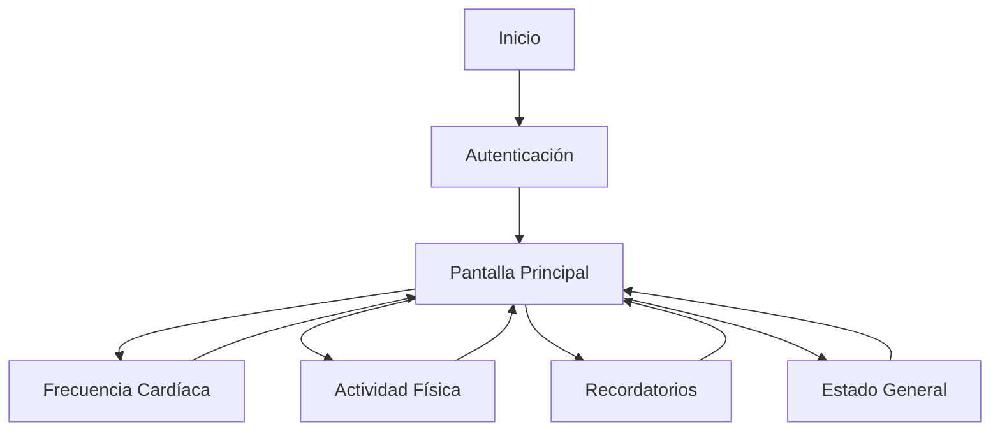

<div align="center">

# VitalMind Wearable

Aplicación para dispositivos Wear OS de la plataforma **VitalMind**, desarrollada para ofrecer monitoreo de salud en tiempo real, acceso rápido a información relevante y sincronización con la plataforma principal.

<br>


<br><br>


</div>

---

# Tabla de Contenidos

- [Descripción](#descripción)
- [Objetivos](#objetivos)
- [Características](#características)
- [Arquitectura](#arquitectura)
- [Tecnologías](#tecnologías)
- [Estructura del Proyecto](#estructura-del-proyecto)
- [Requisitos](#requisitos)
- [Instalación](#instalación)
- [Configuración](#configuración)
- [Scripts Disponibles](#scripts-disponibles)
- [Experiencia de Usuario](#experiencia-de-usuario)
- [Flujo de la Aplicación](#flujo-de-la-aplicación)
- [Integración con la API](#integración-con-la-api)
- [Hoja de Ruta](#hoja-de-ruta)
- [Contribución](#contribución)
- [Estado del Proyecto](#estado-del-proyecto)
- [Autor](#autor)
- [Licencia](#licencia)

---

# Descripción

**VitalMind Wearable** es la aplicación para relojes inteligentes de la plataforma **VitalMind**, diseñada para ofrecer monitoreo continuo de la salud desde dispositivos Wear OS.

La aplicación proporciona acceso inmediato a información importante del usuario, seguimiento de signos vitales, visualización de métricas de actividad y sincronización automática con la plataforma principal.

Su objetivo es complementar la aplicación móvil ofreciendo una experiencia rápida, ligera y optimizada para dispositivos de muñeca.

---

# Objetivos

Los principales objetivos de VitalMind Wearable son:

- Proporcionar acceso rápido a la información de salud.
- Monitorear signos vitales en tiempo real.
- Registrar actividad física diaria.
- Mostrar notificaciones relevantes.
- Sincronizar información con la plataforma VitalMind.
- Mejorar el seguimiento del bienestar del usuario.
- Mantener una interfaz clara y simple para pantallas pequeñas.

---

# Características

- Inicio de sesión seguro.
- Sincronización con la aplicación móvil.
- Monitoreo de frecuencia cardíaca.
- Registro de actividad física.
- Consulta rápida del estado de salud.
- Notificaciones inteligentes.
- Recordatorios de medicamentos.
- Alertas de salud.
- Interfaz optimizada para Wear OS.
- Consumo eficiente de batería.
- Diseño adaptable a pantallas pequeñas.
- Navegación simplificada.

---

# Arquitectura

```text
              +----------------------+
              |     VitalMind API    |
              +----------+-----------+
                         |
                    Retrofit
                         |
+---------------------------------------------+
|             Wear OS Application             |
|---------------------------------------------|
| Screens                                     |
| Components                                  |
| ViewModels                                  |
| Services                                    |
| Repository                                  |
+---------------------------------------------+
                         |
                 Smartwatch Wear OS
                         |
                 Sensores del dispositivo
````

La aplicación se comunica con el backend mediante solicitudes HTTP gestionadas con Retrofit. La lógica de presentación se organiza en pantallas, componentes, viewmodels, servicios y repositorios para mantener el código ordenado y fácil de mantener.

---

# Tecnologías

| Tecnología        | Descripción                                 |
| ----------------- | ------------------------------------------- |
| Kotlin            | Lenguaje principal de desarrollo            |
| Jetpack Compose   | Construcción de interfaces modernas         |
| Wear OS           | Sistema operativo para relojes inteligentes |
| Android Studio    | Entorno de desarrollo                       |
| Retrofit          | Cliente HTTP                                |
| Firebase          | Autenticación y notificaciones              |
| Material Design 3 | Sistema visual y de componentes             |

---

# Estructura del Proyecto

```text
VitalMind-Wearable
│
├── app/
│   ├── src/
│   │   ├── main/
│   │   │   ├── java/
│   │   │   ├── ui/
│   │   │   ├── viewmodel/
│   │   │   ├── repository/
│   │   │   ├── services/
│   │   │   ├── sensors/
│   │   │   └── utils/
│   │   ├── res/
│   │   └── AndroidManifest.xml
│
├── gradle/
├── build.gradle
├── settings.gradle
└── README.md
```

Esta estructura puede variar según la organización interna del proyecto, pero se recomienda mantener una separación clara entre interfaz, lógica de negocio, acceso a datos y sensores.

---

# Requisitos

Antes de ejecutar el proyecto asegúrate de tener instalado:

* Android Studio.
* JDK 17 o superior.
* Emulador Wear OS o reloj inteligente compatible.
* Git.

Verifica las versiones desde Android Studio o desde la terminal:

```bash
java -version
git --version
```

---

# Instalación

Clona el repositorio:

```bash
git clone https://github.com/tu-usuario/VitalMind-Wearable.git
```

Ingresa al directorio del proyecto:

```bash
cd VitalMind-Wearable
```

Abre el proyecto con Android Studio.

Espera a que Gradle sincronice las dependencias.

Ejecuta la aplicación en un emulador o dispositivo Wear OS.

---

# Configuración

Si el proyecto utiliza variables de configuración para consumir la API, colócalas en los archivos correspondientes del proyecto Android.

Ejemplo:

```properties
BASE_URL=https://api.vitalmind.com/
```

Si se requiere integración con Firebase, agrega el archivo `google-services.json` en la carpeta `app/` y configura el proyecto desde la consola de Firebase.

---

# Scripts Disponibles

| Acción          | Descripción             |
| --------------- | ----------------------- |
| Run             | Ejecuta la aplicación   |
| Build APK       | Genera el APK           |
| Clean Project   | Limpia el proyecto      |
| Rebuild Project | Reconstruye el proyecto |

---

# Experiencia de Usuario

VitalMind Wearable está diseñado bajo los principios de **Wear OS**, priorizando una experiencia simple, rápida y útil para el usuario.

Principios de diseño:

* Acceso inmediato.
* Información resumida.
* Navegación mediante gestos.
* Alto rendimiento.
* Bajo consumo energético.
* Interfaces legibles.
* Sincronización transparente.
* Interacción mínima y eficiente.

---

# Flujo de la Aplicación



Este flujo representa la navegación principal dentro de la aplicación para smartwatch.

---

# Integración con la API

La aplicación consume los servicios REST de VitalMind para:

* Autenticación.
* Sincronización de datos.
* Consulta del historial.
* Envío de métricas.
* Recepción de recomendaciones.
* Actualización del estado del usuario.

La comunicación con el backend se realiza mediante Retrofit, centralizando las peticiones en servicios y repositorios para mantener la implementación limpia y escalable.

Ejemplo de estructura recomendada para servicios:

```text
src/
├── services/
│   ├── auth.service.kt
│   ├── health.service.kt
│   ├── activity.service.kt
│   ├── reminders.service.kt
│   └── sync.service.kt
```

---

# Hoja de Ruta

Funcionalidades previstas para futuras versiones:

* Medición de oxígeno en sangre.
* Detección de caídas.
* Monitoreo del sueño.
* Integración con Google Fit.
* Integración con Health Connect.
* Alertas inteligentes.
* Sincronización en segundo plano.
* Compatibilidad con nuevos dispositivos Wear OS.
* Mayor personalización de la interfaz.
* Historial rápido de métricas.

---

# Contribución

Las contribuciones son bienvenidas.

1. Realiza un Fork del repositorio.
2. Crea una nueva rama.

```bash
git checkout -b feature/nueva-funcionalidad
```

3. Realiza tus cambios y crea un commit.

```bash
git commit -m "Agregar nueva funcionalidad"
```

4. Envía los cambios.

```bash
git push origin feature/nueva-funcionalidad
```

5. Abre un Pull Request.

---

# Estado del Proyecto

| Estado        | Descripción                                                                                                           |
| ------------- | --------------------------------------------------------------------------------------------------------------------- |
| En desarrollo | La aplicación continúa incorporando nuevas funcionalidades para Wear OS y su integración con la plataforma VitalMind. |

---

# Autor

Desarrollado como parte del proyecto **VitalMind**.

---

# Licencia

Este proyecto tiene fines académicos y de desarrollo interno.

No está permitido su uso comercial sin autorización expresa.

---

<div align="center">

## VitalMind Wearable

Aplicación Inteligente para Wear OS

Desarrollado con Kotlin, Jetpack Compose y Retrofit

</div>


