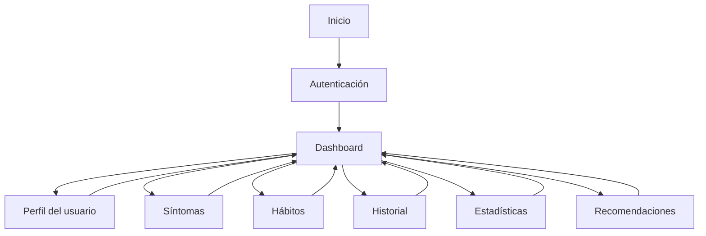

<div align="center">0

# VitalMind Web Frontend

Frontend web de **VitalMind**, una plataforma inteligente de salud integral diseñada para centralizar información de bienestar, hábitos, síntomas y recomendaciones personalizadas.

<br>


<br><br>


</div>

---

# Tabla de Contenidos

- [Descripción](#descripción)
- [Objetivos](#objetivos)
- [Funcionalidades principales](#funcionalidades-principales)
- [Características del diseño](#características-del-diseño)
- [Arquitectura](#arquitectura)
- [Tecnologías utilizadas](#tecnologías-utilizadas)
- [Estructura del proyecto](#estructura-del-proyecto)
- [Requisitos](#requisitos)
- [Instalación](#instalación)
- [Scripts disponibles](#scripts-disponibles)
- [Experiencia de usuario](#experiencia-de-usuario)
- [Flujo de la aplicación](#flujo-de-la-aplicación)
- [Integración con la API](#integración-con-la-api)
- [Buenas prácticas](#buenas-prácticas)
- [Hoja de ruta](#hoja-de-ruta)
- [Estado del proyecto](#estado-del-proyecto)
- [Autor](#autor)
- [Licencia](#licencia)

---

# Descripción

**VitalMind Web Frontend** es la versión web de VitalMind, desarrollada con **React** y **Vite** para ofrecer una plataforma clara, profesional y escalable desde un navegador web.

Su propósito es centralizar la información relacionada con la salud del usuario, facilitando el acceso a módulos de seguimiento, historial, estadísticas y recomendaciones personalizadas dentro de una experiencia visual organizada.

La aplicación está pensada para funcionar de forma fluida en escritorio, tablet y móvil.

---

# Objetivos

Construir una interfaz web moderna que permita:

- Gestionar el perfil del usuario.
- Registrar síntomas, hábitos y datos de seguimiento.
- Consultar historiales y estadísticas.
- Visualizar recomendaciones personalizadas.
- Navegar de forma rápida y organizada entre módulos.

---

# Funcionalidades principales

- Dashboard principal con resumen de salud.
- Formulario de registro de síntomas.
- Historial de actividad y seguimiento.
- Panel de recomendaciones.
- Navegación por módulos.
- Diseño responsive para escritorio, tablet y móvil.

---

# Características del diseño

La versión web está orientada a una experiencia más completa y visual. Se busca:

- Mejor aprovechamiento del espacio en pantalla.
- Organización por módulos.
- Tablas, tarjetas y gráficos para visualización de datos.
- Interfaz profesional y fácil de mantener.
- Navegación clara entre secciones.
- Estructura modular para facilitar futuras mejoras.

---

# Arquitectura

```text
                    +----------------------+
                    |    VitalMind API     |
                    +----------+-----------+
                               |
                         Axios / Fetch
                               |
+------------------------------------------------------+
|                  React + Vite                        |
|------------------------------------------------------|
| Pages                                                |
| Components                                           |
| Layouts                                              |
| Routes                                               |
| Services                                             |
| Hooks                                                |
+------------------------------------------------------+
                               |
                     Navegador web / Usuario
````

La aplicación consume servicios externos mediante peticiones HTTP y organiza la interfaz en páginas, componentes reutilizables, rutas y servicios, manteniendo una separación clara entre presentación y lógica.

---

# Tecnologías utilizadas

* React
* Vite
* JavaScript
* HTML5
* CSS3
* React Router
* Axios
* Fetch API

---

# Estructura del proyecto

```text
src/
├── assets/
├── components/
├── layouts/
├── pages/
├── routes/
├── services/
├── hooks/
├── styles/
└── main.jsx
```

Esta estructura permite mantener el proyecto ordenado y facilitar la escalabilidad conforme se agregan nuevos módulos o funcionalidades.

---

# Requisitos

Antes de ejecutar el proyecto, asegúrate de contar con lo siguiente:

* Node.js instalado
* npm o yarn
* Git

Verifica las versiones desde la terminal:

```bash
node -v
npm -v
git --version
```

---

# Instalación

Clona el repositorio:

```bash
git clone https://github.com/tu-usuario/vitalmind-web.git
```

Ingresa al directorio del proyecto:

```bash
cd vitalmind-web
```

Instala las dependencias:

```bash
npm install
```

Ejecuta el entorno de desarrollo:

```bash
npm run dev
```

---

# Scripts disponibles

```bash
npm run dev
npm run build
npm run preview
```

---

# Experiencia de usuario

La interfaz de VitalMind Web Frontend está pensada para ofrecer una experiencia clara, funcional y adaptable.

Principios de diseño:

* Navegación ordenada.
* Visualización rápida de información.
* Componentes reutilizables.
* Interfaz limpia y profesional.
* Adaptación a distintos tamaños de pantalla.
* Acceso eficiente a los módulos principales.

---

# Flujo de la aplicación



Este flujo representa la navegación general dentro de la plataforma web.

---

# Integración con la API

VitalMind Web Frontend se conecta con la API de VitalMind para mostrar y gestionar la información de salud del usuario.

Las peticiones se pueden organizar mediante:

* Axios para solicitudes centralizadas.
* Fetch API en consultas simples o específicas.
* Servicios separados por módulo.

Áreas comunes de integración:

* Inicio de sesión.
* Perfil del usuario.
* Registro de síntomas.
* Historial de actividad.
* Recomendaciones personalizadas.
* Estadísticas y seguimiento.

Ejemplo de organización sugerida para servicios:

```text
src/
├── services/
│   ├── auth.service.js
│   ├── user.service.js
│   ├── symptoms.service.js
│   ├── habits.service.js
│   ├── history.service.js
│   └── recommendations.service.js
```

---

# Buenas prácticas

* Componentes reutilizables.
* Separación de lógica y presentación.
* Código modular.
* Estilos organizados por secciones.
* Uso de servicios centralizados.
* Estructura clara de rutas y páginas.
* Mantenimiento sencillo y escalable.

---

# Hoja de ruta

Funcionalidades previstas para futuras versiones:

* Gráficas de seguimiento.
* Exportación de reportes.
* Mejoras en el dashboard.
* Filtros avanzados por fechas.
* Soporte para notificaciones.
* Personalización de módulos.
* Integración con más fuentes de datos.
* Optimización visual para tablets y pantallas grandes.

---

# Estado del proyecto

| Estado        | Descripción                                                                                              |
| ------------- | -------------------------------------------------------------------------------------------------------- |
| En desarrollo | El proyecto continúa en desarrollo activo y nuevas funcionalidades son incorporadas de forma progresiva. |

---

# Autor

Desarrollado para **VitalMind**.

---

# Licencia

Uso académico y de desarrollo interno.

```
```
