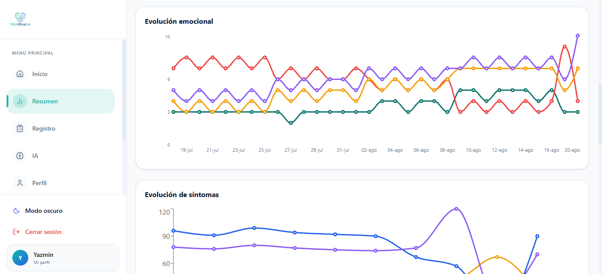
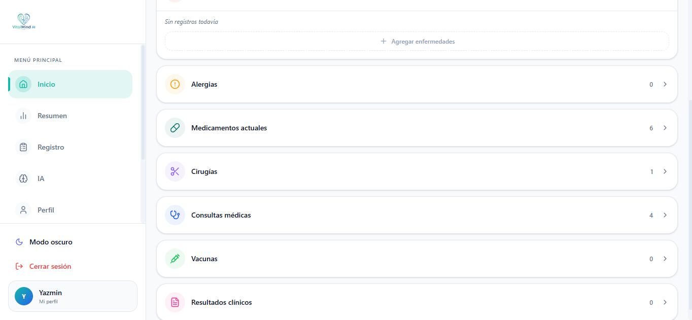
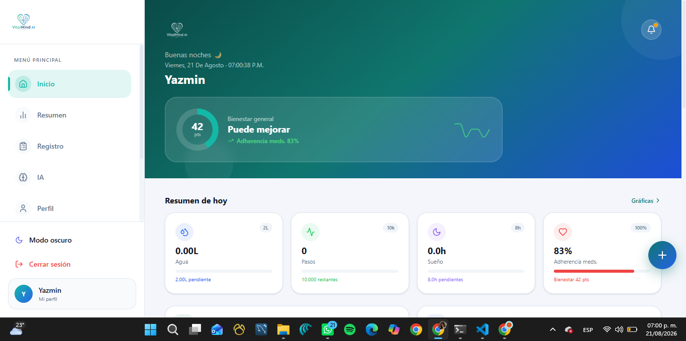
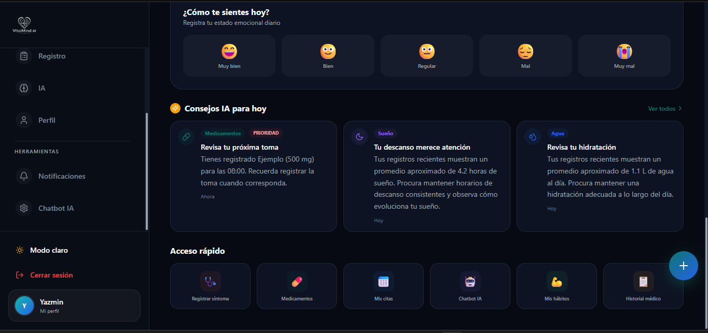
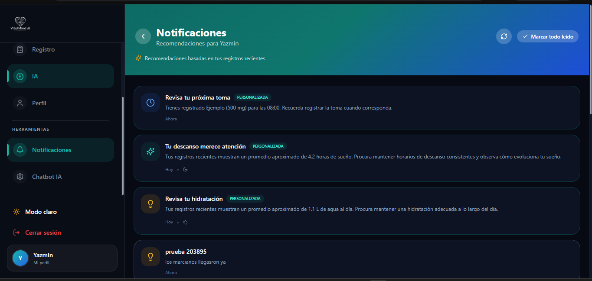

<div align="center">

# VitalMind Web Frontend

Frontend web de **VitalMind**, una plataforma inteligente de salud integral orientada a centralizar información de bienestar, hábitos, síntomas, historial y recomendaciones personalizadas.

<br>


<br><br>


</div>

---
<div align="center">

 # Resultados  

</div>

| | |
|---|---|
|  |  |
|  |  |
|  |  |
 ---

# Tabla de Contenidos

- [Descripción](#-descripción)
- [Arquitectura general](#-arquitectura-general)
- [Objetivos](#-objetivos)
- [Funcionalidades principales](#-funcionalidades-principales)
- [Tecnologías utilizadas](#-tecnologías-utilizadas)
- [Estructura del proyecto](#-estructura-del-proyecto)
- [Requisitos](#-requisitos)
- [Configuración](#-configuración)
- [Desarrollo local](#-desarrollo-local)
- [Prueba completa Frontend + Backend](#-prueba-completa-frontend--backend)
- [Docker](#-docker)
- [Docker Compose](#-docker-compose)
- [Variables de entorno](#-variables-de-entorno)
- [Integración con la API](#-integración-con-la-api)
- [Socket.IO](#-socketio)
- [Rutas SPA con Nginx](#-rutas-spa-con-nginx)
- [Flujo general](#-flujo-general)
- [Estado del proyecto](#-estado-del-proyecto)
- [Autor](#-autor)
- [Licencia](#-licencia)

---

# Descripción

**VitalMind Web Frontend** es la aplicación web de **VitalMind**, desarrollada para proporcionar una interfaz moderna y organizada para la gestión y visualización de información relacionada con la salud y el bienestar del usuario.

La aplicación permite acceder a diferentes módulos desde un navegador web, consultar información, registrar datos y comunicarse con los servicios proporcionados por el backend de VitalMind.

El frontend está preparado para ejecutarse:

- De forma local mediante **Node.js + Vite**.
- En producción mediante **Docker + Nginx**.
- Integrado con el **backend de VitalMind** mediante HTTP y Socket.IO.

> **Importante:** el frontend por sí solo permite comprobar la interfaz y la navegación, pero una **prueba funcional completa** requiere que el backend de VitalMind esté disponible, ya que la autenticación, persistencia de información, consultas a la API y comunicación en tiempo real dependen de él.

---

# Arquitectura general

El sistema está compuesto por dos partes principales:

```text
┌─────────────────────────────────────┐
│         VitalMind Frontend          │
│         React + Vite + Nginx        │
└──────────────────┬──────────────────┘
                   │
         HTTP / Axios / Fetch
                   │
                   ▼
┌─────────────────────────────────────┐
│          VitalMind Backend          │
│       API + Socket.IO + lógica      │
└──────────────────┬──────────────────┘
                   │
                   ▼
┌─────────────────────────────────────┐
│        Base de datos / servicios    │
└─────────────────────────────────────┘
```

Para las funciones en tiempo real se utiliza:

```text
Frontend
   │
   │ Socket.IO
   ▼
Backend VitalMind
```

Por esta razón, para probar el proyecto de manera integral se deben levantar **frontend y backend al mismo tiempo**.

---

# Objetivos

El frontend tiene como principales objetivos:

- Proporcionar una interfaz web clara y fácil de utilizar.
- Centralizar la información del usuario.
- Facilitar la navegación entre los módulos de VitalMind.
- Mostrar información de salud de forma organizada.
- Permitir la comunicación con la API del sistema.
- Utilizar Socket.IO para comunicación en tiempo real cuando sea requerida.
- Mantener una estructura preparada para futuras funcionalidades.
- Facilitar el desarrollo y despliegue mediante Docker.

---

# Funcionalidades principales

El frontend contempla diferentes módulos orientados a la gestión integral del usuario:

- Autenticación.
- Perfil del usuario.
- Registro y consulta de síntomas.
- Historial.
- Visualización de información.
- Recomendaciones personalizadas.
- Seguimiento de datos.
- Estadísticas.
- Navegación entre módulos.
- Diseño adaptable a diferentes dispositivos.
- Consumo de API.
- Comunicación en tiempo real mediante Socket.IO.

La disponibilidad real de estas funciones depende de que el backend tenga disponibles los endpoints y servicios correspondientes.

---

# Tecnologías utilizadas

| Tecnología | Función |
|---|---|
| **React 19** | Desarrollo de la interfaz |
| **Vite 7** | Desarrollo y compilación |
| **JavaScript ES6** | Lógica de la aplicación |
| **HTML5** | Estructura |
| **CSS3** | Estilos |
| **React Router** | Navegación |
| **Axios** | Consumo de API |
| **Fetch API** | Solicitudes HTTP |
| **Socket.IO Client** | Comunicación en tiempo real |
| **Docker** | Contenerización |
| **Nginx** | Servidor web para producción |
| **Docker Compose** | Orquestación de servicios |

---

# Estructura del proyecto

```text
Front_VitalMind/
│
├── src/
│   ├── components/
│   ├── pages/
│   ├── services/
│   ├── hooks/
│   ├── assets/
│   └── ...
│
├── public/
│
├── guidelines/
│   └── Guías y documentación
│
├── .dockerignore
├── .env.example
├── .gitignore
├── Dockerfile
├── docker-compose.yml
├── nginx.conf
├── index.html
├── package.json
├── package-lock.json
└── README.md
```

> `node_modules/` y `dist/` son directorios generados. No se recomienda subirlos al repositorio ni depender de ellos para construir la imagen Docker.

---

# Requisitos

Para desarrollar y ejecutar el frontend:

```text
Node.js 20+
npm
Git
Docker
Docker Compose
```

Para una prueba completa del sistema también se necesita:

```text
VitalMind Backend
Base de datos y servicios requeridos por el backend
```

Comprobar versiones:

```bash
node -v
npm -v
git --version
docker --version
docker compose version
```

---

# Configuración

El frontend utiliza variables de entorno para identificar el backend.

Crea tu archivo `.env` a partir del ejemplo:

### PowerShell

```powershell
Copy-Item .env.example .env
```

### CMD

```cmd
copy .env.example .env
```

La configuración mínima puede ser:

```env
VITE_API_URL=http://localhost:3000
VITE_SOCKET_URL=http://localhost:3000
```

Los valores anteriores son ejemplos. Deben coincidir con el puerto y URL reales del backend.

---

# Desarrollo local

## 1. Instalar dependencias

```bash
npm ci
```

> Se recomienda `npm ci` porque utiliza el `package-lock.json` y evita diferencias de versiones entre equipos.

## 2. Configurar el backend

Antes de probar las funciones que dependen de la API, inicia el backend de VitalMind.

Ejemplo:

```text
Backend
http://localhost:3000
```

## 3. Configurar `.env`

```env
VITE_API_URL=http://localhost:3000
VITE_SOCKET_URL=http://localhost:3000
```

## 4. Ejecutar el frontend

```bash
npm run dev
```

Vite proporcionará normalmente:

```text
http://localhost:5173
```

---

# Prueba completa Frontend + Backend

Para probar **todo el sistema**, no basta con ejecutar solamente el frontend.

El flujo recomendado es:

```text
1. Levantar base de datos/servicios necesarios
2. Levantar VitalMind Backend
3. Verificar API
4. Ejecutar VitalMind Frontend
5. Verificar conexión HTTP
6. Verificar conexión Socket.IO
7. Probar autenticación y módulos
```

Ejemplo de entorno local:

```text
Frontend
http://localhost:5173

Backend
http://localhost:3000

Socket.IO
http://localhost:3000
```

El frontend utiliza:

```env
VITE_API_URL=http://localhost:3000
VITE_SOCKET_URL=http://localhost:3000
```

## ¿Qué se puede probar con ambos proyectos levantados?

Se puede validar la comunicación completa entre:

```text
Usuario
  ↓
Frontend React
  ↓
API HTTP
  ↓
Backend VitalMind
  ↓
Base de datos / servicios
```

y, para comunicación en tiempo real:

```text
Frontend React
  ↕
Socket.IO
  ↕
Backend VitalMind
```

Esto permite comprobar no solamente la interfaz, sino también autenticación, consultas, registros, respuestas de la API y eventos de tiempo real implementados por el backend.

---

# Docker

El frontend está dockerizado utilizando una construcción multietapa.

## Etapa 1: Build

Node.js se encarga de:

```text
npm ci
npm run build
```

Esto genera:

```text
dist/
```

## Etapa 2: Producción

Nginx recibe el contenido de `dist/` y sirve la aplicación.

```text
Node.js
   ↓
npm ci
   ↓
npm run build
   ↓
dist/
   ↓
Nginx
   ↓
Frontend
```

La imagen final no necesita ejecutar Vite ni conservar `node_modules`.

---

# Crear la imagen Docker

Desde la raíz del proyecto:

```bash
docker build -t vitalmind-frontend .
```

Ejecutar:

```bash
docker run -d \
  --name vitalmind-frontend \
  -p 8080:80 \
  vitalmind-frontend
```

Abrir:

```text
http://localhost:8080
```

Verificar health check:

```text
http://localhost:8080/health
```

Respuesta esperada:

```text
ok
```

---

# Docker Compose

El proyecto incluye:

```text
docker-compose.yml
```

Su objetivo es simplificar la ejecución del frontend y facilitar una arquitectura preparada para trabajar junto al backend.

## Ejecutar

```bash
docker compose up -d --build
```

## Ver estado

```bash
docker compose ps
```

## Ver logs

```bash
docker compose logs -f
```

## Detener

```bash
docker compose down
```

La aplicación quedará disponible normalmente en:

```text
http://localhost:8080
```

> **Nota:** el frontend y el backend pueden estar en proyectos/repositorios separados. Para una integración completa mediante Docker Compose, ambos deben compartir una red de Docker y el frontend debe tener configurada la URL correspondiente al backend.

---

# Variables de entorno

Las variables principales utilizadas por el frontend son:

## `VITE_API_URL`

URL base de la API HTTP.

Ejemplo local:

```env
VITE_API_URL=http://localhost:3000
```

Ejemplo con backend desplegado:

```env
VITE_API_URL=https://tu-backend.up.railway.app
```

## `VITE_SOCKET_URL`

URL base utilizada para Socket.IO.

Ejemplo local:

```env
VITE_SOCKET_URL=http://localhost:3000
```

Ejemplo con backend desplegado:

```env
VITE_SOCKET_URL=https://tu-backend.up.railway.app
```

> Las variables `VITE_*` son públicas en el frontend compilado. No deben contener contraseñas, claves privadas ni secretos.

Después de cambiar estas variables debes reconstruir el frontend:

```bash
docker compose down
docker compose up -d --build
```

---

# Integración con la API

El frontend se comunica con el backend mediante solicitudes HTTP.

Las operaciones dependen de los endpoints disponibles en VitalMind, pero el frontend está preparado para trabajar con procesos como:

- Autenticación.
- Consulta del perfil.
- Registro de información.
- Consulta de historial.
- Obtención de recomendaciones.
- Consulta de estadísticas.
- Actualización de información.

Las herramientas principales son:

```text
Axios
Fetch API
```

La dirección de la API se controla con:

```env
VITE_API_URL
```

---

# Socket.IO

VitalMind utiliza **Socket.IO** para las funciones que requieren comunicación en tiempo real.

La configuración del cliente utiliza:

```env
VITE_SOCKET_URL
```

Ejemplo:

```env
VITE_SOCKET_URL=http://localhost:3000
```

El flujo general es:

```text
React
  │
  │ socket.io-client
  ▼
Socket.IO Server
  │
  ▼
VitalMind Backend
```

## Importante

Socket.IO no sustituye a la API HTTP.

El sistema puede utilizar:

```text
HTTP / Axios / Fetch
```

para operaciones tradicionales y:

```text
Socket.IO
```

para eventos en tiempo real.

Por eso, si el backend no está levantado:

- Las llamadas a la API pueden fallar.
- La autenticación puede no funcionar.
- Los datos no podrán cargarse desde el servidor.
- Las funciones de Socket.IO no podrán establecer conexión.
- El frontend puede mostrar la interfaz, pero la prueba funcional estará incompleta.

---

# Rutas SPA con Nginx

El proyecto utiliza React Router.

Por ello, rutas como:

```text
/
 /dashboard
 /perfil
 /historial
 /sintomas
```

deben seguir funcionando al recargar la página.

La configuración de `nginx.conf` incluye el fallback correspondiente a:

```text
index.html
```

Esto evita el problema común de recibir un **404** al recargar una ruta interna de una SPA.

---

# Arquitectura

```text
                      ┌──────────────────────────┐
                      │       Usuario            │
                      └────────────┬─────────────┘
                                   │
                                   ▼
                      ┌──────────────────────────┐
                      │   VitalMind Frontend     │
                      │     React + Vite         │
                      └────────────┬─────────────┘
                                   │
                    ┌──────────────┴──────────────┐
                    │                             │
             HTTP / Axios                  Socket.IO
                    │                             │
                    ▼                             ▼
          ┌─────────────────────────────────────────────┐
          │              VitalMind Backend               │
          │                 API + Socket.IO              │
          └──────────────────────┬──────────────────────┘
                                 │
                                 ▼
                    ┌─────────────────────────┐
                    │ Base de datos / servicios│
                    └─────────────────────────┘
```

En producción:

```text
React + Vite
     ↓
npm run build
     ↓
dist/
     ↓
Docker
     ↓
Nginx
     ↓
Navegador
```

---

# Flujo general

```mermaid
flowchart TD

A[Usuario] --> B[Frontend VitalMind]

B --> C[Autenticación]
C --> D[Dashboard]

D --> E[Perfil]
D --> F[Síntomas]
D --> G[Hábitos]
D --> H[Historial]
D --> I[Estadísticas]
D --> J[Recomendaciones]

E --> K[VitalMind Backend]
F --> K
G --> K
H --> K
I --> K
J --> K

B -. HTTP / Axios / Fetch .-> K
B -. Socket.IO .-> K

K --> L[Base de datos / servicios]
```

---

# Estado del proyecto

| Elemento | Estado |
|---|---|
| Frontend Web | 🟢 Funcional |
| React + Vite | 🟢 Implementado |
| Integración con API | 🟢 Implementada |
| Socket.IO | 🟢 Configurado |
| Diseño responsive | 🟢 Implementado |
| Docker | 🟢 Implementado |
| Docker Compose | 🟢 Implementado |
| Nginx | 🟢 Configurado |
| Rutas SPA | 🟢 Configuradas |
| Variables de entorno | 🟢 Configuradas |
| Prueba completa | 🟡 Requiere backend |
| Desarrollo de nuevas funciones | 🟠 En progreso |

---

# Problemas comunes

## `vite: Permission denied`

No utilices un `node_modules` copiado desde otro equipo o sistema operativo.

En Windows PowerShell:

```powershell
Remove-Item -Recurse -Force node_modules
npm ci
```

Con Docker, las dependencias se instalan dentro de la imagen y no se reutiliza el `node_modules` del equipo.

---

## El frontend carga, pero no aparecen datos

Comprueba:

```env
VITE_API_URL=...
```

y verifica que el backend esté funcionando.

También revisa:

```bash
docker compose logs -f
```

---

## Socket.IO no conecta

Comprueba:

```env
VITE_SOCKET_URL=...
```

y confirma que el servidor Socket.IO esté activo en el backend.

Después reconstruye:

```bash
docker compose down
docker compose up -d --build
```

---

## Error 404 al recargar una ruta

Comprueba que Nginx esté utilizando el `nginx.conf` del proyecto y que tenga configurado el fallback hacia `index.html`.

---

# Autor

Desarrollado por **Yazmín Gutiérrez**, desarrolladora Frontend de **VitalMind**.

Responsable del desarrollo, diseño e implementación de la interfaz web de la plataforma **VitalMind**, incluyendo su estructura frontend, integración con la API, comunicación mediante Socket.IO, experiencia de usuario y configuración para su despliegue mediante Docker.

---

# Licencia

Este proyecto está destinado a **uso académico y desarrollo interno**.

© 2026 VitalMind.
