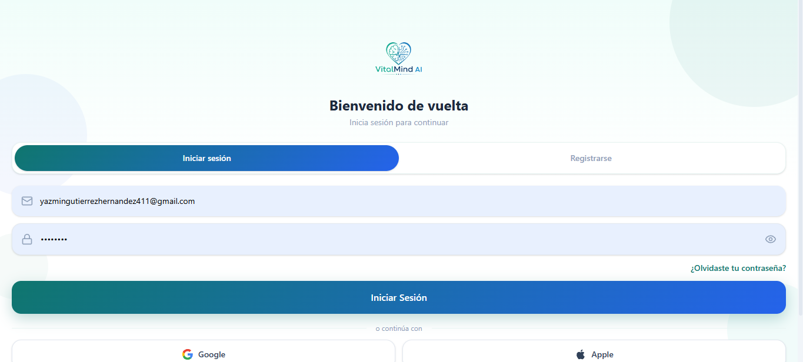
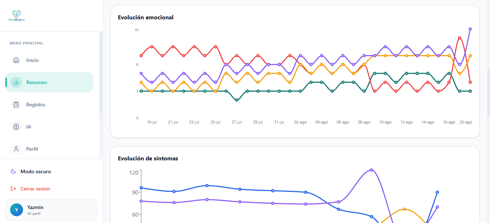
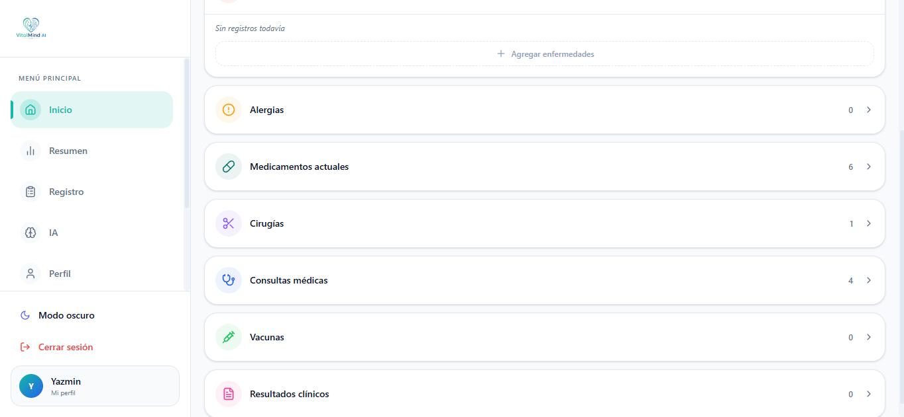
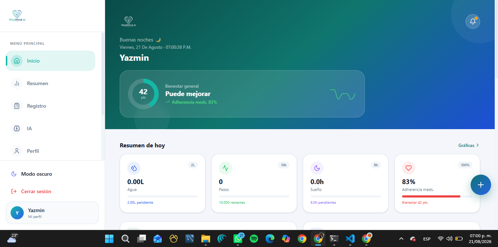
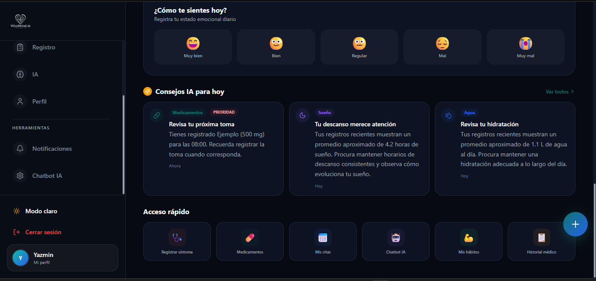
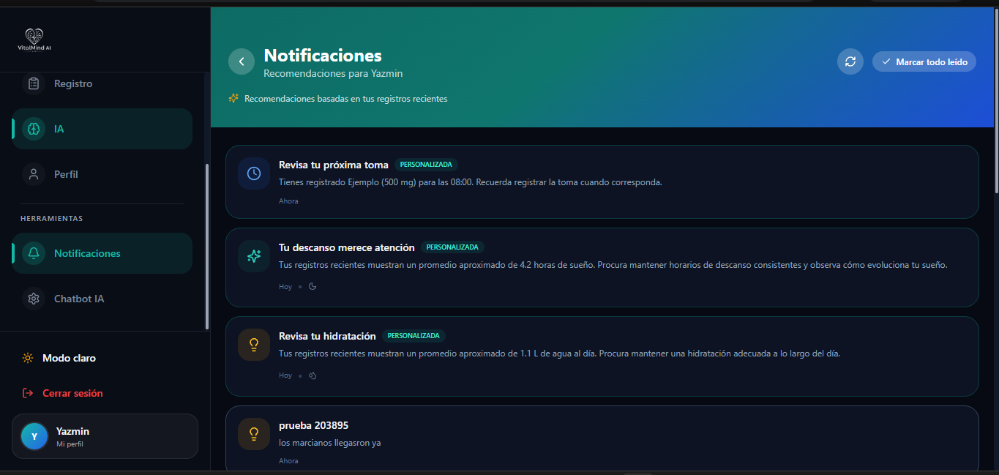

<div align="center">

# VitalMind Frontend

**VitalMind** es una plataforma digital de salud integral diseñada para acompañar al usuario en el seguimiento de síntomas, hábitos, bienestar emocional y recomendaciones personalizadas mediante un ecosistema de interfaces modernas, accesibles y responsivas.

El frontend de VitalMind está concebido como un **ecosistema multiplataforma**, donde las experiencias **Web, Móvil y Wearable** comparten una misma identidad visual, lógica de navegación y propósito, adaptándose a las necesidades de cada dispositivo.

<br>


<br><br>


</div>

---
<div align="center">

 # Resultados  

</div>

| | |
|---|---|
|  |  |
|  |  |
|  |  |

---
# Tabla de Contenidos

- [Descripción](#-descripción)
- [Visión del frontend](#-visión-del-frontend)
- [Objetivo](#-objetivo)
- [Experiencia multiplataforma](#-experiencia-multiplataforma)
- [Funcionalidades principales](#-funcionalidades-principales)
- [Tecnologías utilizadas](#-tecnologías-utilizadas)
- [Arquitectura del ecosistema](#-arquitectura-del-ecosistema)
- [Requisitos](#-requisitos)
- [Instalación](#-instalación)
- [Scripts disponibles](#-scripts-disponibles)
- [Estructura del frontend](#-estructura-del-frontend)
- [Plataformas](#-plataformas)
- [Diseño y experiencia de usuario](#-diseño-y-experiencia-de-usuario)
- [Integración y comunicación](#-integración-y-comunicación)
- [Buenas prácticas](#-buenas-prácticas)
- [Estado del proyecto](#-estado-del-proyecto)
- [Autor](#-autor)
- [Licencia](#-licencia)

---

# Descripción

Este repositorio contiene el **frontend del ecosistema VitalMind**, desarrollado con el objetivo de ofrecer una experiencia coherente y accesible en diferentes dispositivos.

La propuesta no se limita a una sola interfaz. VitalMind se plantea como un conjunto de experiencias conectadas:

- **Web:** interfaz completa para consultar, registrar y analizar información de salud de manera detallada.
- **Móvil:** experiencia optimizada para el uso cotidiano, con acceso rápido a las funciones principales desde una pantalla pequeña.
- **Wearable:** experiencia ligera y compacta enfocada en la consulta rápida y el seguimiento desde dispositivos inteligentes.

Las tres experiencias forman parte de un mismo ecosistema y buscan mantener una **identidad visual, funcional y de navegación consistente**, aunque cada una adapta sus componentes y distribución al dispositivo donde se ejecuta.

---

# Visión del frontend

El frontend de VitalMind funciona como la capa de interacción entre el usuario y los servicios de la plataforma.

Su propósito es transformar la información y funcionalidades del sistema en experiencias claras y fáciles de utilizar, independientemente del dispositivo utilizado.

```text
                    VITALMIND
                        │
            ┌───────────┼───────────┐
            │           │           │
            ▼           ▼           ▼
          WEB         MÓVIL      WEARABLE
            │           │           │
            └───────────┼───────────┘
                        │
                        ▼
                SERVICIOS VITALMIND
                 API + SOCKET.IO
```

La idea central es que el usuario pueda interactuar con VitalMind desde diferentes puntos de acceso sin perder la continuidad de la experiencia.

---

# Objetivo

Desarrollar un ecosistema frontend que permita al usuario:

- Consultar información de salud de manera rápida y organizada.
- Registrar síntomas, hábitos y actividades relacionadas con su bienestar.
- Visualizar seguimiento e historiales de forma clara.
- Recibir recomendaciones personalizadas.
- Utilizar VitalMind desde computadora, teléfono y dispositivos wearable.
- Mantener una experiencia consistente entre las diferentes plataformas.
- Adaptar la interfaz y la cantidad de información al contexto de cada dispositivo.

---

# Experiencia multiplataforma

La experiencia de VitalMind está diseñada para adaptarse al contexto de uso.

## Web

La versión web representa la experiencia más completa del ecosistema.

Está orientada a:

- Visualización detallada de información.
- Navegación amplia entre módulos.
- Consulta de historiales y seguimiento.
- Gestión de información del usuario.
- Visualización de estadísticas y recomendaciones.
- Uso cómodo en pantallas de computadora.

```text
Web
┌─────────────────────────────────────────┐
│              VitalMind                   │
│                                         │
│  Dashboard     Perfil     Historial    │
│                                         │
│  Síntomas      Hábitos    Estadísticas  │
│                                         │
│         Recomendaciones                  │
└─────────────────────────────────────────┘
```

## Móvil

La experiencia móvil está orientada al uso cotidiano.

Busca proporcionar:

- Acceso rápido a las funciones principales.
- Navegación adaptada a pantallas pequeñas.
- Registro de información desde cualquier lugar.
- Consulta rápida de síntomas, hábitos e historial.
- Una interfaz práctica y responsiva.

```text
Móvil
┌─────────────────┐
│    VitalMind    │
│─────────────────│
│                 │
│   Dashboard     │
│                 │
│   Síntomas      │
│   Hábitos       │
│   Historial     │
│   Perfil        │
│                 │
└─────────────────┘
```

## Wearable

La experiencia wearable está pensada para ser más directa y ligera.

Su prioridad es presentar la información esencial sin sobrecargar la pantalla.

Puede orientarse a:

- Consulta rápida de información.
- Visualización de datos relevantes.
- Seguimiento inmediato.
- Acciones simples.
- Interacción desde dispositivos inteligentes.

```text
Wearable
┌──────────────┐
│   VitalMind  │
│              │
│    Estado    │
│              │
│   Registro   │
│              │
│    Datos     │
└──────────────┘
```

---

# Funcionalidades principales

El ecosistema frontend contempla funcionalidades orientadas a la gestión integral del usuario:

- Inicio de sesión y registro.
- Dashboard general de salud.
- Registro y seguimiento de síntomas.
- Registro de hábitos diarios.
- Historial de actividad y progreso.
- Recomendaciones personalizadas.
- Consulta de información del usuario.
- Visualización de estadísticas.
- Navegación modular entre secciones.
- Diseño responsive y adaptable.
- Comunicación con los servicios de VitalMind.
- Comunicación en tiempo real mediante Socket.IO cuando corresponda.

La presentación y profundidad de cada funcionalidad puede variar dependiendo de la plataforma.

---

# Tecnologías utilizadas

| Tecnología | Función |
|---|---|
| **React** | Desarrollo de interfaces |
| **Vite** | Desarrollo y compilación |
| **JavaScript** | Lógica de la aplicación |
| **HTML5** | Estructura |
| **CSS3** | Estilos |
| **React Router** | Navegación |
| **Axios** | Consumo de servicios HTTP |
| **Fetch API** | Solicitudes HTTP |
| **Socket.IO** | Comunicación en tiempo real |

Cada plataforma puede incorporar tecnologías adicionales específicas del entorno donde se ejecute, manteniendo siempre los principios generales de diseño y experiencia de VitalMind.

---

# Arquitectura del ecosistema

El frontend se estructura alrededor de tres experiencias principales que se comunican con los servicios de VitalMind.

```text
                        ┌────────────────────┐
                        │      USUARIO       │
                        └─────────┬──────────┘
                                  │
                  ┌───────────────┼───────────────┐
                  │               │               │
                  ▼               ▼               ▼
             ┌─────────┐     ┌─────────┐     ┌──────────┐
             │   WEB   │     │ MÓVIL   │     │ WEARABLE │
             └────┬────┘     └────┬────┘     └─────┬────┘
                  │               │                │
                  └───────────────┼────────────────┘
                                  │
                         HTTP / Socket.IO
                                  │
                                  ▼
                     ┌────────────────────────┐
                     │   VITALMIND BACKEND    │
                     │       API + IA         │
                     └───────────┬────────────┘
                                 │
                                 ▼
                     ┌────────────────────────┐
                     │ Base de datos/servicios │
                     └────────────────────────┘
```

El frontend es responsable de la experiencia de usuario, mientras que los servicios del sistema gestionan la lógica y la información necesaria para que las diferentes plataformas funcionen de manera integrada.

---

# Requisitos

Para trabajar con el frontend web de VitalMind se necesita:

- Node.js
- npm o yarn
- Git

Verifica las versiones:

```bash
node -v
npm -v
git --version
```

Para las otras plataformas se deberán considerar además las herramientas de desarrollo propias de cada entorno.

---

# Instalación

Clona el repositorio e instala las dependencias:

```bash
git clone <URL_DEL_REPOSITORIO>
cd <NOMBRE_DEL_PROYECTO>
npm install
```

Para iniciar el frontend web en desarrollo:

```bash
npm run dev
```

La aplicación quedará disponible desde la dirección indicada por Vite.

> Para una prueba completa del ecosistema, las interfaces deben conectarse con los servicios y backend correspondientes de VitalMind.

---

# Scripts disponibles

```bash
npm run dev
```

Inicia el entorno de desarrollo.

```bash
npm run build
```

Genera la versión compilada para producción.

```bash
npm run preview
```

Permite previsualizar localmente la compilación de producción.

---

# Estructura del frontend

La organización general busca separar las responsabilidades del proyecto:

```text
src/
│
├── assets/
│
├── components/
│
├── layouts/
│
├── pages/
│
├── routes/
│
├── services/
│
├── hooks/
│
├── styles/
│
└── main.jsx
```

Esta estructura permite mantener el código modular y facilita la ampliación futura de componentes, pantallas y servicios.

En un ecosistema multiplataforma, cada experiencia puede mantener su propia estructura específica, mientras comparte los principios generales de:

- Organización.
- Reutilización.
- Escalabilidad.
- Consistencia visual.
- Separación de responsabilidades.

---

# Plataformas

## Web

Experiencia completa orientada a computadoras y pantallas grandes.

**Enfoque:**

- Mayor cantidad de información visible.
- Navegación amplia.
- Paneles y módulos completos.
- Consulta detallada.

## Móvil

Experiencia orientada a teléfonos inteligentes.

**Enfoque:**

- Interacciones rápidas.
- Navegación compacta.
- Diseño responsive.
- Uso cotidiano.

## Wearable

Experiencia orientada a dispositivos inteligentes de pantalla reducida.

**Enfoque:**

- Información esencial.
- Lectura rápida.
- Interacciones simples.
- Interfaces compactas.

---

# Diseño y experiencia de usuario

La propuesta visual de VitalMind prioriza:

- Limpieza y facilidad de uso.
- Componentes reutilizables.
- Navegación intuitiva.
- Adaptabilidad a múltiples dispositivos.
- Experiencia consistente en todo el ecosistema.
- Estructura modular y escalable.
- Interfaz clara para facilitar el seguimiento de información de salud.
- Adaptación de la cantidad de información según el dispositivo.

La finalidad no es hacer que todas las interfaces sean idénticas, sino que **todas se sientan parte del mismo producto**.

---

# Integración y comunicación

Las diferentes experiencias frontend se integran con los servicios de VitalMind mediante los mecanismos definidos por la arquitectura del sistema.

Para operaciones tradicionales:

```text
Frontend
   │
   │ Axios / Fetch API
   ▼
VitalMind API
```

Para comunicación en tiempo real:

```text
Frontend
   │
   │ Socket.IO
   ▼
VitalMind Backend
```

Esto permite que las distintas interfaces puedan trabajar sobre los mismos servicios, manteniendo una experiencia conectada entre las plataformas.

---

# Buenas prácticas

El ecosistema frontend sigue principios orientados a mantener un código ordenado y escalable:

- Organización modular del código.
- Separación entre componentes, páginas y servicios.
- Uso de componentes reutilizables.
- Centralización de llamadas a servicios.
- Estructura preparada para futuras mejoras.
- Código mantenible y fácil de extender.
- Estilos organizados por secciones.
- Adaptación de la interfaz al contexto de cada plataforma.
- Consistencia visual entre Web, Móvil y Wearable.

---

# Estado del proyecto

| Plataforma / Elemento | Estado |
|---|---|
| Frontend Web | 🟢 Implementado |
| Frontend Móvil | 🟢 Integrado al ecosistema |
| Frontend Wearable | 🟢 Integrado al ecosistema |
| Diseño multiplataforma | 🟢 Implementado |
| React + Vite | 🟢 Implementado |
| React Router | 🟢 Implementado |
| Axios / Fetch API | 🟢 Implementado |
| Socket.IO | 🟢 Integrado |
| Experiencia consistente | 🟢 Implementada |
| Nuevas funcionalidades | 🟠 En desarrollo |

---

# Autor

Desarrollado por **Yazmín Gutiérrez**, desarrolladora Frontend de **VitalMind**.

El frontend forma parte del desarrollo integral de la plataforma y busca ofrecer una experiencia tecnológica unificada para **Web, Móvil y Wearable**.

---

# Licencia

Uso académico y de desarrollo interno.

No está permitido su uso comercial sin autorización expresa.

---

<div align="center">

## VitalMind Frontend

**Un mismo ecosistema. Tres experiencias. Una sola identidad.**

**Web • Móvil • Wearable**

Plataforma Inteligente para la Gestión Integral de la Salud

Desarrollado con tecnologías frontend modernas.

</div>

---


