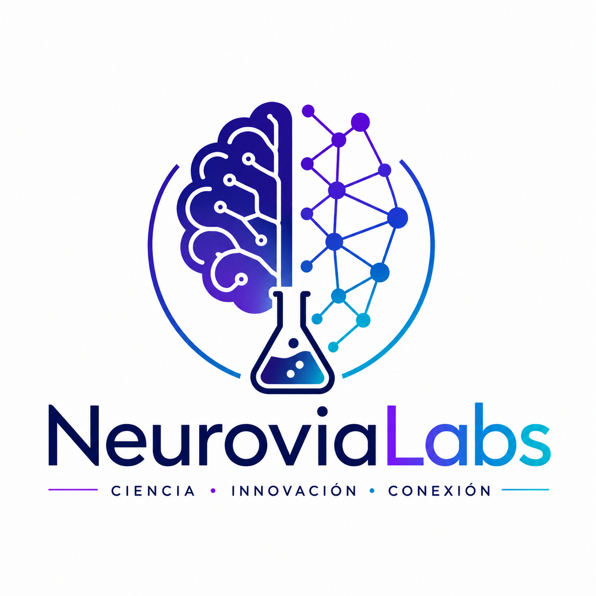
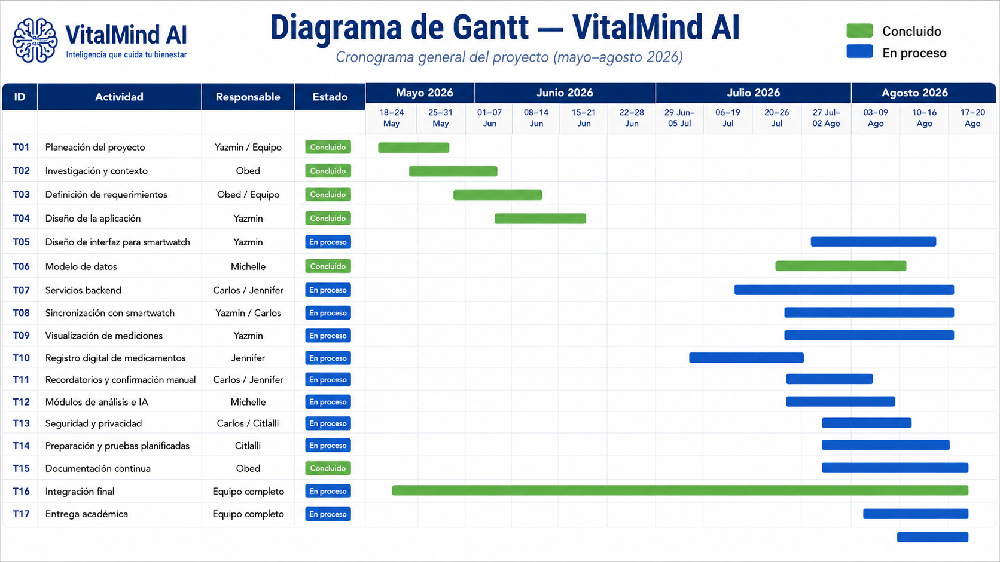
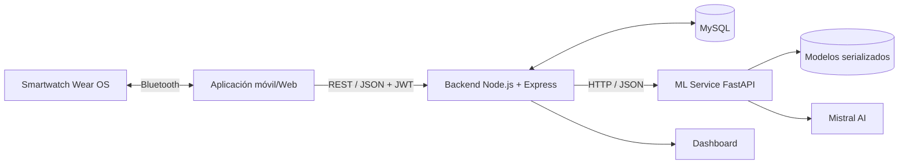
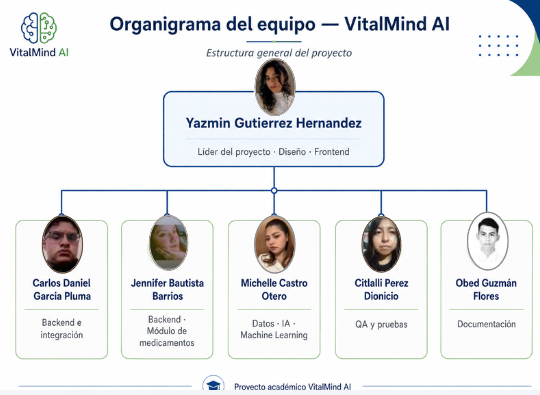

<div align="center">

# 🩺 Proyecto VitalMind AI

### Aplicación de monitoreo de salud conectada con smartwatch, análisis de datos e Inteligencia Artificial orientativa
<p align="center">
  
  
  
  
  
</p>
</div>

<h3 align="center">Logos del proyecto</h3>

<p align="center">
  
  &nbsp;&nbsp;&nbsp;&nbsp;&nbsp;&nbsp;&nbsp;&nbsp;
  
</p>

---

## 📚 Tabla de contenido

1. [Descripción general](#-descripción-general)
2. [Estado del proyecto](#-estado-del-proyecto)
3. [Problemática](#-problemática)
4. [Propósito y alcance](#-propósito-y-alcance)
5. [Objetivos](#-objetivos)
6. [Público objetivo](#-público-objetivo)
7. [Metodología](#-metodología)
8. [Diagrama de Gantt](#-diagrama-de-gantt)
9. [Arquitectura prevista](#️-arquitectura-prevista)
10. [Datos del proyecto](#️-datos-del-proyecto)
11. [Inteligencia Artificial y Machine Learning](#-inteligencia-artificial-y-machine-learning)
12. [Dashboard y comunicación en tiempo real](#-dashboard-y-comunicación-en-tiempo-real)
13. [API y endpoints](#-api-y-endpoints)
14. [Instalación y configuración](#️-instalación-y-configuración)
15. [Ejecución](#️-ejecución)
16. [Pruebas](#-pruebas)
17. [Seguridad, privacidad y ética](#-seguridad-privacidad-y-ética)
18. [Uso responsable de IA generativa](#-uso-responsable-de-ia-generativa)
19. [Organigrama](#-organigrama)
20. [Equipo de trabajo](#-equipo-de-trabajo)
21. [Resultados y limitaciones](#-resultados-y-limitaciones)
22. [Tecnologías utilizadas](#️-tecnologías-utilizadas)
23. [Referencias](#-referencias)

---

## 📖 Descripción general

**VitalMind AI** es una aplicación de monitoreo y seguimiento personal de salud conectada con un smartwatch compatible con **Wear OS**. La aplicación móvil se desarrolla con **Kotlin** en **Android Studio** y la vinculación entre teléfono y reloj utiliza **Bluetooth**.

La solución integra API, base de datos MySQL, visualizaciones, un microservicio de Machine Learning con FastAPI y un chatbot con Mistral AI. Permite registrar y consultar hábitos, sueño, actividad, medicamentos, síntomas y mediciones disponibles, además de analizar los registros con técnicas supervisadas y no supervisadas.


---

## 🚧 Estado del proyecto

| Elemento | Estado |
|---|---|
| **Estado general** | Prototipo académico integrado |
| **Versión** | `0.1.0-alpha` |
| **Aplicación móvil** | Kotlin + Android Studio |
| **Smartwatch** | Wear OS; módulo wearable disponible |
| **Sincronización** | Bluetooth y servicios Wear OS |
| **Backend principal** | Node.js + Express + MySQL |
| **ML Service** | FastAPI con modelos supervisados y no supervisados |
| **Chatbot** | Mistral AI (`mistral-small-latest`) |
| **Dashboard** | Implementado con gráficas y actualización automática por polling |

La documentación distingue entre funciones implementadas, evidencia de prueba y limitaciones técnicas reales del prototipo.

---

## ❗ Problemática

La información personal de salud suele quedar distribuida entre registros manuales, aplicaciones y dispositivos. Cuando los datos se revisan de forma aislada es difícil observar cambios, comparar periodos o relacionar hábitos con mediciones.

VitalMind AI centraliza esos registros y los presenta mediante historial, indicadores, gráficas y análisis orientativos, facilitando el seguimiento personal sin convertir la aplicación en una herramienta de diagnóstico médico.

---

## 🎯 Propósito y alcance

VitalMind AI permite a usuarios generales registrar, recibir, almacenar, consultar y visualizar información personal de salud mediante una aplicación móvil conectada con un smartwatch Wear OS.

### Alcance del MVP

- Registro e inicio de sesión.
- Perfil general del usuario.
- Registro de síntomas y mediciones disponibles.
- Seguimiento de hábitos, actividad, sueño e hidratación.
- Registro digital de medicamentos, dosis, horarios y confirmación manual.
- Historial, indicadores, gráficas y dashboard.
- Sincronización móvil-wearable mediante Bluetooth.
- Inferencia supervisada de riesgo y bienestar.
- Clustering y detección de anomalías con fines exploratorios.
- Recomendaciones generales basadas en reglas.
- Chatbot informativo con Mistral AI.
- API documentada con Swagger/OpenAPI.
- Pruebas de datos, backend, integración y modelos según evidencia disponible.

### Fuera del alcance

- Emitir diagnósticos médicos.
- Prescribir o modificar tratamientos.
- Sustituir una valoración profesional.
- Garantizar métricas que el smartwatch no soporte.
- Exponer datos de una cuenta a otra.
- Considerar las métricas de modelos sintéticos como validación clínica.

---

## ✅ Objetivos

### Objetivo general

Desarrollar una solución digital integrada por una aplicación móvil y un smartwatch Wear OS que permita a usuarios generales recopilar, registrar, almacenar, consultar y analizar información relacionada con su salud y bienestar, incorporando sincronización Bluetooth, historial, visualizaciones y técnicas de Inteligencia Artificial con fines preventivos e informativos.

### Objetivos específicos

- Desarrollar la aplicación móvil con Kotlin en Android Studio.
- Integrar un smartwatch Wear OS mediante Bluetooth.
- Registrar y consultar mediciones, hábitos, actividad, sueño y medicamentos.
- Persistir la información en MySQL mediante una API segura.
- Aplicar CRISP-DM al ciclo de datos y Machine Learning.
- Implementar análisis supervisado y no supervisado.
- Exponer modelos mediante FastAPI y consumirlos desde el backend.
- Visualizar tendencias mediante historial, indicadores y dashboard.
- Integrar un chatbot informativo dentro de límites no diagnósticos.
- Documentar y probar los componentes con evidencia verificable.

---

## 👥 Público objetivo

### Usuarios principales

- Personas que desean organizar y consultar su propia información de salud.
- Usuarios interesados en monitorear hábitos, actividad, sueño, medicamentos y mediciones.
- Personas que utilizan un smartwatch Wear OS compatible como complemento del seguimiento.
- Usuarios que requieren una visualización sencilla de tendencias personales.

### Contexto académico

- Equipo de desarrollo del proyecto.
- Docentes y evaluadores del Proyecto Integrador.

---

## 🔄 Metodología

### Análisis de datos: CRISP-DM

1. **Comprensión del problema:** definición de necesidades y preguntas de análisis.
2. **Comprensión de los datos:** revisión de fuentes, atributos, calidad y distribuciones.
3. **Preparación:** simulación, limpieza, ETL y división temporal.
4. **Modelado:** entrenamiento supervisado y no supervisado.
5. **Evaluación:** comparación de métricas y limitaciones.
6. **Despliegue:** serialización e integración mediante FastAPI.
### Desarrollo de software: Scrum

1. **Planificación:** organización de las actividades y definición de los objetivos de trabajo.

2. **Backlog:** registro y priorización de funcionalidades, correcciones y tareas del proyecto.

3. **Trabajo iterativo:** desarrollo de funcionalidades en periodos cortos, permitiendo integrar avances de forma progresiva.

4. **Seguimiento:** revisión periódica del estado de las actividades, dependencias y avances del equipo.

5. **Revisión:** comprobación de los entregables desarrollados y verificación de que cumplan con los requerimientos definidos.

6. **Mejora continua:** identificación de problemas y ajustes en la organización, desarrollo, pruebas y documentación para las siguientes iteraciones.

### Desarrollo de software

El trabajo se organiza de forma incremental por componentes, responsables, dependencias y entregables, con control de versiones mediante Git y GitHub y seguimiento general de actividades del equipo.


---

## 📊 Diagrama de Gantt

<p align="center">
  
</p>


---

## 🏗️ Arquitectura prevista

La arquitectura separa interfaz, servicios, persistencia y análisis.



### Flujo previsto

1. El usuario registra información o el reloj aporta una métrica compatible.
2. La aplicación sincroniza y envía datos al backend.
3. El backend valida autenticación y persiste en MySQL.
4. Para análisis, el backend construye el contrato requerido por FastAPI.
5. FastAPI ejecuta modelos serializados y devuelve resultados orientativos.
6. La aplicación y el dashboard muestran historial, indicadores y gráficas.

La arquitectura completa se documenta en [`docs/architecture.md`](./docs/architecture.md).

---

## 🗃️ Datos del proyecto

### Origen

El componente analítico utiliza **datos sintéticos** generados mediante reglas reproducibles. No corresponden a personas reales.

### Formato actual

- **Dataset raw:** 5,000 registros, 34 columnas y 1,500 valores nulos controlados.
- **Dataset processed:** 5,000 registros, 35 columnas y 0 valores nulos.
- **Usuarios sintéticos:** 250.
- **Periodo simulado:** 1 de abril al 29 de junio de 2026.
- **Base operacional:** MySQL.
- **División temporal:** train 3,418; validación 731; prueba 851.

### Grupos de información

- perfil y fecha;
- hábitos;
- síntomas y mediciones;
- estado emocional;
- indicadores derivados;
- etiquetas sintéticas de riesgo y anomalía.

El diccionario completo se encuentra en [`docs/data-dictionary.md`](./docs/data-dictionary.md).

---

## 🤖 Inteligencia Artificial y Machine Learning

VitalMind AI combina modelos supervisados y no supervisados entrenados con datos sintéticos.

### Mecanismos implementados

| Enfoque | Función | Resultado |
|---|---|---|
| Supervisado | Clasificación de riesgo | `low`, `medium`, `high` y probabilidades |
| Supervisado | Estimación de bienestar | `wellbeing_score` |
| No supervisado | Agrupación de perfiles | Clúster y distancia al centroide |
| No supervisado | Detección de anomalías | Indicador de atipicidad y puntuación |
| Reglas | Recomendaciones | Sugerencias generales |
| IA generativa | Chatbot | Explicación conversacional |

### Resultados documentados

| Componente | Métricas principales |
|---|---|
| Clasificación | Accuracy 0.9048 · F1 macro 0.9037 · ROC-AUC macro 0.9808 |
| Regresión | MAE 3.1230 · RMSE 3.8266 · R² 0.9584 |
| Clustering | Silhouette 0.3615 · Davies-Bouldin 1.0408 |
| Anomalías | F1 externo 0.1300; uso exploratorio |

Las métricas describen desempeño sobre datos sintéticos y no equivalen a precisión clínica.

---

## 📊 Dashboard y comunicación en tiempo real

El dashboard independiente de la API consulta datos persistidos y utiliza Chart.js. 
Entre las series disponibles se encuentran actividad, sueño, agua, glucosa, presión arterial, dolor, estado de ánimo y distribuciones agregadas.

### Actualización automática

El dashboard ejecuta una carga inicial y repite sus consultas al instante, por lo que las gráficas se actualizan sin recargar manualmente la página.

El frontend web también contiene un cliente Socket.IO y lógica de conexión para notificaciones.

Consulta [`docs/dashboard.md`](./docs/dashboard.md) para el detalle técnico.

---


## 🔌 API y endpoints

La API principal utiliza el prefijo `/api` y Swagger en `/api/docs`. El microservicio FastAPI publica sus propios contratos en `/docs` y `/redoc`.

### API principal

```http
POST /api/auth/register
POST /api/auth/login
GET  /api/health
POST /api/ml/analyze
GET  /api/ml/health
GET  /api/ml/models/info
GET  /api/dashboard/statistics
```

También existen módulos para usuarios, síntomas, hábitos, medicamentos, notificaciones, historial, reportes y dashboard.

### ML Service

```http
GET  /health
GET  /api/v1/models/info
POST /api/v1/analyze
POST /api/v1/wellbeing-cluster
POST /api/v1/anomaly-detection
POST /api/v1/chat
POST /api/v1/chat/analyze
```

Los contratos completos están en [`docs/api-contracts.md`](./docs/api-contracts.md).

---

## ⚙️ Instalación y configuración


### API principal

```bash
cd vitalmind-api
npm install
npm run dev
```

### ML Service

```bash
cd ml-service
python -m venv .venv
# activar el entorno
pip install -r requirements.txt
uvicorn app.main:app --host 127.0.0.1 --port 8000 --reload
```

### Aplicación móvil

Abrir `Frontend/Movil_Wearable/Frontend_Movil_Wearable` en Android Studio y ejecutar el módulo correspondiente en un dispositivo o emulador Android/Wear OS.

Los secretos deben configurarse localmente mediante archivos `.env` creados a partir de `.env.example`.

---

## ▶️ Ejecución

| Componente | Inicio | Acceso habitual |
|---|---|---|
| API principal | `npm run dev` | `http://localhost:4000/api` |
| Swagger Express | con la API | `http://localhost:4000/api/docs` |
| Dashboard | con la API | `http://localhost:4000/dashboard` |
| ML Service | `uvicorn app.main:app ...` | `http://localhost:8000` |
| Swagger FastAPI | con ML Service | `http://localhost:8000/docs` |
| Aplicación Android | Android Studio | dispositivo/emulador |

Antes de ejecutar un flujo completo deben estar disponibles MySQL, la API principal y el ML Service.

---

## 🧪 Pruebas

El proyecto conserva evidencia de pruebas de backend e integración en `reports/` y pruebas automatizadas del ML Service.

### Resultados respaldados por el repositorio

- Conexión Backend-MySQL.
- Registro y login.
- Persistencia de usuarios.
- Validación de datos.
- Protección de endpoints.
- Registro de síntomas y visualización posterior.
- Integración Frontend → Backend → MySQL / ML Service → Frontend.
- Chatbot e insights dentro del flujo probado.

### Revisión técnica adicional

- 68 archivos JavaScript validados con `node --check`: 0 fallos.
- 44 archivos Python compilados: 0 fallos.
- Inferencia supervisada directa: ejecutada correctamente.
- Clustering directo: ejecutado correctamente.
- Detección de anomalías directa: ejecutada correctamente.
- `pytest -q` no completó la colección en el entorno de revisión porque faltaba la dependencia local `mistralai`; no se declara esa ejecución como aprobada.

Consulta [`docs/testing.md`](./docs/testing.md) para la matriz completa.

---

## 🔐 Seguridad, privacidad y ética

- Contraseñas protegidas mediante bcrypt.
- Autenticación JWT y refresh tokens.
- CORS configurable y Helmet en la API principal.
- Secretos mediante variables de entorno.
- Validación de entradas con `express-validator` y Pydantic.
- Acceso restringido a información autorizada.
- Datos sintéticos para entrenamiento.
- Resultados preventivos e informativos, no diagnósticos.
- HTTPS/TLS requerido en un despliegue real.

La política de uso responsable se desarrolla en [`docs/ethics.md`](./docs/ethics.md).

---

## 🧠 Uso responsable de IA generativa

El proyecto documenta el uso de herramientas generativas como apoyo al desarrollo y utiliza **Mistral AI** como componente conversacional del producto.

Todo contenido o código apoyado por IA debe ser revisado por el equipo, contrastado con el proyecto real y probado cuando corresponda. No se utilizan herramientas generativas para inventar métricas, resultados ni evidencias.

Detalles en [`docs/ai-usage.md`](./docs/ai-usage.md).

---

## 🧑‍💻 Organigrama

<p align="center">
  
</p>

---

## 👨‍💻 Equipo de trabajo

| Nombre | Matrícula | Rol |
|---|---:|---|
| **Yazmin Gutierrez Hernandez** | 230447 | Frontend y experiencia de usuario |
| **Carlos Daniel Garcia Pluma** | 230187 | Backend |
| **Jennifer Bautista Barrios** | 230317 | Backend |
| **Michelle Castro Otero** | 230881 | Inteligencia Artificial y Machine Learning |
| **Obed Guzmán Flores** | 230142 | Documentación |
| **Citlalli Perez Dionicio** | 230237 | Control de Calidad (QA) e integración |

---


## 📈 Resultados y limitaciones

### Resultados actuales

- Dataset sintético reproducible de 5,000 registros.
- Dos mecanismos supervisados evaluados.
- Clustering y detección de anomalías disponibles mediante FastAPI.
- Backend con MySQL, JWT y Swagger.
- Chatbot Mistral AI integrado a nivel de código y con evidencia de uso en pruebas de integración.
- Dashboard con múltiples gráficas y actualización automática cada 30 segundos.
- Aplicación móvil/web y módulo Wear OS en Kotlin.

### Limitaciones

- Los modelos no tienen validación clínica.
- El comportamiento con datos reales puede diferir del dataset sintético.
- Las métricas disponibles desde Wear OS dependen del hardware y permisos.
- El dashboard de la API utiliza polling; el servidor Socket.IO de extremo a extremo no forma parte del backend incluido en esta versión.
- Los artefactos ML deben cargarse con versiones compatibles de scikit-learn.


---

### 🧰 Tecnologías utilizadas

#### 🎨 Aplicación y frontend

| Tecnología | Uso principal |
|---|---|
|  **Kotlin** | Desarrollo de la aplicación móvil y wearable. |
|  **Android Studio** | Entorno de desarrollo Android/Wear OS. |
| **Wear OS** | Plataforma del smartwatch compatible. |
| **Bluetooth** | Vinculación entre teléfono y smartwatch. |
|  **React** | Interfaz web complementaria. |

#### ⚙️ Backend y servicios

| Tecnología | Uso principal |
|---|---|
|  **Node.js** | Ejecución del servidor y lógica del Backend. |
|  **Express.js** | Creación de rutas, controladores y servicios REST. |
|  **FastAPI** | Exposición de los modelos de Machine Learning mediante API. |
| **Socket.IO Client** | Cliente configurado en el frontend web;  |
|  **Swagger / OpenAPI** | Descripción y prueba de los endpoints de la API. |

#### 🗄️ Bases de datos

| Tecnología | Uso principal |
|---|---|
|  **MySQL** | Base operacional de la aplicación. |
|  **MySQL Workbench** | Diseño, visualización y administración del modelo relacional. |

#### 🤖 Datos e Inteligencia Artificial

| Tecnología | Uso principal |
|---|---|
|  **Python** | Procesamiento de datos y desarrollo de modelos inteligentes. |
|  **scikit-learn** | Entrenamiento, comparación y evaluación de modelos. |
|  **pandas** | Limpieza, transformación y análisis de datasets. |
|  **NumPy** | Operaciones numéricas y manejo de arreglos. |
|  **Matplotlib** | Generación de gráficas para el análisis de datos. |
|  **Jupyter Notebook** | Desarrollo del EDA y experimentación con modelos. |
|  **Joblib** | Serialización y almacenamiento de modelos entrenados. |

#### 🔐 Seguridad

| Tecnología | Uso principal |
|---|---|
|  **bcrypt** | Protección de contraseñas mediante funciones hash. |
|  **JWT** | Autenticación de usuarios y control de sesiones. |
|  **HTTPS / TLS** | Protección de la información transmitida entre servicios. |

#### 🧩 Diseño, gestión y colaboración

| Tecnología | Uso principal |
|---|---|
|  **Figma** | Diseño de interfaces y elaboración de prototipos. |
|  **Git** | Control de versiones y seguimiento de cambios. |
|  **GitHub** | Administración del repositorio, ramas y Pull Requests. |
|  **Microsoft Teams** | Reuniones y comunicación formal del equipo. |
|  **WhatsApp** | Comunicación rápida y coordinación interna. |
---

## 📚 Referencias

### Metodología, ética y seguridad

- [IBM — CRISP-DM](https://www.ibm.com/docs/es/spss-modeler/saas?topic=dm-crisp-help-overview)
- [World Health Organization — Ethics and governance of artificial intelligence for health](https://www.who.int/publications/i/item/9789240029200)
- [OWASP — Password Storage Cheat Sheet](https://cheatsheetseries.owasp.org/cheatsheets/Password_Storage_Cheat_Sheet.html)
- [RFC 7519 — JSON Web Token](https://www.rfc-editor.org/info/rfc7519/)
- [RFC 8725 — JSON Web Token Best Current Practices](https://www.rfc-editor.org/info/rfc8725/)
- [GitHub Docs — Licensing a repository](https://docs.github.com/articles/licensing-a-repository)


<div align="center">

**VitalMind AI — Proyecto académico en desarrollo**

Datos · Modelos · API · Dashboard · Integración · Pruebas · Documentación

</div>
