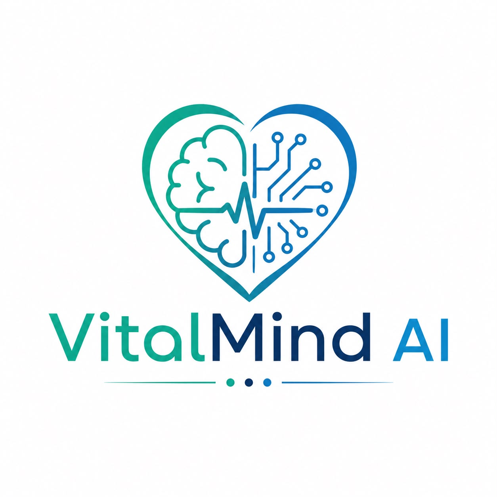

  <h1 align="center">Proyecto VitalMind AI</h1>

<table>
   <td>Logo de la Aplicacion</td>
   <td>Logo de empresa</td>
  <tr>
    <td>    </td>
    <td>    </td> 
  </tr>
</table>

## Descripción General

VitalMind AI es una plataforma web inteligente de salud integral orientada al seguimiento personal y autocuidado del bienestar físico y emocional. Integra diseño centrado en el usuario, desarrollo web, análisis de datos e Inteligencia Artificial orientativa para centralizar el historial médico, registrar síntomas y hábitos, y ofrecer un dashboard dinámico con orientación asistida.

## Propósito y Alcance

Permite a los usuarios gestionar su historial médico, registrar hábitos y síntomas, recibir recomendaciones orientativas mediante Inteligencia Artificial y dar seguimiento a su bienestar físico y emocional de manera segura, accesible y personalizada. VitalMind AI no sustituye el diagnóstico ni la atención de un profesional de la salud; su función es apoyar la prevención, el seguimiento personal y la toma de decisiones informadas.

## Problemática

En internet abundan los consejos de salud genéricos que no se adaptan al estilo de vida, la edad o los síntomas específicos de cada persona, generando frustración o abandono del autocuidado. Además, las personas suelen notar el deterioro de su salud o el descuido de sus rutinas hasta que los síntomas agudos ya aparecieron, perdiendo la oportunidad de prevenir el malestar.

## Objetivo General (Solucion)

Desarrollar una plataforma web inteligente de salud integral que permita a los usuarios gestionar su historial médico, registrar hábitos y síntomas, recibir recomendaciones orientativas mediante Inteligencia Artificial y dar seguimiento a su bienestar físico y emocional de manera segura, accesible y personalizada.

## Objetivos Específicos

- Diseñar una interfaz intuitiva en Figma y maquetarla en React.js para gestionar información médica y hábitos saludables de forma sencilla.
- Implementar módulos transaccionales en Node.js y MongoDB para registrar síntomas, historial médico y hábitos.
- Desarrollar un chatbot inteligente conversacional con recomendaciones básicas de salud y bienestar usando APIs de IA.
- Integrar análisis de datos y mecanismos de Machine Learning para generar sugerencias preventivas y proyecciones personalizadas.
- Realizar pruebas funcionales, de usabilidad y de seguridad mediante HTTPS con TLS para validar la protección de la plataforma.

## Público Objetivo

VitalMind AI está dirigido a:

-	Personas que desean centralizar y mejorar la organización de su información médica personal.
-	Usuarios interesados en monitorear de manera constante la correlación entre sus síntomas cotidianos, sus hábitos diarios y su bienestar emocional.
-	Pacientes bajo esquemas de autocuidado preventivo que necesitan un registro simplificado de indicadores.
-	Familiares o cuidadores que apoyan el seguimiento preventivo de la salud de un tercero.
-	Profesionales de la salud que deseen utilizar los reportes históricos y gráficas generadas por el sistema como apoyo informativo secundario en consulta.
-	Instituciones académicas interesadas en la validación de prototipos funcionales de salud digital.

## Tecnologias Usadas

| **Área**                    | **Tecnologías**                                                                                             |
|-----------------------------|------------------------------------------------------------------------------------------------------------|
| **Frontend (Cliente)**      |     |
| **Backend (Servidor)**      |    |
| **IA & Machine Learning**   |    |
| **Diseño**                  |  |
| **Gestión**                 |  |
| **Control de Versiones**    |  |
| **Seguridad**               |  |

## Métricas de Evaluación

- **Clasificación (Riesgo de Deterioro de Hábitos):** Accuracy, Precision, Recall, F1-Score.
- **Regresión (Proyección de Síntomas):** RMSE, MAE, R².
- **Recomendación e Interfaz:** Precision@K, Tasa de Aceptación (CTR), System Usability Scale (SUS > 68).

## Colaboradores
| Nombre                        | Matrícula |
|-------------------------------|-----------|
| Citlalli Pérez Dionicio       | 230237    |
| Yazmin Gutierrez Hernández    | 230447    |
| Jennifer Bautista Barrios     | 230317    |
| Obed Guzmán Flores            | 230142    |
| Michelle Castro Otero         | 230881    |
| Carlos Daniel Garcia Pluma    | 230187    |