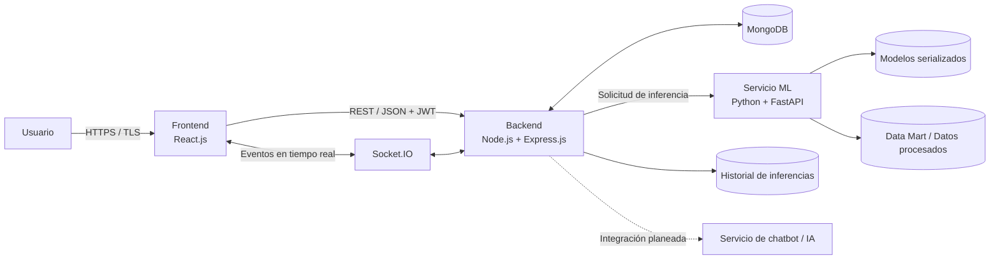

<div align="center">

# 🩺 Proyecto VitalMind AI

### Plataforma inteligente de salud integral con análisis de datos e Inteligencia Artificial orientativa
<p align="center">
  
  
  
  
  
</p>
</div>

<h3 align="center">Logos del proyecto</h3>

<p align="center">
  
  &nbsp;&nbsp;&nbsp;&nbsp;&nbsp;&nbsp;&nbsp;&nbsp;
  
</p>
---

## 📚 Tabla de contenido

1. [Descripción general](#-descripción-general)
2. [Estado del proyecto](#-estado-del-proyecto)
3. [Problemática](#-problemática)
4. [Propósito y alcance](#-propósito-y-alcance)
5. [Objetivos](#-objetivos)
6. [Público objetivo](#-público-objetivo)
7. [Metodología](#-metodología)
8. [Arquitectura prevista](#-arquitectura-prevista)
9. [Datos del proyecto](#-datos-del-proyecto)
10. [Inteligencia Artificial y Machine Learning](#-inteligencia-artificial-y-machine-learning)
11. [Dashboard y comunicación en tiempo real](#-dashboard-y-comunicación-en-tiempo-real)
12. [Tecnologías utilizadas](#-tecnologías-utilizadas)
13. [Estructura del repositorio](#-estructura-del-repositorio)
14. [API y endpoints](#-api-y-endpoints)
15. [Instalación y configuración](#-instalación-y-configuración)
16. [Ejecución](#-ejecución)
17. [Pruebas](#-pruebas)
18. [Seguridad, privacidad y ética](#-seguridad-privacidad-y-ética)
19. [Uso responsable de IA generativa](#-uso-responsable-de-ia-generativa)
20. [Equipo de trabajo](#-equipo-de-trabajo)
21. [Documentación](#-documentación)
22. [Resultados y limitaciones](#-resultados-y-limitaciones)
23. [Enlaces del proyecto](#-enlaces-del-proyecto)
24. [Licencia](#-licencia)
25. [Referencias](#-referencias)

---

## 📖 Descripción general

**VitalMind AI** es una plataforma web inteligente de salud integral orientada al seguimiento personal y al autocuidado del bienestar físico y emocional. El proyecto integra diseño centrado en el usuario, desarrollo web, bases de datos, análisis de datos e Inteligencia Artificial orientativa.

La plataforma busca centralizar información relacionada con el historial médico, síntomas, hábitos y registros de bienestar. A partir de estos datos, se plantea ofrecer un dashboard dinámico, visualizaciones estadísticas, mecanismos de Machine Learning y orientación asistida mediante un chatbot.

> [!IMPORTANT]
> **VitalMind AI no sustituye el diagnóstico, tratamiento, prescripción ni atención de un profesional de la salud.** Los resultados, alertas y recomendaciones del sistema serán únicamente informativos y orientativos.

---

## 🚧 Estado del proyecto

| Elemento | Estado |
|---|---|
| **Estado general** | En desarrollo |
| **Versión actual propuesta** | `0.1.0-alpha` |
| **Tipo de versión** | Versión inicial no estable del MVP |
| **Funcionalidades terminadas** | Por confirmar con cada equipo técnico |
| **Frontend** | En desarrollo |
| **Backend** | En desarrollo |
| **Dataset simulado** | En desarrollo |
| **Data Warehouse y ETL** | En desarrollo |
| **Modelos supervisados** | En desarrollo |
| **Modelo no supervisado** | En definición y desarrollo |
| **Chatbot** | Planeado |
| **Dashboard y Socket.IO** | En desarrollo |
| **Pruebas** | En planeación |
| **Despliegue** | Pendiente |

La versión `0.1.0-alpha` identifica una primera etapa de construcción que todavía puede contener cambios de arquitectura, contratos de API, variables del dataset y funcionalidades incompletas.

---

## ❗ Problemática

En internet existen recomendaciones de salud generales que no necesariamente consideran el contexto, los hábitos, la edad o los síntomas de cada persona. Al mismo tiempo, muchas personas no mantienen un registro organizado de sus síntomas, antecedentes, hábitos o cambios en su bienestar.

La información suele permanecer dispersa o depender de la memoria del usuario, lo que dificulta reconocer tendencias, relacionar hábitos con síntomas y conservar datos útiles para futuras consultas profesionales.

VitalMind AI busca atender esta situación mediante una plataforma que centralice los registros personales, facilite su consulta y permita visualizar patrones e indicadores de forma comprensible, sin presentar sus resultados como diagnósticos médicos.

---

## 🎯 Propósito y alcance

VitalMind AI permitirá a los usuarios gestionar información personal de salud, registrar hábitos y síntomas, consultar indicadores, recibir recomendaciones orientativas mediante Inteligencia Artificial y dar seguimiento a su bienestar físico y emocional de manera segura, accesible y personalizada.

### Alcance del MVP

- Registro e inicio de sesión.
- Autenticación y control de acceso.
- Gestión del perfil del usuario.
- Registro de síntomas.
- Gestión de historial médico básico.
- Registro de hábitos saludables.
- Seguimiento del bienestar físico y emocional.
- Dashboard con indicadores y estadísticas.
- Integración de modelos supervisados y no supervisados.
- Consumo de inferencias mediante una API.
- Actualización de información mediante Socket.IO.
- Registro de inferencias en la base de datos.
- Chatbot inteligente de apoyo.
- Recomendaciones orientativas.
- Pruebas del dataset, ETL, modelos, API e integración.
- Documentación técnica y funcional.

### Fuera del alcance

- Emitir diagnósticos médicos definitivos.
- Prescribir medicamentos o tratamientos.
- Sustituir la consulta con profesionales de la salud.
- Atender emergencias médicas.
- Integrarse con expedientes clínicos oficiales durante el MVP.
- Automatizar decisiones clínicas sin intervención humana.
- Utilizar datos reales de pacientes sin autorización, protección y validación formal.

---

## ✅ Objetivos

### Objetivo general

Desarrollar una plataforma web inteligente de salud integral que permita a los usuarios gestionar su historial médico, registrar hábitos y síntomas, recibir recomendaciones orientativas mediante Inteligencia Artificial y dar seguimiento a su bienestar físico y emocional de manera segura, accesible y personalizada.

### Objetivos específicos

- Diseñar una interfaz intuitiva en Figma y maquetarla en React.js para gestionar información médica y hábitos saludables.
- Implementar módulos transaccionales con Node.js, Express.js y MongoDB para registrar síntomas, historial médico y hábitos.
- Desarrollar un chatbot conversacional que proporcione orientación general de salud y bienestar mediante servicios de IA.
- Aplicar CRISP-DM para comprender, preparar, modelar, evaluar y desplegar mecanismos de análisis de datos.
- Simular un dataset coherente, reproducible y adecuado para entrenamiento, validación, prueba e inferencia.
- Diseñar un Data Warehouse o Data Mart y desarrollar un proceso ETL reproducible.
- Implementar y comparar mecanismos supervisados y no supervisados.
- Exponer un modelo supervisado y uno no supervisado mediante endpoints inteligentes.
- Visualizar inferencias, métricas y alertas en un dashboard con Socket.IO.
- Realizar pruebas funcionales, de datos, modelos, API, integración, usabilidad y seguridad.
- Proteger la comunicación mediante HTTPS con TLS y las credenciales mediante hashing seguro.

---

## 👥 Público objetivo

### Usuarios principales

- Personas que desean centralizar y organizar su información personal de salud.
- Usuarios interesados en monitorear la relación entre síntomas, hábitos y bienestar emocional.
- Personas que siguen esquemas de autocuidado preventivo y requieren un registro simplificado.
- Usuarios que desean visualizar la evolución de indicadores personales mediante gráficas.

### Usuarios secundarios

- Familiares o cuidadores que apoyan el seguimiento preventivo.
- Profesionales de la salud que podrían consultar reportes como apoyo informativo secundario.
- Instituciones académicas interesadas en prototipos funcionales de salud digital.
- Docentes y evaluadores del proyecto integrador.

---

## 🔄 Metodología

### Análisis de datos: CRISP-DM

El proyecto utiliza **CRISP-DM** para organizar el ciclo de análisis:

1. **Comprensión del negocio:** definición de la problemática y necesidades de información.
2. **Comprensión de los datos:** análisis de fuentes, entidades, atributos y calidad.
3. **Preparación de los datos:** simulación, limpieza, transformación, ETL y división de conjuntos.
4. **Modelado:** entrenamiento de modelos supervisados y no supervisados.
5. **Evaluación:** comparación de métricas, estabilidad, utilidad e interpretabilidad.
6. **Despliegue:** serialización, integración mediante API y consumo desde el prototipo web.

### Desarrollo de software: Scrum

El desarrollo se organiza mediante **Scrum**, con trabajo colaborativo por módulos y entregables incrementales.

- **Número y duración de sprints:** por definir.
- **Gestión de actividades:** Jira.
- **Comunicación:** Microsoft Teams y WhatsApp.
- **Control de versiones:** Git y GitHub.
- **Integración:** ramas por área, commits descriptivos y Pull Requests.

---

## 🏗️ Arquitectura prevista

La arquitectura se encuentra en desarrollo. El siguiente diagrama representa la integración prevista y deberá actualizarse cuando los contratos y rutas definitivas sean aprobados.



### Flujo previsto

1. El usuario interactúa con la aplicación web desarrollada en React.js.
2. El frontend consume los servicios del backend mediante HTTPS y JSON.
3. El backend valida autenticación y autorización mediante JWT.
4. MongoDB almacena usuarios, registros de salud, inferencias y resultados.
5. El backend solicita predicciones o análisis al servicio de Machine Learning en FastAPI.
6. El servicio de ML carga modelos serializados y devuelve resultados con contexto.
7. Socket.IO actualiza gráficas, inferencias o alertas sin recargar la interfaz.
8. El chatbot se integrará como servicio de orientación general y deberá mostrar límites de responsabilidad médica.

---

## 🗃️ Datos del proyecto

### Origen

El proyecto utilizará **datos clínicos sintéticos**, generados mediante reglas de simulación y apoyo de herramientas de Inteligencia Artificial. Los registros no deberán corresponder a pacientes reales.

Para cumplir con los criterios de reproducibilidad, la simulación deberá incluir:

- Script generador.
- Semilla documentada.
- Rangos y distribuciones.
- Relaciones entre variables.
- Casos normales, extremos, faltantes y anómalos.
- Reglas lógicas para las etiquetas supervisadas.
- Validaciones de calidad.
- Dataset original y dataset procesado.

### Formato actual

- **Formato principal:** CSV.
- **Número de registros:** en desarrollo.
- **Persistencia de la aplicación:** MongoDB.
- **Almacén analítico:** Data Warehouse o Data Mart en desarrollo.

### Entidades previstas

| Entidad | Propósito |
|---|---|
| **Usuario** | Identificación técnica, autenticación y configuración de cuenta |
| **Perfil de salud** | Datos generales y características necesarias para el análisis |
| **Síntoma** | Registro de tipo, intensidad, frecuencia, duración y fecha |
| **Hábito** | Registro de sueño, actividad, hidratación, alimentación u otras rutinas |
| **Historial médico** | Antecedentes básicos declarados por el usuario |
| **Registro de bienestar** | Indicadores físicos y emocionales por fecha |
| **Medición** | Valores numéricos o categóricos utilizados en el dashboard |
| **Recomendación** | Sugerencia orientativa asociada a un resultado |
| **Inferencia** | Entrada, salida, versión de modelo, confianza y fecha |
| **Conversación del chatbot** | Consultas y respuestas generales de apoyo |
| **Notificación** | Recordatorios, avisos y alertas informativas |

> [!NOTE]
> Las entidades, atributos, tipos, unidades, rangos y reglas de validación definitivas se documentarán en `docs/data-dictionary.md`.

### Protección de los datos simulados

Aunque el dataset sea sintético, se aplicarán prácticas de minimización y anonimización:

- No utilizar nombres, CURP, NSS, domicilios, teléfonos ni correos reales.
- Utilizar identificadores artificiales.
- Separar los datos de autenticación de los registros analíticos.
- Evitar combinaciones que permitan asociar registros con personas reales.
- Documentar la finalidad de cada variable.
- Excluir atributos sin utilidad para el análisis.
- No publicar secretos, credenciales ni cadenas de conexión.

---

## 🤖 Inteligencia Artificial y Machine Learning

Los mecanismos se encuentran en desarrollo. No se publicarán resultados ni métricas hasta completar el entrenamiento, la evaluación y las pruebas con conjuntos separados.

### Mecanismos previstos

| Tipo | Problema propuesto | Algoritmos candidatos | Salida esperada | Estado |
|---|---|---|---|---|
| **Supervisado: clasificación** | Clasificar el riesgo de deterioro de hábitos o bienestar | Regresión logística, árbol de decisión, Random Forest | Clase de riesgo y probabilidad | En desarrollo |
| **Supervisado: regresión** | Estimar un indicador o puntuación futura de síntomas | Regresión lineal, Random Forest Regressor, Gradient Boosting | Valor numérico estimado | En desarrollo |
| **No supervisado: agrupamiento** | Segmentar perfiles según síntomas, hábitos y bienestar | K-Means, DBSCAN o clustering jerárquico | Cluster y perfil interpretado | Por definir y evaluar |
| **No supervisado: reducción** | Visualizar perfiles complejos en menos dimensiones | PCA; otras técnicas sujetas a evaluación | Componentes y representación reducida | Planeado |

### Variables candidatas

Las variables finales dependerán del diccionario de datos y del EDA. Como punto de partida se consideran:

- Edad simulada o grupo de edad.
- Frecuencia e intensidad de síntomas.
- Horas y calidad del sueño.
- Actividad física.
- Hidratación.
- Regularidad de hábitos.
- Indicadores de bienestar emocional.
- Frecuencia de registros.
- Antecedentes simulados relevantes.
- Tendencias temporales derivadas.

### Evaluación prevista

| Mecanismo | Métricas |
|---|---|
| **Clasificación** | Accuracy, Precision, Recall, F1-score, matriz de confusión y ROC-AUC |
| **Regresión** | MAE, MSE, RMSE y R² |
| **Agrupamiento** | Silhouette Score, Davies-Bouldin, inercia e interpretación de clusters |
| **Reducción de dimensionalidad** | Varianza explicada, componentes y conservación de información |
| **Recomendación** | Precision@K y tasa de aceptación, cuando aplique |
| **Usabilidad** | System Usability Scale (SUS), con referencia general de 68 puntos |

### Selección para despliegue

La selección final se realizará después de comparar utilidad, calidad, estabilidad, velocidad, interpretabilidad, integración y riesgo. La API deberá desplegar:

- Un modelo supervisado.
- Un modelo no supervisado.

---

## 📊 Dashboard y comunicación en tiempo real

El dashboard se encuentra en desarrollo y mostrará estadísticas relacionadas con la información del paciente simulado o del usuario de la aplicación.

### Información prevista

- Historial de síntomas.
- Evolución de hábitos.
- Indicadores de bienestar físico y emocional.
- Nuevas clasificaciones o predicciones.
- Asignación de clusters o perfiles.
- Probabilidad o confianza del resultado, cuando aplique.
- Estado del servicio de modelos.
- Número e historial de inferencias.
- Alertas informativas.
- Tiempo de respuesta de la API.

### Socket.IO

Se utilizará Socket.IO para actualizar la interfaz sin recargar la página. Los eventos definitivos están en desarrollo. Como base se consideran:

```text
new_inference
new_prediction
new_cluster_assignment
model_alert
dataset_update
processing_status
api_error
```

Las inferencias se almacenarán en la base de datos para mantener trazabilidad, mostrar historial y permitir pruebas de integración.

> Socket.IO permitirá actualizar información en tiempo real, pero no implica que los modelos se reentrenen automáticamente en tiempo real.

---

## 🛠️ Tecnologías utilizadas

| Área | Tecnologías |
|---|---|
| **Frontend** |     |
| **Backend** |   |
| **Base de datos** |  |
| **IA y Machine Learning** |    |
| **Tiempo real** |  |
| **Diseño** |  |
| **Gestión** |  Microsoft Teams y WhatsApp |
| **Versionamiento** |   |
| **Seguridad** | HTTPS/TLS, bcrypt y JWT |
| **Formato de datos** | CSV y JSON |

---

## 📁 Estructura del repositorio

La estructura se actualizará conforme las ramas de Backend, Frontend, QA, Machine Learning y documentación sean integradas.

```text
/
├── Backend/
├── Frontend/
├── QA/
├── ml-service/
├── Logos/
│   ├── LogoVitalMind.jpeg
│   └── empresa.png
├── docs/
│   ├── context.md
│   ├── methodology.md
│   ├── proposals.md
│   ├── data-sources.md
│   ├── data-dictionary.md
│   ├── simulation-rules.md
│   ├── data-warehouse.md
│   ├── etl-process.md
│   ├── model-evaluation.md
│   ├── api-contracts.md
│   ├── testing.md
│   ├── ethics.md
│   └── ai-usage.md
├── .env.example
├── .gitignore
├── LICENSE
└── README.md
```

> [!WARNING]
> No deben almacenarse archivos `.env`, contraseñas, tokens, claves de API, certificados privados ni cadenas de conexión reales en el repositorio.

---

## 🔌 API y endpoints

Las rutas reales se encuentran en desarrollo y deberán documentarse cuando Backend y Machine Learning definan sus contratos.

### Endpoints de la aplicación

| Módulo | Ruta | Estado |
|---|---|---|
| Autenticación | Por definir | En desarrollo |
| Usuarios | Por definir | En desarrollo |
| Síntomas | Por definir | En desarrollo |
| Hábitos | Por definir | En desarrollo |
| Historial médico | Por definir | En desarrollo |
| Inferencias | Por definir | En desarrollo |
| Swagger/OpenAPI | Por definir | Pendiente |

### Contratos inteligentes propuestos por la guía

```http
POST /api/ml/supervised/predict
POST /api/ml/unsupervised/analyze
GET  /api/ml/models
GET  /api/ml/models/{id}/metrics
GET  /api/ml/inferences
GET  /api/ml/health
```

Los nombres anteriores son una propuesta inicial. Los endpoints definitivos deberán incluir:

- Propósito.
- Método HTTP y ruta.
- Parámetros.
- Esquema de entrada.
- Validaciones.
- Modelo y versión utilizados.
- Respuesta y nivel de confianza.
- Manejo de errores.
- Tiempo de respuesta.
- Ejemplos de consumo.

---

## ⚙️ Instalación y configuración

Los comandos definitivos están pendientes de validación con las ramas técnicas. La siguiente secuencia representa el flujo esperado y deberá ajustarse a los scripts reales de cada `package.json` y `requirements.txt`.

### 1. Clonar el repositorio

```bash
git clone https://github.com/KouDionicio/9A-IDGS-ECBD-VitalMind-.git
cd 9A-IDGS-ECBD-VitalMind-
```

### 2. Frontend — referencia provisional

```bash
cd Frontend
npm install
npm run dev
```

### 3. Backend — referencia provisional

```bash
cd Backend
npm install
npm run dev
```

### 4. Servicio de Machine Learning — referencia provisional

```bash
cd ml-service
python -m venv .venv
```

En Windows PowerShell:

```powershell
.\.venv\Scripts\Activate.ps1
pip install -r requirements.txt
```

En Linux o macOS:

```bash
source .venv/bin/activate
pip install -r requirements.txt
```

Ejecución provisional del servicio:

```bash
uvicorn app.main:app --reload
```

### Versiones

Las versiones mínimas de Node.js y Python se definirán después de revisar las dependencias reales del proyecto.

### Variables de entorno previstas

El archivo `.env.example` deberá contener únicamente nombres y ejemplos no sensibles:

```env
NODE_ENV=development
PORT=
MONGODB_URI=
JWT_SECRET=
JWT_EXPIRES_IN=
BCRYPT_ROUNDS=
ML_SERVICE_URL=
FRONTEND_URL=
CORS_ORIGIN=
AI_API_KEY=
```

> [!NOTE]
> `AI_API_KEY` debe permanecer vacía en `.env.example`. La clave real nunca debe subirse al repositorio.

La decisión entre MongoDB local y MongoDB Atlas está pendiente.

---

## ▶️ Ejecución

Los puertos y scripts definitivos se encuentran en desarrollo.

| Componente | Comando provisional | Puerto |
|---|---|---|
| Frontend | `npm run dev` | Por definir |
| Backend | `npm run dev` | Por definir |
| Servicio ML | `uvicorn app.main:app --reload` | Por definir |
| Swagger | Por definir | Por definir |

Antes de ejecutar el sistema completo deberán estar activos:

1. MongoDB.
2. Backend.
3. Servicio de Machine Learning.
4. Frontend.
5. Servicio externo del chatbot, cuando se implemente.

---

## 🧪 Pruebas

El plan de pruebas se encuentra en desarrollo. De acuerdo con el alcance del proyecto, se cubrirán los siguientes niveles:

| Área | Validaciones previstas |
|---|---|
| **Dataset** | Tipos, rangos, nulos, duplicados, distribución, balance e integridad |
| **Simulación** | Reglas, coherencia, casos extremos, anomalías y reproducibilidad |
| **ETL** | Extracción, transformación, carga, totales y manejo de errores |
| **Modelos** | Métricas, generalización, sobreajuste, estabilidad y casos frontera |
| **API** | Solicitudes válidas, campos faltantes, tipos incorrectos, rangos, errores y latencia |
| **Frontend** | Navegación, formularios, accesibilidad, mensajes y visualización |
| **Backend** | Autenticación, validaciones, permisos, persistencia y errores |
| **Integración** | Frontend, Backend, MongoDB, FastAPI y Socket.IO |
| **Seguridad** | Hashing de contraseñas, JWT, HTTPS/TLS, secretos y control de acceso |
| **Usabilidad** | Claridad, facilidad de navegación y evaluación SUS |

Las herramientas y resultados definitivos serán agregados cuando QA complete el plan de pruebas y sus evidencias.

### Criterios generales de aceptación

- Los flujos principales funcionan sin errores críticos.
- Las entradas inválidas producen respuestas controladas.
- Los datos sensibles no se exponen en respuestas, logs o repositorio.
- Las inferencias muestran contexto, modelo y nivel de confianza cuando aplique.
- El chatbot muestra una advertencia médica.
- Las correcciones son probadas nuevamente antes de integrar los cambios.

---

## 🔐 Seguridad, privacidad y ética

### Autenticación

- Las contraseñas se protegerán mediante **hashing con bcrypt**; no se almacenarán en texto plano.
- La autenticación utilizará **JWT**.
- Los tokens deberán transmitirse únicamente mediante HTTPS/TLS.
- Los secretos y claves se administrarán mediante variables de entorno.
- Los datos devueltos por la API deberán limitarse a lo necesario para cada funcionalidad.

### Anonimización y minimización

- El dataset será sintético y no representará a pacientes reales.
- Se utilizarán identificadores artificiales.
- No se incluirán identificadores directos reales.
- Solo se conservarán variables justificadas para el análisis.
- Los reportes y capturas deberán ocultar credenciales, tokens y datos sensibles.
- La información de autenticación y los datos clínicos simulados deberán mantenerse separados.

### Datos que no deben exponerse

- Contraseñas y hashes.
- Tokens JWT.
- Claves de API.
- Cadenas de conexión.
- Identificadores personales reales.
- Historial médico completo en vistas o respuestas no autorizadas.
- Datos internos del modelo que no sean necesarios para explicar el resultado.

### Uso responsable de resultados

El sistema no deberá presentar predicciones o clusters como hechos clínicos definitivos. Los resultados deberán incluir contexto, limitaciones y, cuando corresponda, probabilidad o confianza.

Un profesional de la salud deberá intervenir cuando exista una situación que requiera evaluación clínica, cuando los síntomas sean persistentes o preocupantes, cuando los valores se encuentren fuera de los rangos definidos por el proyecto o cuando el usuario considere que enfrenta una urgencia. VitalMind AI no deberá utilizarse para decidir tratamientos por cuenta propia.

### Advertencia propuesta para la interfaz

> **Esta plataforma brinda información orientativa y no sustituye una consulta médica. No modifiques tratamientos ni medicamentos con base únicamente en sus resultados. Ante síntomas preocupantes, persistentes o una posible urgencia, solicita atención de un profesional de la salud.**

---

## 🧠 Uso responsable de IA generativa

El equipo ha utilizado o planea utilizar ChatGPT, Gemini y servicios de IA en la nube como herramientas de apoyo.

### Usos registrados

- Generación inicial y revisión de documentación.
- Propuestas para la simulación del dataset.
- Apoyo en el diseño del Data Warehouse.
- Generación y revisión de ejemplos de código frontend y backend.
- Propuestas de modelos y métricas.
- Apoyo en pruebas y corrección de errores.
- Revisión de estructura y redacción del README.

### Validación

Todo contenido generado con IA deberá:

1. Ser comprendido por el equipo.
2. Ser revisado por al menos un integrante responsable del módulo.
3. Ser comparado con los requerimientos del proyecto.
4. Ser probado cuando contenga código, datos o configuraciones.
5. Ser corregido antes de integrarse.
6. No utilizarse para inventar métricas, resultados o evidencias.
7. Registrarse en `docs/ai-usage.md`.

La aprobación del equipo no reemplaza las pruebas técnicas; los scripts, modelos, endpoints y resultados deberán validarse mediante ejecución y evidencias.

---

## 👨‍💻 Equipo de trabajo

| Nombre | Matrícula | Rol |
|---|---:|---|
| **Yazmin Gutiérrez Hernández** | 230447 | Frontend y Experiencia de Usuario |
| **Carlos Daniel García Pluma** | 230187 | Backend |
| **Jennifer Bautista Barrios** | 230317 | Backend |
| **Michelle Castro Otero** | 230881 | Inteligencia Artificial y Machine Learning |
| **Obed Guzmán Flores** | 230142 | Documentación |
| **Citlalli Pérez Dionicio** | 230237 | Control de Calidad (QA) e Integración |

---

## 📑 Documentación

La documentación se mantiene en la carpeta `docs/` y se actualizará conforme avance el proyecto.

| Documento | Ruta | Estado |
|---|---|---|
| Contexto | [`docs/context.md`](./docs/context.md) | Creado |
| Metodología | `docs/methodology.md` | En desarrollo |
| Propuestas supervisadas y no supervisadas | `docs/proposals.md` | En desarrollo |
| Fuentes de datos | `docs/data-sources.md` | En desarrollo |
| Diccionario de datos | `docs/data-dictionary.md` | Pendiente |
| Reglas de simulación | `docs/simulation-rules.md` | Pendiente |
| Data Warehouse | `docs/data-warehouse.md` | Pendiente |
| Proceso ETL | `docs/etl-process.md` | Pendiente |
| Evaluación de modelos | `docs/model-evaluation.md` | Pendiente |
| Contratos de API | `docs/api-contracts.md` | Pendiente |
| Pruebas | `docs/testing.md` | Pendiente |
| Ética y privacidad | `docs/ethics.md` | Pendiente |
| Uso de IA | `docs/ai-usage.md` | Pendiente |

---

## 📈 Resultados y limitaciones

### Resultados actuales

El proyecto se encuentra en desarrollo. Por lo tanto:

- No existen métricas finales aprobadas.
- No se ha seleccionado todavía el modelo supervisado definitivo.
- El modelo no supervisado se encuentra en definición.
- Los endpoints y puertos definitivos no han sido publicados.
- Las funcionalidades terminadas deberán confirmarse con cada responsable.
- Los resultados se actualizarán después de las pruebas con los conjuntos de validación y prueba.

### Limitaciones actuales

- El dataset será simulado.
- La calidad del modelo dependerá de la coherencia de las reglas de simulación.
- Los resultados no tendrán validez clínica.
- El chatbot estará limitado a orientación general.
- La arquitectura y los contratos pueden cambiar durante el MVP.
- El número de registros y el balance de clases aún no están definidos.
- No se contempla integración con expedientes médicos oficiales.
- Las recomendaciones requerirán supervisión y límites claros.
- La evaluación con usuarios reales queda fuera de esta etapa, salvo autorización y protocolo adecuado.

---

## 🔗 Enlaces del proyecto

| Recurso | Enlace |
|---|---|
| **Repositorio oficial** | [9A-IDGS-ECBD-VitalMind](https://github.com/KouDionicio/9A-IDGS-ECBD-VitalMind-) |
| **Prototipo desplegado** | Pendiente |
| **Figma** | Pendiente |
| **Swagger/OpenAPI** | Pendiente |
| **Tablero Jira** | Pendiente |
| **Video demostrativo** | Pendiente |

---

## 📄 Licencia

La licencia todavía no ha sido aprobada por el equipo.

Para un repositorio académico público se propone utilizar la **Licencia MIT**, debido a que permite usar, modificar y distribuir el software conservando el aviso de copyright y la licencia. Antes de declarar formalmente el proyecto bajo MIT deberá agregarse un archivo `LICENSE` en la raíz y contar con la aprobación del equipo.

Mientras no exista el archivo `LICENSE`, el proyecto debe considerarse de **uso académico con licencia pendiente de definición**.

---

## 📚 Referencias

### Metodología, ética y seguridad

- [IBM — CRISP-DM](https://www.ibm.com/docs/es/spss-modeler/saas?topic=dm-crisp-help-overview)
- [World Health Organization — Ethics and governance of artificial intelligence for health](https://www.who.int/publications/i/item/9789240029200)
- [OWASP — Password Storage Cheat Sheet](https://cheatsheetseries.owasp.org/cheatsheets/Password_Storage_Cheat_Sheet.html)
- [RFC 7519 — JSON Web Token](https://www.rfc-editor.org/info/rfc7519/)
- [RFC 8725 — JSON Web Token Best Current Practices](https://www.rfc-editor.org/info/rfc8725/)
- [GitHub Docs — Licensing a repository](https://docs.github.com/articles/licensing-a-repository)

### 🧰 Tecnologías utilizadas

#### 🎨 Frontend

| Tecnología | Uso principal |
|---|---|
|  **React** | Desarrollo de interfaces y componentes reutilizables. |
|  **HTML5** | Estructura y organización del contenido web. |
|  **CSS3** | Diseño visual, estilos y adaptación responsiva. |
|  **JavaScript** | Lógica e interacción de la aplicación en el navegador. |

#### ⚙️ Backend y servicios

| Tecnología | Uso principal |
|---|---|
|  **Node.js** | Ejecución del servidor y lógica del Backend. |
|  **Express.js** | Creación de rutas, controladores y servicios REST. |
|  **FastAPI** | Exposición de los modelos de Machine Learning mediante API. |
|  **Socket.IO** | Comunicación en tiempo real entre Backend y Frontend. |
|  **Swagger / OpenAPI** | Descripción y prueba de los endpoints de la API. |

#### 🗄️ Bases de datos

| Tecnología | Uso principal |
|---|---|
|  **MongoDB** | Almacenamiento de información utilizada por la aplicación. |
|  **MySQL** | Gestión de la base operacional y propuesta del Data Mart. |
|  **MySQL Workbench** | Diseño, visualización y administración del modelo relacional. |

#### 🤖 Datos e Inteligencia Artificial

| Tecnología | Uso principal |
|---|---|
|  **Python** | Procesamiento de datos y desarrollo de modelos inteligentes. |
|  **scikit-learn** | Entrenamiento, comparación y evaluación de modelos. |
|  **pandas** | Limpieza, transformación y análisis de datasets. |
|  **NumPy** | Operaciones numéricas y manejo de arreglos. |
|  **Matplotlib** | Generación de gráficas para el análisis de datos. |
|  **Jupyter Notebook** | Desarrollo del EDA y experimentación con modelos. |
|  **Joblib** | Serialización y almacenamiento de modelos entrenados. |

#### 🔐 Seguridad

| Tecnología | Uso principal |
|---|---|
|  **bcrypt** | Protección de contraseñas mediante funciones hash. |
|  **JWT** | Autenticación de usuarios y control de sesiones. |
|  **HTTPS / TLS** | Protección de la información transmitida entre servicios. |

#### 🧩 Diseño, gestión y colaboración

| Tecnología | Uso principal |
|---|---|
|  **Figma** | Diseño de interfaces y elaboración de prototipos. |
|  **Jira** | Gestión de épicas, historias, tareas y sprints. |
|  **Git** | Control de versiones y seguimiento de cambios. |
|  **GitHub** | Administración del repositorio, ramas y Pull Requests. |
|  **Microsoft Teams** | Reuniones y comunicación formal del equipo. |
|  **WhatsApp** | Comunicación rápida y coordinación interna. |
---

<div align="center">

**VitalMind AI — Proyecto académico en desarrollo**

Datos · Modelos · API · Dashboard · Integración · Pruebas · Documentación

</div>
