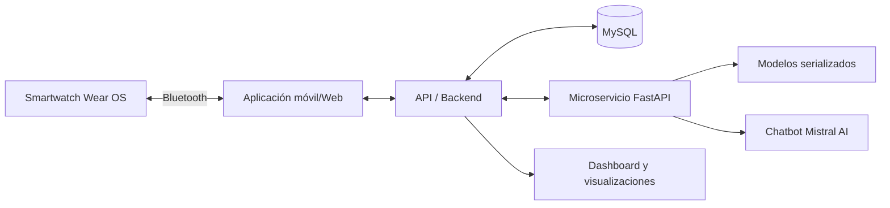

# Contexto del Proyecto — VitalMind AI

## 1. Identificación

| Elemento | Descripción |
|---|---|
| Proyecto | VitalMind AI |
| Empresa académica | NeuroviaLabs |
| Programa | Ingeniería en Desarrollo y Gestión de Software |
| Grupo | 9A |
| Asignatura | Extracción del Conocimiento de Bases de Datos |
| Periodo | Mayo-agosto de 2026 |
| Enfoque | Monitoreo y seguimiento personal de salud |
| Público | Usuarios generales que desean organizar y consultar su propia información |

## 2. Contexto

VitalMind AI integra una aplicación móvil, un módulo para smartwatch Wear OS, servicios backend, una base de datos MySQL, un microservicio de Machine Learning y herramientas de visualización. La aplicación móvil se desarrolla con Kotlin en Android Studio y el reloj se vincula con el teléfono mediante Bluetooth. El código del módulo wearable utiliza además Google Play Services Wearable y AndroidX Health Services para la comunicación entre dispositivos y la lectura de métricas disponibles.

El sistema permite registrar y consultar información como hábitos, sueño, actividad, medicamentos, síntomas y mediciones. Las capacidades que provienen del reloj dependen de los sensores, permisos y características del dispositivo compatible.

## 3. Problemática

Los datos personales de salud pueden quedar repartidos entre registros manuales, aplicaciones y dispositivos. Cuando la información se consulta de forma aislada resulta difícil identificar cambios, revisar tendencias o relacionar hábitos con mediciones a lo largo del tiempo.

VitalMind AI propone concentrar esa información en un mismo flujo para que el usuario pueda consultarla mediante historial, indicadores, gráficas y análisis preventivos. El sistema no pretende emitir diagnósticos ni sustituir una valoración profesional.

## 4. Solución propuesta

La solución combina cinco capas:

1. **Captura y consulta:** aplicación móvil y smartwatch Wear OS.
2. **Sincronización:** comunicación entre teléfono y reloj mediante Bluetooth y servicios Wear OS.
3. **Servicios:** API REST con autenticación, validación y lógica de negocio.
4. **Persistencia:** MySQL para usuarios, hábitos, mediciones, medicamentos, notificaciones y otros registros del prototipo.
5. **Análisis:** microservicio FastAPI con modelos supervisados y no supervisados, recomendaciones y chatbot Mistral AI.

## 5. Objetivo general

Desarrollar una solución digital integrada por una aplicación móvil y un smartwatch Wear OS que permita a usuarios generales recopilar, registrar, almacenar, consultar y analizar información relacionada con su salud y bienestar, incorporando sincronización Bluetooth, historial, visualizaciones y técnicas de Inteligencia Artificial con fines preventivos e informativos.

## 6. Objetivos específicos

- Registrar información de salud, hábitos, actividad, sueño y medicamentos.
- Sincronizar datos disponibles desde un smartwatch compatible con Wear OS.
- Almacenar los registros de forma organizada y permitir su consulta histórica.
- Visualizar indicadores y tendencias mediante gráficas y dashboard.
- Aplicar aprendizaje supervisado para clasificación y estimación de resultados informativos.
- Aplicar aprendizaje no supervisado para agrupación y detección de observaciones atípicas.
- Integrar los modelos mediante un microservicio FastAPI consumible desde el backend.
- Proteger el acceso mediante autenticación, validaciones y variables de entorno.
- Mantener trazabilidad entre datos sintéticos, preparación, modelos, métricas y contratos de API.

## 7. Preguntas de análisis

1. ¿Qué variables ayudan a estimar el nivel de riesgo sintético de un registro?
2. ¿Qué combinación de variables permite aproximar un puntaje de bienestar?
3. ¿Qué grupos naturales aparecen al analizar perfiles agregados de hábitos y mediciones?
4. ¿Qué observaciones se alejan estadísticamente del patrón aprendido?
5. ¿Qué calidad alcanzan los modelos supervisados sobre un conjunto temporal separado?
6. ¿Cómo se integran los resultados del modelo con la aplicación mediante API?
7. ¿Cómo pueden mostrarse los resultados sin presentarlos como conclusiones clínicas?
8. ¿Qué cambios serían necesarios si los datos proceden de un smartwatch real?

## 8. Alcance funcional

- Registro e inicio de sesión.
- Perfil general del usuario.
- Registro de síntomas y mediciones.
- Hábitos de hidratación, actividad, sueño, alimentación y meditación.
- Registro digital de medicamentos, dosis, horarios y confirmación manual.
- Historial y resumen personal.
- Gráficas de evolución.
- Chatbot informativo.
- Recomendaciones generales basadas en reglas.
- Inferencia supervisada de riesgo y bienestar.
- Segmentación no supervisada de perfiles.
- Detección exploratoria de anomalías.
- Dashboard web de datos agregados.

## 9. Arquitectura general

El microservicio de ML no necesita consultar MySQL directamente: recibe desde el backend los campos requeridos para inferencia.

## 10. Evidencia visual de la aplicación

### Pantalla principal

La pantalla principal resume bienestar, hábitos y accesos a funciones de seguimiento.

### Registro de mediciones

El formulario permite capturar valores como dolor, temperatura, frecuencia cardiaca, presión arterial, glucosa y peso cuando corresponda.

### Resumen e historial

El resumen combina evolución gráfica e historial de registros personales.

## 11. Limitaciones técnicas

- Los modelos se entrenaron con datos sintéticos y sus métricas no representan validación clínica.
- La saturación de oxígeno y otras métricas dependen de que el smartwatch y sus sensores las soporten.
- El dashboard independiente de la API se actualiza automáticamente mediante consultas periódicas cada 30 segundos. El frontend web contiene un cliente Socket.IO, pero el backend incluido en esta versión no expone un servidor Socket.IO; por ello no se declara validada una actualización push de extremo a extremo.
- La base operacional y los CSV de entrenamiento cumplen funciones diferentes: la primera soporta la aplicación y los segundos reproducen el trabajo analítico.
- El uso de datos reales requeriría una nueva evaluación de calidad, privacidad, sesgo y desempeño.

## 12. Documentos relacionados

- [`methodology.md`](./methodology.md)
- [`data-sources.md`](./data-sources.md)
- [`data-dictionary.md`](./data-dictionary.md)
- [`simulation-rules.md`](./simulation-rules.md)
- [`etl-process.md`](./etl-process.md)
- [`eda.md`](./eda.md)
- [`model-evaluation.md`](./model-evaluation.md)
- [`api-contracts.md`](./api-contracts.md)
- [`dashboard.md`](./dashboard.md)
- [`testing.md`](./testing.md)
- [`ethics.md`](./ethics.md)
