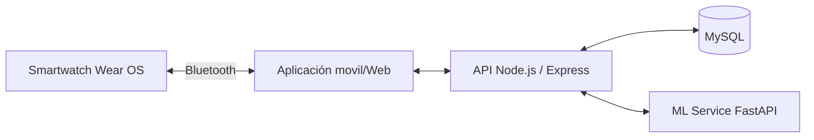
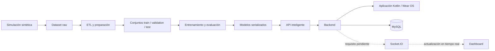

# Contexto del Proyecto — VitalMind AI

## 1. Identificación del proyecto

| Elemento | Descripción |
|---|---|
| Nombre | VitalMind AI |
| Empresa ficticia | NeuroviaLabs |
| Programa educativo | Ingeniería en Desarrollo y Gestión de Software |
| Universidad | Universidad Tecnológica de Xicotepec de Juárez |
| Grupo | 9A |
| Periodo | Mayo-agosto de 2026 |
| Modalidad | Proyecto colaborativo |
| Estado | En desarrollo e integración |
| Aplicación principal | Android, desarrollada en Kotlin con Android Studio |
| Smartwatch | Dispositivo compatible con Wear OS |
| Comunicación reloj-aplicación | Bluetooth |
| Backend | Node.js y Express |
| Base de datos operacional | MySQL |
| Servicio de análisis e IA | Python, FastAPI y scikit-learn |
| Público principal | Personas que desean registrar, consultar y comprender información sobre su salud, actividad, medicamentos y hábitos |

## 2. Contexto y proceso principal

VitalMind AI es una solución de monitoreo y seguimiento personal de la salud. La aplicación Android organiza datos registrados por la persona usuaria y, cuando exista un reloj Wear OS compatible con las mediciones requeridas, recibe información del smartwatch mediante Bluetooth. El backend almacena los registros, concentra la lógica de negocio y comunica los datos necesarios al microservicio de análisis.

El proceso principal consiste en capturar o sincronizar información, almacenarla, consultarla mediante historiales y gráficas, y utilizar modelos de Machine Learning para generar resultados preventivos de apoyo. Entre los datos contemplados se encuentran hábitos, síntomas, frecuencia cardiaca, presión arterial cuando exista una fuente compatible, sueño, actividad, medicamentos y variables de percepción de bienestar.

Los resultados analíticos no son diagnósticos. La aplicación no prescribe ni modifica tratamientos y las mediciones dependen de la calidad de la fuente que las genere.

## 3. Problemática

La información relacionada con la salud personal puede quedar distribuida entre registros manuales, aplicaciones y mediciones de dispositivos. Cuando los datos se encuentran separados, resulta más difícil revisar su evolución, reconocer cambios a lo largo del tiempo y relacionar hábitos con el bienestar reportado.

El proyecto atiende dos necesidades complementarias:

1. **Organización del seguimiento personal:** reunir registros, mediciones, hábitos y medicamentos en una sola experiencia.
2. **Extracción de conocimiento:** transformar datos históricos en indicadores, clasificaciones preventivas, agrupaciones y resúmenes que ayuden a interpretar patrones sin convertirlos en conclusiones clínicas.

Para el componente académico de análisis se utiliza un dataset sintético reproducible. Esto permite practicar el ciclo completo de preparación, modelado, evaluación e integración sin utilizar información personal real.

## 4. Necesidades de información y decisiones que se buscan apoyar

El sistema busca aportar información para que la persona usuaria pueda:

- revisar cómo han cambiado sus mediciones y hábitos;
- consultar el cumplimiento de registros de medicamentos y horarios;
- identificar tendencias generales en sueño, actividad, hidratación, estrés, energía y otras variables disponibles;
- visualizar un nivel de riesgo sintético y un puntaje de bienestar como resultados del modelo;
- recibir recomendaciones generales basadas en reglas;
- entender de forma sencilla un resultado analítico mediante el chatbot.

En el proyecto de datos, la información también permite decidir qué variables conservar, qué modelos ofrecen mejor desempeño, qué mecanismo no supervisado resulta más útil y qué componentes están en condiciones de integrarse a una API.

## 5. Stakeholders del proyecto
 Para efectos del Proyecto Integrador se distinguen los siguientes interesados del trabajo académico y técnico:

| Stakeholder | Interés principal |
|---|---|
| Persona usuaria | Consultar y organizar sus propios registros de salud y bienestar |
|Administrador| Consulta cantidad de regidstros, datos medicos de los usuarios|V
| Equipo de desarrollo | Integrar aplicación, backend, datos, modelos y pruebas |
| Docente y evaluación académica | Verificar que el proyecto cubra datos, modelos, integración, pruebas y documentación |

## 6. Preguntas de análisis

Las preguntas que orientan el componente de extracción de conocimiento son:

1. ¿Qué variables originales ayudan a clasificar el nivel de riesgo sintético?
2. ¿Qué modelo de clasificación ofrece mejor equilibrio entre F1 macro, recall y ROC-AUC?
3. ¿Qué tan bien puede estimarse `wellbeing_score` utilizando variables disponibles en una inferencia realista?
4. ¿Qué grupos naturales aparecen cuando se agregan hábitos, mediciones y percepción de bienestar por usuario sintético?
5. ¿Qué número de clusters ofrece mejor separación según Silhouette, Davies-Bouldin y Calinski-Harabasz?
6. ¿Qué registros se consideran atípicos mediante un detector no supervisado y qué tan distinta es esa noción de la anomalía creada por simulación?
7. ¿Qué variables muestran relaciones fuertes que deban revisarse antes del entrenamiento para evitar redundancia o fuga de información?
8. ¿Cómo se exponen los resultados de los modelos mediante una API sin presentarlos como diagnóstico?
9. ¿Qué requisitos faltan para consumir un mecanismo no supervisado desde el prototipo?
10. ¿Qué cambios serán necesarios cuando las mediciones provengan de un smartwatch Wear OS real en lugar de datos sintéticos?

## 7. Objetivo general

Desarrollar una solución digital integrada por una aplicación y un smartwatch que permita recopilar, almacenar, consultar y analizar información relacionada con la salud del usuario, facilitando el seguimiento de mediciones, actividad, medicamentos, hábitos y tendencias mediante interfaces accesibles, recordatorios y herramientas de análisis.

## 8. Objetivos específicos

1. Implementar registro, autenticación y gestión del perfil general del usuario.
2. Organizar el registro de hábitos, síntomas, mediciones y medicamentos en una base de datos.
3. Permitir la consulta de historiales, indicadores, gráficas y reportes.
4. Gestionar medicamentos de forma digital mediante dosis, horarios, recordatorios y confirmación manual de toma.
5. Integrar la comunicación entre una aplicación Kotlin y un smartwatch Wear OS mediante Bluetooth.
6. Desarrollar servicios backend que conecten la aplicación, MySQL y el microservicio de Machine Learning.
7. Preparar y evaluar datos sintéticos mediante un proceso reproducible que evite fuga de información.
8. Implementar clasificación, regresión, agrupamiento y reducción de dimensionalidad con evaluación documentada.
9. Exponer resultados supervisados mediante una API y dejar definido el trabajo pendiente para el endpoint no supervisado exigido por la guía.
10. Proteger la información mediante autenticación, validación, manejo de secretos y comunicación segura.
11. Mantener pruebas y documentación diferenciando evidencia ejecutada de actividades todavía pendientes.

## 9. Alcance funcional

El alcance actual contempla:

- registro e inicio de sesión;
- perfil general de usuario;
- registro y consulta de hábitos;
- registro manual de síntomas y mediciones;
- registro digital de medicamentos, dosis y horarios;
- confirmación manual de toma;
- recordatorios y notificaciones;
- historiales, indicadores y gráficas;
- aplicación Android en Kotlin;
- interfaz para smartwatch Wear OS;
- comunicación Bluetooth entre reloj y aplicación;
- backend REST en Node.js y Express;
- almacenamiento operacional en MySQL;
- microservicio FastAPI;
- clasificación preventiva de riesgo sintético;
- estimación de bienestar;
- agrupamiento exploratorio con K-Means;
- reducción de dimensionalidad con PCA como apoyo al clustering;
- detección exploratoria de anomalías;
- recomendaciones basadas en reglas;
- chatbot con Mistral AI.

## 10. Datos de salud contemplados

A nivel de producto se consideran, según disponibilidad de la fuente:

- frecuencia cardiaca;
- presión arterial;
- saturación de oxígeno;
- actividad física y pasos;
- duración y calidad del sueño;
- peso y estatura;
- síntomas registrados manualmente;
- hidratación, ejercicio, alimentación y meditación;
- medicamentos, dosis, horarios y confirmaciones;
- estado de ánimo, estrés, energía y calidad percibida del sueño.

## 11. Fuentes disponibles

| Fuente | Uso |
|---|---|
| `vitalmind_dataset_raw.csv` | Simulación original con faltantes controlados |
| `vitalmind_dataset_processed.csv` | Análisis exploratorio y validación general |
| Conjuntos temporales de modelado | Entrenamiento, validación y prueba |
| MySQL operacional | Datos de la aplicación por módulo |
| Aplicación Kotlin | Captura y consulta de información |
| Smartwatch Wear OS | Fuente física prevista mediante Bluetooth; métricas sujetas a compatibilidad |

## 12. Estado técnico observado

| Componente | Evidencia disponible | Estado |
|---|---|---|
| Aplicación Android | Tecnología confirmada: Kotlin y Android Studio | En desarrollo |
| Wearable | Wear OS y comunicación Bluetooth confirmados | En desarrollo; modelo y API/SDK de salud sin confirmar |
| Backend | API REST Node.js / Express | Código disponible |
| Base de datos | MySQL, respaldo y migraciones | Estructura disponible |
| Dataset | Raw y processed con 5,000 registros sintéticos | Disponible |
| EDA | Notebook `01_exploratory_data_analysis.ipynb` | Disponible |
| Clasificación | Regresión Logística evaluada | Implementada |
| Regresión | Ridge Regression evaluada | Implementada |
| Agrupamiento | K-Means con artefacto serializado | Implementado de forma exploratoria |
| Reducción | PCA 2D para apoyo al clustering | Implementada como análisis |
| Anomalías | Isolation Forest | Implementado de forma exploratoria |
| Chatbot | Mistral AI | Código disponible |
| Endpoint supervisado | `/api/v1/analyze` | Implementado |
| Endpoint no supervisado | Requerido por la guía | Pendiente |
| Dashboard | Dashboard HTML/Chart.js con consultas periódicas | Disponible, pero sin Socket.IO |
| Socket.IO | Requisito de la guía para tiempo real | No identificado en el backend actual |
| Pruebas completas frontend/backend/E2E | Requieren reporte de ejecución | No confirmadas |

## 13. Arquitectura funcional

## 14. Arquitectura analítica del Proyecto Integrador

## 15. Dataset y preparación

El dataset sintético contiene:

- 5,000 registros;
- 250 usuarios sintéticos;
- fechas del 1 de abril al 29 de junio de 2026;
- 34 columnas en raw y 35 en processed;
- 1,500 valores faltantes controlados en raw;
- 150 anomalías sintéticas;
- cero filas duplicadas.

La evaluación final utiliza separación temporal antes de aprender estadísticas de imputación:

| Conjunto | Registros | Periodo |
|---|---:|---|
| Entrenamiento | 3,418 | 2026-04-01 a 2026-06-01 |
| Validación | 731 | 2026-06-02 a 2026-06-14 |
| Prueba | 851 | 2026-06-15 a 2026-06-29 |

## 16. Modelos y mecanismos seleccionados

El proyecto cuenta con:

- Regresión Logística para `risk_level`;
- Ridge Regression para `wellbeing_score`;
- K-Means para agrupamiento de perfiles agregados;
- PCA para representación bidimensional;
- Isolation Forest para exploración de anomalías.

## 17. Limitaciones

- Los modelos se entrenaron con datos sintéticos.
- No existe validación clínica.
- El modelo específico de smartwatch no está confirmado.
- No está confirmada una API o SDK de salud para Wear OS.
- Saturación de oxígeno y pasos no forman parte del dataset actual.
- El endpoint no supervisado exigido por la guía todavía no está implementado.
- El dashboard actual no utiliza Socket.IO.
- No existe reporte verificable de ejecución completa de las pruebas de frontend, backend e integración end-to-end.
- No se identificó en este paquete documental un conjunto independiente de inferencia.
- Las métricas obtenidas no garantizan el mismo comportamiento con datos reales.

## 18. Resultado esperado

El resultado académico busca demostrar el flujo completo desde el problema y los datos hasta el consumo de resultados analíticos desde el prototipo. Las partes ya respaldadas por archivos incluyen simulación, ETL, EDA, entrenamiento, evaluación, modelos serializados, API supervisada, backend y dashboard.

