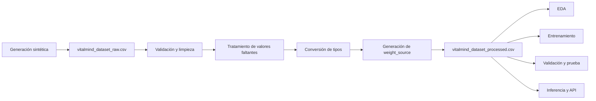

<div align="center">

# 🗃️ Fuentes de Datos — VitalMind AI

### Descripción, procedencia, estructura y calidad de los datasets del proyecto

<p align="center">
  
  
  
  
</p>

</div>


## 📌 Propósito del documento

Este documento describe las fuentes de datos utilizadas en **VitalMind AI**, su procedencia, formato, volumen, estructura general, calidad y relación con las etapas de análisis y Machine Learning.

Actualmente, el proyecto cuenta con dos archivos principales:

- Un dataset original o **raw**, que conserva los datos antes de completar el tratamiento de valores faltantes.
- Un dataset **processed**, preparado para análisis, entrenamiento y consumo por los módulos de Machine Learning.


---

## 📂 Archivos disponibles


```text
data/
├── raw/
│   └── vitalmind_dataset_raw.csv
└── processed/
    └── vitalmind_dataset_processed.csv
```

| Archivo | Etapa | Registros | Columnas | Valores nulos | Duplicados |
|---|---|---:|---:|---:|---:|
| `vitalmind_dataset_raw.csv` | Fuente original | 5,000 | 34 | 1,500 celdas nulas | 0 |
| `vitalmind_dataset_processed.csv` | Datos procesados | 5,000 | 35 | 0 | 0 |

El archivo procesado conserva los **5,000 registros** del archivo original y agrega la columna `weight_source`, utilizada para identificar la procedencia del valor de peso.

---

## 🧭 Origen y naturaleza de los datos

| Elemento | Descripción |
|---|---|
| **Origen** | Generación sintética interna para el proyecto VitalMind AI |
| **Responsable técnico** | Área de Inteligencia Artificial y Machine Learning |
| **Formato** | CSV |
| **Tipo de datos** | Estructurados |
| **Cobertura temporal** | Del 1 de abril de 2026 al 29 de junio de 2026 |
| **Usuarios sintéticos** | 250 |
| **Registros por usuario** | Entre 10 y 30 |
| **Promedio de registros por usuario** | 20 |
| **Uso previsto** | EDA, ETL, modelado, evaluación e inferencia |
| **Datos reales de pacientes** | No |
| **Datos personales identificables** | No se observan identificadores reales |

Cada registro representa una observación de bienestar asociada a un usuario sintético y a una fecha determinada.

---

## 🔄 Flujo de los datos



---

## 🧱 Unidad de análisis

La unidad de análisis corresponde a:

> **Un registro de bienestar de un usuario sintético en una fecha determinada.**

Cada observación integra datos de perfil, hábitos, síntomas, signos, estado emocional, puntuaciones calculadas y etiquetas de riesgo.

Los campos `record_id` y `user_id` permiten distinguir cada observación y agrupar los registros por usuario.

---

## 🧩 Organización de las variables

### 1. Identificación y tiempo

| Campo | Descripción general |
|---|---|
| `record_id` | Identificador único del registro |
| `user_id` | Identificador sintético del usuario |
| `log_date` | Fecha de la observación |

### 2. Perfil del usuario

| Campo | Descripción general |
|---|---|
| `profile_type` | Perfil sintético de hábitos o condición general |
| `age` | Edad |
| `height_cm` | Estatura en centímetros |
| `weight_profile_kg` | Peso registrado en el perfil |
| `weight_kg` | Peso asociado al registro |
| `bmi` | Índice de masa corporal |
| `weight_source` | Procedencia del peso en el dataset procesado |

### 3. Hábitos de bienestar

| Campo | Descripción general |
|---|---|
| `water_glasses` | Vasos de agua |
| `water_liters` | Consumo estimado en litros |
| `exercise_minutes` | Minutos de ejercicio |
| `sleep_hours` | Horas de sueño |
| `healthy_meals_count` | Número de comidas saludables |
| `meditation_minutes` | Minutos de meditación |

### 4. Síntomas y mediciones físicas

| Campo | Descripción general |
|---|---|
| `pain` | Nivel de dolor |
| `temperature_c` | Temperatura corporal en °C |
| `systolic_mmhg` | Presión arterial sistólica |
| `diastolic_mmhg` | Presión arterial diastólica |
| `glucose_mg_dl` | Glucosa en mg/dL |
| `heart_rate_bpm` | Frecuencia cardiaca en latidos por minuto |

### 5. Bienestar emocional y percepción

| Campo | Descripción general |
|---|---|
| `mood` | Estado de ánimo categórico |
| `stress_level` | Nivel de estrés |
| `energy_level` | Nivel de energía |
| `sleep_quality` | Calidad percibida del sueño |

### 6. Indicadores calculados

| Campo | Descripción general |
|---|---|
| `sleep_score` | Puntuación asociada al sueño |
| `activity_score` | Puntuación de actividad |
| `nutrition_score` | Puntuación de nutrición |
| `emotional_score` | Puntuación emocional |
| `physical_condition_score` | Puntuación de condición física |
| `wellbeing_score` | Puntuación integral de bienestar |
| `risk_factors_count` | Cantidad de factores de riesgo identificados |

### 7. Etiquetas y control analítico

| Campo | Descripción general |
|---|---|
| `risk_level` | Nivel de riesgo: bajo, medio o alto |
| `is_anomaly` | Indicador booleano de registro anómalo |

> [!NOTE]
> La función exacta de cada campo, su regla de cálculo, unidad, rango válido y uso como entrada o salida de modelos se documentará en `docs/data-dictionary.md`.

---

## 📊 Perfil general del dataset

### Distribución de perfiles

| Perfil | Registros | Porcentaje |
|---|---:|---:|
| `healthy` | 1,776 | 35.52 % |
| `poor_habits` | 1,280 | 25.60 % |
| `irregular` | 1,229 | 24.58 % |
| `physically_vulnerable` | 715 | 14.30 % |
| **Total** | **5,000** | **100 %** |

### Distribución del nivel de riesgo

| Nivel | Registros | Porcentaje |
|---|---:|---:|
| `low` | 1,849 | 36.98 % |
| `medium` | 1,970 | 39.40 % |
| `high` | 1,181 | 23.62 % |
| **Total** | **5,000** | **100 %** |

### Registros anómalos

| Valor | Registros | Porcentaje |
|---|---:|---:|
| `False` | 4,850 | 97.00 % |
| `True` | 150 | 3.00 % |
| **Total** | **5,000** | **100 %** |

### Estados de ánimo en el archivo original

| Estado | Registros |
|---|---:|
| `Mal` | 1,231 |
| `Bien` | 1,182 |
| `Regular` | 1,179 |
| `Muy bien` | 719 |
| `Muy mal` | 539 |
| Valor faltante | 150 |

---

## 🔍 Calidad del dataset original

El archivo `vitalmind_dataset_raw.csv` presenta las siguientes características:

- 5,000 identificadores de registro únicos.
- 0 filas duplicadas.
- 1,500 valores nulos distribuidos en 10 columnas.
- 150 valores faltantes en cada una de las columnas afectadas.
- 1,326 filas contienen al menos un valor faltante.
- Se conservan 150 registros marcados como anomalías.

### Columnas con valores faltantes

| Campo | Valores nulos | Porcentaje |
|---|---:|---:|
| `weight_kg` | 150 | 3.00 % |
| `temperature_c` | 150 | 3.00 % |
| `systolic_mmhg` | 150 | 3.00 % |
| `diastolic_mmhg` | 150 | 3.00 % |
| `glucose_mg_dl` | 150 | 3.00 % |
| `heart_rate_bpm` | 150 | 3.00 % |
| `mood` | 150 | 3.00 % |
| `stress_level` | 150 | 3.00 % |
| `energy_level` | 150 | 3.00 % |
| `sleep_quality` | 150 | 3.00 % |

La existencia de valores faltantes permite probar actividades de limpieza, imputación, validación y control de calidad dentro del proceso ETL.

---

## ✅ Estado del dataset procesado

El archivo `vitalmind_dataset_processed.csv` presenta:

- 5,000 registros.
- 35 columnas.
- 0 valores nulos.
- 0 filas duplicadas.
- Conservación de `record_id` y `user_id`.
- Conservación de la etiqueta `is_anomaly`.
- Incorporación de `weight_source`.
- Conversión a enteros de varias mediciones que en el archivo original estaban representadas como valores numéricos con posibilidad de nulos.

### Cambios observados entre archivos

| Cambio | Evidencia observada |
|---|---|
| Tratamiento de valores faltantes | El dataset procesado no contiene valores nulos |
| Columna nueva | Se agregó `weight_source` |
| Procedencia del peso | `symptom_log`: 4,850 registros; `profile_fallback`: 150 |
| Conversión de tipos | Presión, glucosa, frecuencia cardiaca, estrés, energía y calidad del sueño pasan a enteros |
| Conservación del volumen | Ambos archivos contienen 5,000 registros |
| Conservación de anomalías | Se mantienen 150 registros con `is_anomaly = True` |


---

## 📐 Rangos observados

Los siguientes rangos describen los valores presentes en el dataset procesado. No deben confundirse automáticamente con rangos clínicos de referencia.

| Variable | Mínimo | Máximo |
|---|---:|---:|
| Edad | 18 | 74 |
| Estatura | 140.0 cm | 191.2 cm |
| Peso | 40.0 kg | 134.5 kg |
| IMC | 16.16 | 44.33 |
| Agua | 0.0 L | 3.56 L |
| Ejercicio | 0.0 min | 111.0 min |
| Sueño | 1.0 h | 10.0 h |
| Comidas saludables | 0 | 5 |
| Meditación | 0.0 min | 49.0 min |
| Dolor | 0 | 10 |
| Temperatura | 35.4 °C | 38.4 °C |
| Presión sistólica | 82 mmHg | 156 mmHg |
| Presión diastólica | 50 mmHg | 98 mmHg |
| Glucosa | 50 mg/dL | 147 mg/dL |
| Frecuencia cardiaca | 44 bpm | 155 bpm |
| Estrés | 1 | 10 |
| Energía | 1 | 10 |
| Calidad del sueño | 1 | 10 |
| Puntuación de bienestar | 15.14 | 99.82 |
| Factores de riesgo | 0 | 9 |

---

## 🧠 Uso analítico previsto

Los datos pueden utilizarse para:

### Aprendizaje supervisado

- Clasificación del nivel de riesgo.
- Clasificación preventiva de síntomas.
- Estimación de adherencia a hábitos.
- Estimación de bienestar o calidad del sueño.
- Detección supervisada de registros sensibles, si se generan etiquetas adecuadas.

### Aprendizaje no supervisado

- Segmentación de usuarios por hábitos.
- Agrupación de patrones de bienestar.
- Detección de anomalías.
- Reducción de dimensionalidad.
- Exploración de perfiles de riesgo.

### Análisis descriptivo

- Evolución temporal de indicadores.
- Comparación entre perfiles.
- Relación entre hábitos y bienestar.
- Distribución de riesgo.
- Análisis de anomalías y valores faltantes.


---

## 🔐 Privacidad y tratamiento responsable

Aunque los datos son sintéticos, el proyecto debe mantener prácticas responsables:

- No incorporar nombres, CURP, NSS, teléfonos, correos o domicilios reales.
- Conservar identificadores artificiales.
- Evitar mezclar los datos sintéticos con información de personas reales.
- No presentar los registros como evidencia clínica.
- No publicar credenciales, tokens ni cadenas de conexión.
- Documentar las transformaciones aplicadas.
- Mantener trazabilidad entre datos originales y procesados.
- Mostrar las predicciones como orientación, no como diagnóstico.
- Limitar el acceso a los datos según el rol del sistema.

---

## 🧪 Validaciones recomendadas

Antes de utilizar el dataset procesado para entrenamiento deben verificarse:

- Unicidad de `record_id`.
- Integridad de `user_id`.
- Formato válido de `log_date`.
- Ausencia de nulos.
- Ausencia de duplicados.
- Consistencia entre `water_glasses` y `water_liters`.
- Coherencia entre peso, estatura e IMC.
- Valores permitidos de `profile_type`, `mood` y `risk_level`.
- Tipos correctos de variables numéricas y booleanas.
- Distribución de clases.
- Separación por usuario para evitar fuga de información.
- Conservación de la proporción de anomalías.
- Reproducibilidad del proceso de transformación.

---

## 🗂️ Relación con otros documentos

| Documento | Relación |
|---|---|
| [`data-dictionary.md`](./data-dictionary.md) | Definirá cada atributo, tipo, unidad, rango y regla |
| [`simulation-rules.md`](./simulation-rules.md) | Explicará cómo se generaron los datos sintéticos |
| [`etl-process.md`](./etl-process.md) | Documentará las transformaciones de raw a processed |
| [`data-warehouse.md`](./data-warehouse.md) | Describirá el almacén analítico |
| [`model-evaluation.md`](./model-evaluation.md) | Indicará qué variables se utilizaron y con qué resultados |
| [`testing.md`](./testing.md) | Registrará las pruebas de calidad y consistencia |

---

## 📝 Conclusión

VitalMind AI dispone de una fuente sintética estructurada con 5,000 observaciones y 250 usuarios artificiales. La existencia de una versión original y una versión procesada permite conservar trazabilidad y separar adecuadamente la fuente de los datos utilizados para análisis y modelado.

El dataset procesado elimina los valores faltantes, conserva el volumen original, añade información de procedencia del peso y deja los datos en condiciones iniciales para EDA, ETL, entrenamiento y evaluación.

Las reglas exactas de simulación y transformación deberán complementarse con los scripts técnicos correspondientes para garantizar reproducibilidad y evitar documentar supuestos como hechos.
