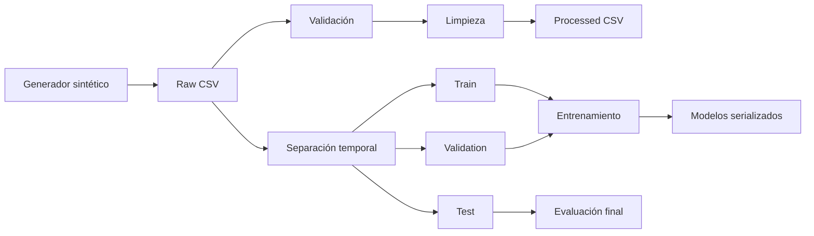

# Fuentes de Datos — VitalMind AI

## 1. Propósito

Este documento identifica las fuentes de información utilizadas o contempladas por VitalMind AI, su función dentro del análisis y los principales resultados del análisis exploratorio de datos.

El componente de Machine Learning se desarrolló principalmente con datos sintéticos. La base MySQL corresponde a la operación de la aplicación.

## 2. Fuentes identificadas

| Fuente | Tipo | Formato / tecnología | Estado | Uso |
|---|---|---|---|---|
| `vitalmind_dataset_raw.csv` | Datos sintéticos | CSV | Disponible | Fuente original para validación, ETL y modelado |
| `vitalmind_dataset_processed.csv` | Datos sintéticos procesados | CSV | Disponible | EDA y revisión general |
| `train_model.csv` | Datos de modelado | CSV | Disponible | Entrenamiento |
| `validation_model.csv` | Datos de modelado | CSV | Disponible | Selección y ajuste |
| `test_model.csv` | Datos de modelado | CSV | Disponible | Evaluación final |
| MySQL operacional | Base relacional | MySQL | Disponible | Registros de la aplicación |
| Aplicación Android | Captura de usuario | Kotlin / Android Studio | En desarrollo | Perfil, hábitos, síntomas, medicamentos y consulta |
| Smartwatch | Wearable | Wear OS + Bluetooth | En desarrollo | Fuente física futura de mediciones compatibles |
| API de salud del smartwatch | Fuente externa | Pendiente de confirmar | No definida | Acceso a sensores o métricas del reloj |


## 3. Archivos principales del dataset

| Archivo | Registros | Columnas | Valores nulos | Filas duplicadas |
|---|---:|---:|---:|---:|
| `vitalmind_dataset_raw.csv` | 5,000 | 34 | 1,500 | 0 |
| `vitalmind_dataset_processed.csv` | 5,000 | 35 | 0 | 0 |

La columna adicional en processed es `weight_source`.

## 4. Origen y naturaleza del dataset sintético

| Elemento | Descripción |
|---|---|
| Origen | Generación interna del proyecto |
| Semilla | 2026 |
| Usuarios sintéticos | 250 |
| Registros | 5,000 |
| Cobertura temporal | 2026-04-01 a 2026-06-29 |
| Registros por usuario | 10 a 30 |
| Promedio aproximado | 20 registros por usuario |
| Datos personales reales | No |
| Uso | EDA, ETL, entrenamiento, validación, prueba e inferencia controlada |

Cada fila representa una observación de bienestar de una persona sintética en una fecha.

## 5. Entidades relevantes

### 5.1 Entidades del análisis

| Entidad | Identificador | Descripción |
|---|---|---|
| Usuario sintético | `user_id` | Perfil artificial utilizado para generar observaciones |
| Observación diaria | `record_id` | Registro de una fecha con hábitos, mediciones y percepción |
| Perfil sintético | `profile_type` | Regla generadora usada solo para simulación |
| Resultado analítico | `risk_level`, `wellbeing_score` | Etiquetas u objetivos creados para el ejercicio de ML |

### 5.2 Entidades de la aplicación operacional

La base MySQL contiene entidades para cuenta, hábitos, síntomas/mediciones, medicamentos, registros de toma, notificaciones, sesiones y auditoría. Su detalle se documenta en `data-warehouse.md`.

### 5.3 Entidad wearable

El smartwatch es un dispositivo Wear OS que se comunica con la aplicación Android mediante Bluetooth. Las métricas disponibles dependerán del modelo seleccionado y de la API o SDK de salud que se confirme.

## 6. Grupos de atributos

### 6.1 Identificación y tiempo

```text
record_id
user_id
log_date
```

### 6.2 Perfil

```text
profile_type
age
height_cm
weight_profile_kg
weight_kg
bmi
weight_source
```

### 6.3 Hábitos

```text
water_glasses
water_liters
exercise_minutes
sleep_hours
healthy_meals_count
meditation_minutes
```

### 6.4 Síntomas y mediciones

```text
pain
temperature_c
systolic_mmhg
diastolic_mmhg
glucose_mg_dl
heart_rate_bpm
```

### 6.5 Percepción y estado emocional

```text
mood
stress_level
energy_level
sleep_quality
```

### 6.6 Indicadores derivados

```text
sleep_score
activity_score
nutrition_score
emotional_score
physical_condition_score
wellbeing_score
risk_factors_count
```

### 6.7 Etiquetas

```text
risk_level
is_anomaly
```

## 7. Clasificación general de los datos

| Grupo | Clasificación |
|---|---|
| Identificadores | Cualitativos nominales |
| Fecha | Temporal estructurado |
| Edad, conteos y escalas enteras | Cuantitativos discretos |
| Peso, estatura, temperatura, horas y puntajes | Cuantitativos continuos |
| `mood` | Cualitativo ordinal |
| `risk_level` | Cualitativo ordinal |
| `profile_type` | Cualitativo nominal de simulación |
| `is_anomaly` | Binario |
| CSV | Datos estructurados |
| MySQL | Datos estructurados relacionales |
| Mensajes del chatbot | Datos no estructurados si se conservaran |
| Comunicación smartwatch-app | Datos estructurados o semiestructurados según el contrato futuro |

El detalle por campo se encuentra en `data-dictionary.md`.

## 8. Flujo de los datos




## 9. Calidad del archivo raw

Se verificó:

- 5,000 `record_id` únicos;
- 0 filas duplicadas;
- 1,500 celdas nulas;
- 1,326 filas con al menos un faltante;
- 150 anomalías sintéticas.

Cada uno de estos campos contiene 150 nulos:

```text
weight_kg
temperature_c
systolic_mmhg
diastolic_mmhg
glucose_mg_dl
heart_rate_bpm
mood
stress_level
energy_level
sleep_quality
```

## 10. Calidad del archivo processed

La versión procesada conserva:

- 5,000 registros;
- 35 columnas;
- 0 valores nulos;
- 0 duplicados.

Cambios principales:

| Transformación | Resultado |
|---|---|
| Peso faltante | Respaldo con `weight_profile_kg` |
| Trazabilidad del peso | `weight_source` |
| Numéricos opcionales | Mediana por usuario y luego global |
| `mood` | Moda por usuario y luego global |
| Derivados | Recálculo de `water_liters` y `bmi` |
| Volumen | No se eliminan registros |

## 11. Perfil general del dataset

### 11.1 Perfiles sintéticos

| Perfil | Registros | Porcentaje |
|---|---:|---:|
| `healthy` | 1,776 | 35.52 % |
| `poor_habits` | 1,280 | 25.60 % |
| `irregular` | 1,229 | 24.58 % |
| `physically_vulnerable` | 715 | 14.30 % |

### 11.2 Riesgo sintético

| Nivel | Registros | Porcentaje |
|---|---:|---:|
| `low` | 1,849 | 36.98 % |
| `medium` | 1,970 | 39.40 % |
| `high` | 1,181 | 23.62 % |

### 11.3 Anomalías

| Valor | Registros | Porcentaje |
|---|---:|---:|
| `False` | 4,850 | 97.00 % |
| `True` | 150 | 3.00 % |

## 12. Análisis exploratorio de datos

El notebook `01_exploratory_data_analysis.ipynb` revisa calidad, distribuciones, relaciones entre variables, perfiles, riesgo y posible fuga de información.

### 12.1 Hallazgos de calidad

- el dataset processed no contiene faltantes ni duplicados;
- las tres clases de riesgo tienen representación suficiente para iniciar experimentación;
- la clase `medium` es la más frecuente y `high` la menos frecuente;
- los registros mantienen orden temporal por usuario;
- existen variables derivadas que deben excluirse para evitar fuga.

### 12.2 Comparación de perfiles sintéticos

Promedios observados en el notebook:

| Perfil | Sueño (h) | Ejercicio (min) | Agua (vasos) | Estrés | Energía | Dolor | Bienestar |
|---|---:|---:|---:|---:|---:|---:|---:|
| `healthy` | 7.74 | 45.85 | 8.51 | 1.82 | 6.71 | 0.75 | 82.00 |
| `irregular` | 6.44 | 25.90 | 6.30 | 4.09 | 3.97 | 2.51 | 61.89 |
| `physically_vulnerable` | 5.96 | 15.27 | 5.14 | 5.32 | 2.65 | 5.85 | 50.53 |
| `poor_habits` | 5.29 | 10.97 | 3.65 | 6.48 | 1.67 | 4.74 | 40.47 |

Estos perfiles sirven para comprobar que la simulación generó comportamientos distintos. `profile_type` no se usa como predictor.

### 12.3 Relaciones fuertes detectadas

El notebook identifica correlaciones absolutas aproximadas de 0.70 o más:

| Variables | Correlación |
|---|---:|
| `weight_kg` - `bmi` | 0.87 |
| `stress_level` - `energy_level` | -0.85 |
| `energy_level` - `sleep_quality` | 0.75 |
| `pain` - `energy_level` | -0.73 |
| `pain` - `stress_level` | 0.73 |
| `sleep_hours` - `stress_level` | -0.73 |
| `sleep_hours` - `sleep_quality` | 0.72 |
| `sleep_hours` - `energy_level` | 0.71 |

La correlación no se interpreta como causalidad. Se utiliza para revisar redundancia y decisiones de preparación.

### 12.4 Decisiones derivadas del EDA

Se excluyen del entrenamiento:

- identificadores;
- fecha como predictor directo;
- `profile_type`;
- `is_anomaly`;
- `risk_factors_count`;
- objetivos cruzados;
- puntajes derivados que participaron en la construcción de los objetivos;
- `water_liters` cuando ya se usa `water_glasses`;
- `weight_profile_kg` cuando se usa `weight_kg`.

## 13. Rangos observados principales

Los rangos describen el dataset y no son umbrales clínicos.

| Variable | Mínimo | Máximo |
|---|---:|---:|
| Edad | 18 | 74 |
| Estatura | 140.0 cm | 191.2 cm |
| Peso | 40.0 kg | 134.5 kg |
| BMI | 16.16 | 44.33 |
| Agua | 0.0 | 14.25 vasos |
| Ejercicio | 0.0 | 111.0 min |
| Sueño | 1.0 | 10.0 h |
| Temperatura | 35.4 | 38.4 °C |
| Sistólica | 82 | 156 mmHg |
| Diastólica | 50 | 98 mmHg |
| Glucosa | 50 | 147 mg/dL |
| Frecuencia cardiaca | 44 | 155 bpm |
| Bienestar | 15.14 | 99.82 |

## 14. Uso en Machine Learning

Los datos se usan para:

- clasificación de `risk_level`;
- regresión de `wellbeing_score`;
- clustering de perfiles agregados;
- PCA para visualización;
- detección exploratoria de anomalías;
- pruebas de inferencia.


## 15. Relación con la base operacional y Wear OS

Los CSV y MySQL tienen propósitos distintos:

- los CSV permiten desarrollar y evaluar modelos con un conjunto controlado;
- MySQL almacena datos operativos de la aplicación;
- el backend transforma registros operativos al contrato del ML Service;
- el smartwatch Wear OS se comunica con la aplicación mediante Bluetooth;
- todavía no se ha definido la API o SDK que expondrá las mediciones del reloj;


## 16. Privacidad

Los CSV no contienen nombres, correos, teléfonos ni identificadores reales. Aun así, el diseño mantiene principios de:

- minimización;
- acceso a datos propios;
- cifrado en tránsito;
- protección de secretos;
- trazabilidad;
- separación entre datos de prueba y datos reales.

