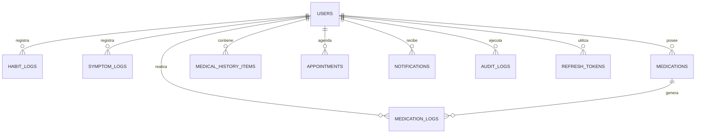
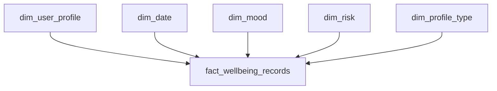
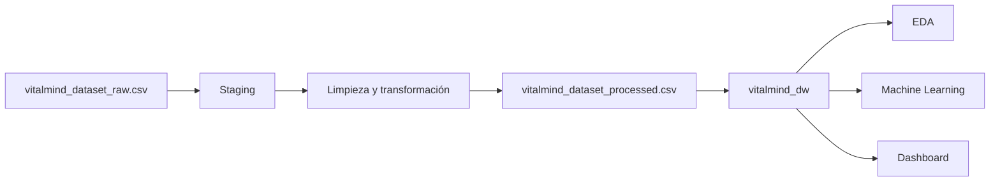

<div align="center">

# 🏛️ Almacén de Datos — VitalMind AI


</div>

---

## 1. Propósito

Este documento describe la estructura recibida en `Warehouse.zip`, su relación con VitalMind AI y los cambios necesarios para convertirla en un almacén analítico.

El paquete contiene:

```text
Warehouse/
├── Backup_OnlyData_VitalMind.sql
├── Backup_Onlystructure_VitalMind.sql
├── DB_VitalMind.sql
├── DIccionario de datos VitalMind.html
└── MySQL Workbench Models VitalMind.mwb
```

---

## 2. Tecnología y configuración

| Elemento | Descripción |
|---|---|
| Motor | MySQL 8 |
| Base de datos | `vitalmind` |
| Motor de almacenamiento | InnoDB |
| Codificación | `utf8mb4` |
| Intercalación | `utf8mb4_unicode_ci` |
| Modelo visual | MySQL Workbench |
| Integridad | Llaves primarias y foráneas |

---

## 3. Tablas identificadas

| Tabla | Propósito |
|---|---|
| `users` | Almacena usuarios, roles y datos generales de perfil |
| `habit_logs` | Registra hábitos diarios como agua, ejercicio, sueño, nutrición y meditación |
| `symptom_logs` | Almacena síntomas, signos físicos, estado de ánimo y notas |
| `medications` | Define los medicamentos registrados por cada usuario |
| `medication_logs` | Registra cuándo un medicamento fue tomado |
| `medical_history_items` | Guarda antecedentes médicos por categoría |
| `appointments` | Administra citas médicas |
| `notifications` | Registra recordatorios, consejos, alertas y mensajes de IA |
| `audit_logs` | Mantiene trazabilidad de las acciones realizadas |
| `refresh_tokens` | Administra tokens de renovación de sesión |

---

## 4. Relaciones principales



La tabla `users` actúa como entidad central de la base operacional.

---

## 5. Integridad observada

La estructura incluye:

- Llaves primarias autoincrementales.
- Llaves foráneas entre usuarios y registros.
- Eliminación en cascada en tablas dependientes.
- Asignación a `NULL` cuando se desea conservar el registro.
- Restricción única en `habit_logs` para evitar dos registros del mismo usuario en la misma fecha.
- Correo electrónico único en `users`.

Ejemplo de restricción importante:

```sql
UNIQUE KEY uq_habit_user_date (user_id, log_date)
```

---

## 6. Volumen del respaldo de datos

| Tabla | Registros |
|---|---:|
| `audit_logs` | 213 |
| `users` | 9 |
| `habit_logs` | 8 |
| `symptom_logs` | 8 |
| `medical_history_items` | 8 |
| `notifications` | 8 |
| `medications` | 7 |
| `medication_logs` | 5 |
| `appointments` | 4 |
| `refresh_tokens` | 0 |

La mayor parte de los registros clínicos y de hábitos pertenece a un solo usuario, por lo que el respaldo funciona como demostración, pero no como fuente analítica representativa.

---

## 7. Evaluación del modelo recibido

### Aspectos correctos

- Organización clara de entidades operacionales.
- Uso de claves primarias y foráneas.
- Separación de medicamentos y eventos de consumo.
- Registro de auditoría.
- Manejo de roles.
- Respaldo separado de estructura y datos.
- Modelo disponible en MySQL Workbench.

### Aspectos por mejorar

| Elemento | Situación observada | Recomendación |
|---|---|---|
| `appointment_time` | Se almacena como texto | Utilizar `TIME` |
| `joined_label` y `last_active_label` | Guardan etiquetas de texto | Almacenar fechas reales |
| `time_label` | Representa tiempo con texto libre | Utilizar fecha u hora estructurada |
| `audit_logs.payload` | Está definido como `LONGTEXT` | Considerar tipo `JSON` |
| Hábitos | Campos sin unidad explícita | Usar nombres como `water_glasses` o `exercise_minutes` |
| Rangos | No existen suficientes restricciones | Agregar validaciones o `CHECK` |
| Datos de ejemplo | Algunas dosis y textos son inconsistentes | Limpiar antes de la entrega final |

---

## 8. Diferencia con el dataset analítico

El dataset procesado de Machine Learning contiene:

```text
5,000 registros
250 usuarios sintéticos
35 columnas
```

La base operacional no contiene directamente todas sus variables. Entre los campos no representados se encuentran:

```text
profile_type
sleep_score
activity_score
nutrition_score
emotional_score
physical_condition_score
wellbeing_score
risk_factors_count
risk_level
is_anomaly
weight_source
stress_level
energy_level
sleep_quality
```

Por lo tanto, el dataset procesado todavía debe integrarse a un esquema analítico independiente o mediante un proceso ETL.

---

## 9. Propuesta de Data Mart

Se recomienda conservar `vitalmind` como base operacional y crear una base separada:

```text
vitalmind_dw
```

### Granularidad propuesta

> Un registro de bienestar de un usuario sintético en una fecha determinada.

### Modelo estrella propuesto



### Tabla de hechos propuesta

`fact_wellbeing_records`

Podría almacenar:

```text
record_id
user_key
date_key
mood_key
risk_key
profile_type_key
water_liters
exercise_minutes
sleep_hours
healthy_meals_count
meditation_minutes
pain
temperature_c
systolic_mmhg
diastolic_mmhg
glucose_mg_dl
heart_rate_bpm
bmi
sleep_score
activity_score
nutrition_score
emotional_score
physical_condition_score
wellbeing_score
risk_factors_count
is_anomaly
```

### Dimensiones propuestas

| Dimensión | Contenido |
|---|---|
| `dim_user_profile` | Usuario sintético, edad, estatura y peso de perfil |
| `dim_date` | Día, mes, año, semana y trimestre |
| `dim_mood` | Estado de ánimo y orden de interpretación |
| `dim_risk` | Nivel de riesgo bajo, medio o alto |
| `dim_profile_type` | Tipo de perfil sintético |

---

## 10. Flujo esperado



---

## 11. Seguridad y privacidad

Los respaldos incluyen datos de usuario, información médica, correos, hashes y registros de auditoría.

Aunque sean datos de prueba, se recomienda:

- No subir respaldos con información sensible a un repositorio público.
- Utilizar únicamente datos ficticios.
- Anonimizar nombres y correos.
- No publicar hashes de contraseña.
- Evitar almacenar información clínica completa dentro de `audit_logs.payload`.
- Mantener respaldos en una ubicación con acceso controlado.

---

## 12. Estado actual

| Elemento | Estado |
|---|---|
| Base operacional | Implementada |
| Relaciones y llaves | Implementadas |
| Respaldo de estructura | Disponible |
| Respaldo de datos | Disponible |
| Modelo Workbench | Disponible |
| Diccionario técnico HTML | Disponible |
| Data Mart | Pendiente |
| Esquema estrella | Propuesto |
| Tabla de hechos | Propuesta |
| Dimensiones | Propuestas |
| Carga del dataset procesado | Pendiente |
| ETL analítico | Pendiente |

---

## 13. Conclusión

La estructura entregada es adecuada como base de datos operacional para registrar usuarios, hábitos, síntomas, medicamentos, citas y notificaciones.

Sin embargo, para cumplir con el componente analítico del proyecto debe conservarse como sistema operacional y complementarse con un Data Mart separado, alimentado mediante ETL desde el dataset procesado.

La propuesta de `fact_wellbeing_records` y sus dimensiones sirve como punto de partida, pero deberá confirmarse con el equipo de Backend y Machine Learning antes de implementarse.
