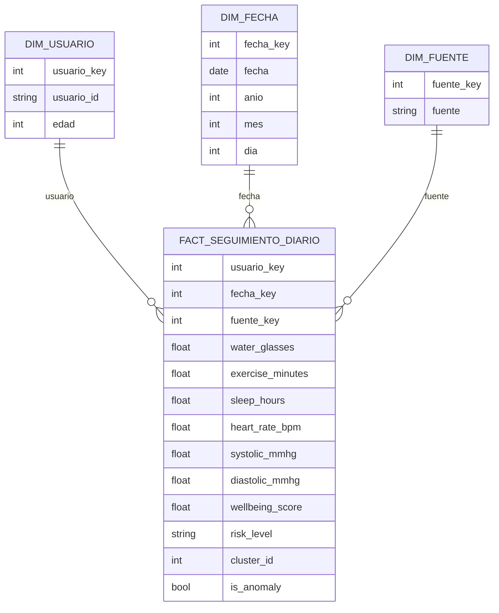

# Data Warehouse / Data Mart — VitalMind AI

## 1. Propósito

La guía solicita un almacén analítico. El proyecto utiliza MySQL como base operacional y dispone de un diseño de Data Mart orientado al seguimiento histórico. Ambos conceptos se documentan por separado para evitar confundir la base transaccional con un almacén dimensional.

## 2. Base operacional existente

El respaldo y el backend muestran tablas como:

```text
users
habit_logs
symptom_logs
medications
medication_logs
notifications
refresh_tokens
audit_logs
appointments
medical_history_items
```


## 3. Granularidad del Data Mart

La granularidad propuesta es **una fila por usuario y fecha** en la tabla de hechos principal. Esta unidad permite concentrar hábitos, mediciones y resultados analíticos de un mismo día.

## 4. Esquema estrella



## 5. Dimensiones

| Dimensión | Finalidad |
|---|---|
| `dim_usuario` | Identificador analítico y atributos de perfil necesarios |
| `dim_fecha` | Análisis temporal por día, mes y periodo |
| `dim_fuente` | Diferenciar registro manual, aplicación o smartwatch |

## 6. Tabla de hechos

`fact_seguimiento_diario` concentra medidas cuantitativas y resultados analíticos. Las métricas del smartwatch solo deben cargarse cuando existan realmente en la fuente compatible.

## 7. Medidas principales

- agua;
- minutos de ejercicio;
- horas de sueño;
- frecuencia cardiaca;
- presión arterial cuando esté disponible;
- indicadores de bienestar;
- clasificación de riesgo sintético;
- clúster asignado;
- indicador de anomalía.

## 8. Diseño DDL de referencia

```sql
CREATE TABLE dim_fecha (
  fecha_key INT PRIMARY KEY,
  fecha DATE NOT NULL,
  anio SMALLINT NOT NULL,
  mes TINYINT NOT NULL,
  dia TINYINT NOT NULL
);

CREATE TABLE dim_fuente (
  fuente_key INT PRIMARY KEY AUTO_INCREMENT,
  fuente VARCHAR(40) NOT NULL UNIQUE
);

CREATE TABLE dim_usuario (
  usuario_key INT PRIMARY KEY AUTO_INCREMENT,
  usuario_id VARCHAR(100) NOT NULL UNIQUE,
  edad SMALLINT NULL
);

CREATE TABLE fact_seguimiento_diario (
  usuario_key INT NOT NULL,
  fecha_key INT NOT NULL,
  fuente_key INT NOT NULL,
  water_glasses DECIMAL(6,2) NULL,
  exercise_minutes DECIMAL(8,2) NULL,
  sleep_hours DECIMAL(5,2) NULL,
  heart_rate_bpm DECIMAL(6,2) NULL,
  systolic_mmhg DECIMAL(6,2) NULL,
  diastolic_mmhg DECIMAL(6,2) NULL,
  wellbeing_score DECIMAL(6,2) NULL,
  risk_level VARCHAR(20) NULL,
  cluster_id INT NULL,
  is_anomaly BOOLEAN NULL,
  PRIMARY KEY (usuario_key, fecha_key, fuente_key),
  FOREIGN KEY (usuario_key) REFERENCES dim_usuario(usuario_key),
  FOREIGN KEY (fecha_key) REFERENCES dim_fecha(fecha_key),
  FOREIGN KEY (fuente_key) REFERENCES dim_fuente(fuente_key)
);
```

El DDL anterior documenta el modelo dimensional de referencia. La aplicación operativa sigue utilizando su esquema transaccional MySQL.

## 9. Flujo ETL conceptual

```text
MySQL / CSV / Wearable
        ↓
Validación y normalización
        ↓
Conformación por usuario y fecha
        ↓
Carga de dimensiones
        ↓
Carga de hechos
        ↓
Consulta analítica / dashboard
```

## 10. Relación con Machine Learning

El entrenamiento final se realiza con CSV sintéticos preparados temporalmente. La base operacional puede suministrar datos de inferencia a través del backend, pero no sustituye el dataset controlado de entrenamiento.

## 11. Calidad

- claves únicas;
- fechas válidas;
- unidades documentadas;
- fuente de medición identificable;
- una única fila por granularidad definida;
- control de valores nulos;
- separación entre datos observados y resultados estimados.

## 12. Seguridad

El Data Mart debe conservar únicamente atributos necesarios para análisis, evitar secretos y aplicar acceso de mínimo privilegio. Las vistas o exportaciones no deben exponer información de una cuenta a otra.

## 13. Conclusión

VitalMind AI dispone de una base MySQL operacional y un diseño dimensional documentado para análisis histórico. La distinción entre ambas capas mantiene claridad arquitectónica y permite evolucionar el componente analítico sin alterar las operaciones del prototipo.
