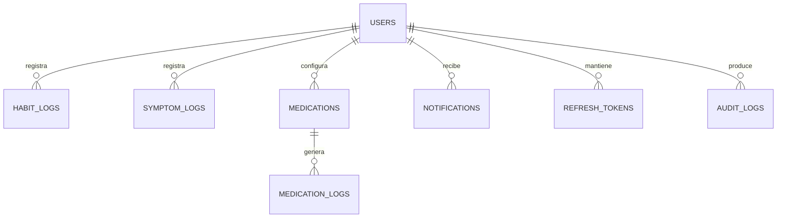
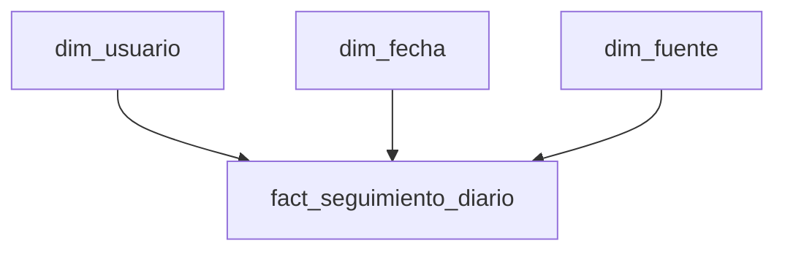

# Almacén de Datos — VitalMind AI

## 1. Propósito

Este documento distingue la base de datos operacional disponible en el proyecto del modelo analítico requerido por la guía del Proyecto Integrador.


## 2. Base de datos operacional observada

| Elemento | Configuración |
|---|---|
| Motor | MySQL 8 |
| Motor de almacenamiento | InnoDB |
| Juego de caracteres | `utf8mb4` |
| Acceso desde backend | `mysql2` |
| Nombre local observado | `vitalmind` |

La conexión se administra mediante variables de entorno.

## 3. Tablas presentes en el respaldo

```text
appointments
audit_logs
habit_logs
medical_history_items
medication_logs
medications
notifications
refresh_tokens
symptom_logs
users
```

Para el alcance actual tienen relación directa:

| Tabla | Uso |
|---|---|
| `users` | Cuenta y perfil |
| `habit_logs` | Hábitos por fecha |
| `symptom_logs` | Síntomas y mediciones |
| `medications` | Medicamentos, dosis y horarios |
| `medication_logs` | Confirmaciones y estados de toma |
| `notifications` | Recordatorios y avisos |
| `refresh_tokens` | Renovación de sesión |
| `audit_logs` | Trazabilidad |

El respaldo conserva tablas de etapas previas. Su presencia no las convierte en parte central del alcance actual.

## 4. Ajustes observados en el backend

Las migraciones del backend amplían la estructura con campos como:

- `stress_level`;
- `energy_level`;
- `sleep_quality`;
- `log_date`;
- registros emocionales.

Estos campos permiten construir parte del contrato que utiliza el ML Service.

## 5. Relaciones operacionales principales



La cuenta de aplicación debe consultar únicamente sus propios registros.

## 6. Volumen del respaldo revisado

| Tabla | Registros |
|---|---:|
| `audit_logs` | 213 |
| `users` | 9 |
| `habit_logs` | 8 |
| `symptom_logs` | 8 |
| `medical_history_items` | 8 |
| `notifications` | 8 |
| `medications` | 7 |
| `medication_logs` | 5 |
| `appointments` | 4 |
| `refresh_tokens` | 0 |


## 7. Diferencia entre operación y análisis

| Aspecto | MySQL operacional | Dataset / Data Mart analítico |
|---|---|---|
| Objetivo | Ejecutar funciones de la aplicación | Analizar comportamiento histórico |
| Granularidad | Registros por módulo | Una fila por usuario y fecha |
| Fuente actual | Aplicación | Dataset sintético y transformación |
| Estructura | Relacional normalizada | Modelo dimensional simplificado |
| ML | El backend transforma datos disponibles | Fuente preparada para análisis |
| Estado | Disponible | Diseño documentado; carga dimensional no confirmada |

## 8. Mapeo operacional hacia ML

| Campo operacional | Campo ML |
|---|---|
| `habit_logs.water` | `water_glasses` |
| `habit_logs.exercise` | `exercise_minutes` |
| `habit_logs.sleep` | `sleep_hours` |
| `habit_logs.nutrition` | `healthy_meals_count` |
| `habit_logs.meditation` | `meditation_minutes` |
| `symptom_logs.temperature` | `temperature_c` |
| `symptom_logs.systolic` | `systolic_mmhg` |
| `symptom_logs.diastolic` | `diastolic_mmhg` |
| `symptom_logs.glucose` | `glucose_mg_dl` |
| `symptom_logs.heart_rate` | `heart_rate_bpm` |


## 9. Data Mart de seguimiento diario

### 9.1 Objetivo

Concentrar, por usuario y fecha, las variables necesarias para análisis de hábitos, mediciones, medicamentos y resultados de modelos.

### 9.2 Granularidad

**Una fila por usuario y fecha.**

Esta granularidad coincide con el dataset sintético y permite agregar información operacional diaria sin mezclar múltiples eventos en una sola métrica sin control.

### 9.3 Esquema

Se propone un esquema estrella simplificado:



### 9.4 Dimensiones

#### `dim_usuario`

| Campo | Tipo | Función |
|---|---|---|
| `usuario_key` | BIGINT | Clave sustituta |
| `user_id` | VARCHAR | Identificador de origen |
| `age` | INT | Edad disponible |
| `height_cm` | DECIMAL | Estatura disponible |

No se incluyen nombre, correo ni otros datos innecesarios para el análisis.

#### `dim_fecha`

| Campo | Tipo | Función |
|---|---|---|
| `fecha_key` | INT | Fecha `YYYYMMDD` |
| `fecha` | DATE | Fecha completa |
| `anio` | SMALLINT | Año |
| `mes` | TINYINT | Mes |
| `dia` | TINYINT | Día |
| `dia_semana` | TINYINT | Día de semana |

#### `dim_fuente`

| Campo | Tipo | Función |
|---|---|---|
| `fuente_key` | SMALLINT | Clave sustituta |
| `nombre_fuente` | VARCHAR | `manual`, `wear_os`, `simulacion` u otra fuente confirmada |
| `detalle` | VARCHAR | Descripción de procedencia |

`wear_os` solo deberá utilizarse cuando la medición provenga realmente del smartwatch.

### 9.5 Tabla de hechos: `fact_seguimiento_diario`

Medidas posibles:

```text
water_glasses
exercise_minutes
sleep_hours
healthy_meals_count
meditation_minutes
pain
temperature_c
systolic_mmhg
diastolic_mmhg
glucose_mg_dl
heart_rate_bpm
stress_level
energy_level
sleep_quality
medication_confirmations
wellbeing_score
risk_level
cluster_id
```


## 10. Script DDL de diseño

El siguiente script documenta el modelo propuesto. 

```sql
CREATE TABLE dim_usuario (
    usuario_key BIGINT AUTO_INCREMENT PRIMARY KEY,
    user_id VARCHAR(64) NOT NULL UNIQUE,
    age INT NULL,
    height_cm DECIMAL(6,2) NULL
);

CREATE TABLE dim_fecha (
    fecha_key INT PRIMARY KEY,
    fecha DATE NOT NULL UNIQUE,
    anio SMALLINT NOT NULL,
    mes TINYINT NOT NULL,
    dia TINYINT NOT NULL,
    dia_semana TINYINT NOT NULL
);

CREATE TABLE dim_fuente (
    fuente_key SMALLINT AUTO_INCREMENT PRIMARY KEY,
    nombre_fuente VARCHAR(40) NOT NULL UNIQUE,
    detalle VARCHAR(255) NULL
);

CREATE TABLE fact_seguimiento_diario (
    seguimiento_key BIGINT AUTO_INCREMENT PRIMARY KEY,
    usuario_key BIGINT NOT NULL,
    fecha_key INT NOT NULL,
    fuente_key SMALLINT NOT NULL,

    water_glasses DECIMAL(6,2) NULL,
    exercise_minutes DECIMAL(7,2) NULL,
    sleep_hours DECIMAL(5,2) NULL,
    healthy_meals_count INT NULL,
    meditation_minutes DECIMAL(7,2) NULL,

    pain DECIMAL(5,2) NULL,
    temperature_c DECIMAL(5,2) NULL,
    systolic_mmhg DECIMAL(6,2) NULL,
    diastolic_mmhg DECIMAL(6,2) NULL,
    glucose_mg_dl DECIMAL(7,2) NULL,
    heart_rate_bpm DECIMAL(6,2) NULL,

    stress_level DECIMAL(5,2) NULL,
    energy_level DECIMAL(5,2) NULL,
    sleep_quality DECIMAL(5,2) NULL,

    medication_confirmations INT NULL,
    wellbeing_score DECIMAL(6,2) NULL,
    risk_level VARCHAR(16) NULL,
    cluster_id INT NULL,

    UNIQUE KEY uq_usuario_fecha_fuente
        (usuario_key, fecha_key, fuente_key),

    CONSTRAINT fk_fact_usuario
        FOREIGN KEY (usuario_key)
        REFERENCES dim_usuario(usuario_key),

    CONSTRAINT fk_fact_fecha
        FOREIGN KEY (fecha_key)
        REFERENCES dim_fecha(fecha_key),

    CONSTRAINT fk_fact_fuente
        FOREIGN KEY (fuente_key)
        REFERENCES dim_fuente(fuente_key)
);
```

## 11. Justificación del diseño

El esquema evita copiar directamente el modelo transaccional y permite:

- consultar tendencias por fecha;
- combinar hábitos y mediciones en una granularidad controlada;
- registrar el origen de cada dato;
- almacenar resultados analíticos junto con la fecha de referencia;
- incorporar más adelante mediciones reales de Wear OS sin confundirlas con simulación;
- mantener identificadores operacionales fuera del modelo de Machine Learning cuando no son necesarios.

## 12. Flujo de carga previsto

```text
CSV sintético / MySQL operacional / Wear OS confirmado
                    ↓
            extracción controlada
                    ↓
          transformación y calidad
                    ↓
       dimensiones + hecho diario
                    ↓
          análisis y reporting
```

En el estado actual, el flujo de modelado carga archivos procesados y conjuntos temporales. 
## 13. Calidad del almacén

Al implementar la carga deben comprobarse:

- unicidad por usuario, fecha y fuente;
- claves sustitutas válidas;
- integridad referencial;
- fechas existentes en `dim_fecha`;
- valores numéricos en unidades correctas;
- procedencia de cada registro;
- ausencia de duplicados por reintentos;
- no mezclar datos sintéticos con datos reales sin marcar la fuente.


## 14. Seguridad

- secretos fuera del código;
- mínimo privilegio de la cuenta MySQL;
- cifrado en tránsito;
- contraseñas con hash;
- acceso a datos propios;
- auditoría;
- respaldo protegido;
- retención definida;
- no replicar PII innecesaria al Data Mart.

## 15. Estado

| Elemento | Estado |
|---|---|
| Base MySQL operacional | Disponible |
| Acceso desde backend | Código disponible |
| Dataset analítico sintético | Disponible |
| Modelo dimensional | Diseñado en este documento |
| Script DDL del Data Mart | Documentado |
| Smartwatch Wear OS | Plataforma confirmada |
| Bluetooth | Confirmado |


