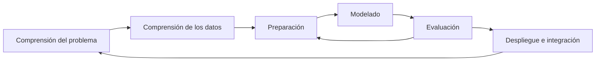

# Metodología del Proyecto VitalMind AI

## 1. Propósito

El proyecto combina desarrollo de software y extracción de conocimiento. Para evitar confundir ambos procesos se utilizan dos marcos con responsabilidades distintas:

- **CRISP-DM**: metodología principal para el análisis de datos y Machine Learning.
- **Scrum**: apoyo para planeación y seguimiento del trabajo de software y documentación.

CRISP-DM organiza la evidencia requerida por el Proyecto Integrador; Scrum ayuda a distribuir actividades, responsables y fechas.

## 2. Justificación de CRISP-DM

CRISP-DM resulta adecuado porque permite mantener trazabilidad entre el problema, los datos, las transformaciones, los modelos y la integración. Sus seis fases pueden repetirse cuando se detecta un problema de calidad o cambia una decisión técnica.

## 3. Aplicación de CRISP-DM

### 3.1 Comprensión del problema

Se define la necesidad de organizar registros personales y convertir datos históricos en resultados preventivos. Las preguntas de análisis se encuentran en `context.md`.

Entregables relacionados:

- contexto y problemática;
- objetivos;
- preguntas de análisis;
- limitaciones;
- propuestas de aplicación.

### 3.2 Comprensión de los datos

Se revisan origen, estructura, tipos, nulos, duplicados, rangos, distribución de clases, relaciones entre variables y variables exclusivas de simulación.

Entregables:

- `data-sources.md`;
- `data-dictionary.md`;
- notebook EDA disponible en el servicio de ML;
- `simulation-rules.md`.

### 3.3 Preparación de los datos

Incluye validación estructural, limpieza, tratamiento de faltantes, recálculo de atributos, separación temporal, imputación aprendida solo con entrenamiento, transformación categórica y exclusión de variables con fuga de información.

Entregable principal: `etl-process.md`.

### 3.4 Modelado

Se compararon:

- Regresión Logística y Random Forest para clasificación;
- Ridge, Random Forest Regressor y Dummy Regressor para regresión;
- K-Means con diferentes valores de `k`;
- PCA para reducción de dimensionalidad y visualización;
- Isolation Forest para anomalías.

### 3.5 Evaluación

La evaluación considera métricas de clasificación y regresión, matriz de confusión, métricas internas de clustering, varianza explicada por PCA, revisión de anomalías y un conjunto temporal de prueba separado.

### 3.6 Despliegue e integración

La inferencia supervisada se sirve mediante FastAPI y se consume desde el backend. El mecanismo K-Means cuenta con artefacto serializado, pero todavía no dispone de un endpoint específico de consumo, por lo que ese requisito de la guía permanece pendiente.

La aplicación actual se desarrolla en Kotlin con Android Studio. El smartwatch utiliza Wear OS y se comunica por Bluetooth. El modelo del reloj y la API o SDK de salud continúan sin confirmarse.

## 4. Relación entre fases y entregables

| Fase CRISP-DM | Actividad del proyecto | Evidencia principal |
|---|---|---|
| Comprensión del problema | Contexto, preguntas, objetivos, alcance | `context.md` |
| Comprensión de datos | Fuentes, atributos, EDA | `data-sources.md`, `data-dictionary.md` |
| Preparación | Simulación, limpieza, split temporal | `simulation-rules.md`, `etl-process.md` |
| Modelado | Clasificación, regresión, clustering, PCA, anomalías | scripts y artefactos del ML Service |
| Evaluación | Comparaciones, tuning y prueba final | `model-evaluation.md` |
| Despliegue | API supervisada e integración con backend | `api-contracts.md` |
| Validación transversal | Dataset, API, interfaz, seguridad | `testing.md` |

## 5. Scrum como apoyo de gestión

Scrum se utiliza como referencia de organización del trabajo. Las actividades se manejan por periodos, responsables y dependencias. Jira ha sido utilizado como herramienta de gestión del proyecto.

## 6. Organización del equipo

| Integrante | Participación principal |
|---|---|
| Yazmin Gutierrez Hernandez | Planeación, diseño de la aplicación, interfaz de smartwatch y visualización |
| Obed Guzmán Flores | Investigación, requerimientos y documentación |
| Citlalli Perez Dionicio | Preparación y planificación de pruebas |
| Michelle Castro Otero | Modelo de datos y módulos de análisis e IA |
| Carlos Daniel Garcia Pluma | Backend|
| Jennifer Bautista Barrios | Backend |
| Equipo completo | Integración final y entrega académica |

## 7. Planeación temporal

| ID | Actividad | Inicio | Fin | Estado |
|---|---|---|---|---|
| T01 | Planeación del proyecto | 20/05/2026 | 29/05/2026 | Concluido |
| T02 | Investigación y contexto | 25/05/2026 | 05/06/2026 | Concluido |
| T03 | Definición de requerimientos | 01/06/2026 | 12/06/2026 | Concluido |
| T04 | Diseño de la aplicación | 08/06/2026 | 19/06/2026 | Concluido |
| T05 | Diseño de interfaz para smartwatch | 31/07/2026 | 08/08/2026 | Concluido |
| T06 | Modelo de datos | 25/07/2026 | 06/08/2026 | Concluido |
| T07 | Servicios backend | 16/07/2026 | 16/08/2026 | Concluido |
| T08 | Sincronización con smartwatch | 28/07/2026 | 16/08/2026 | En proceso |
| T09 | Visualización de mediciones | 28/07/2026 | 16/08/2026 | Concluido |
| T10 | Registro digital de medicamentos | 13/07/2026 | 24/07/2026 | Concluido |
| T11 | Recordatorios y confirmación manual | 28/07/2026 | 04/08/2026 | Concluido |
| T12 | Módulos de análisis e IA | 27/07/2026 | 07/08/2026 | Concluido |
| T13 | Seguridad y privacidad | 03/08/2026 | 10/08/2026 | Concluido|
| T14 | Preparación y pruebas planificadas | 05/08/2026 | 17/08/2026 | Concluido |
| T15 | Documentación continua | 20/05/2026 | 18/08/2026 | Concluido |
| T16 | Integración final | 10/08/2026 | 20/08/2026 | En proceso |
| T17 | Entrega académica | 14/08/2026 | 20/08/2026 | En proceso |

## 8. Criterios de aceptación

### 8.1 Datos

- estructura reproducible;
- identificadores únicos;
- reglas de calidad documentadas;
- separación temporal antes de aprender estadísticas;
- exclusión de variables con fuga.

### 8.2 Modelos

- comparación entre alternativas;
- hiperparámetros registrados;
- evaluación con métricas adecuadas;
- modelo serializado;
- interpretación de limitaciones.

### 8.3 API

- entrada validada;
- respuesta estructurada;
- versión del modelo;
- manejo de errores;
- sin secretos en respuestas;
- documentación OpenAPI.

### 8.4 Integración

- consumo real del endpoint;
- visualización del resultado;
- tratamiento de errores;
- evidencia de ejecución;
- para Wear OS, conexión Bluetooth comprobada en el dispositivo seleccionado.

## 9. Herramientas y tecnologías

| Área | Herramienta o tecnología |
|---|---|
| Gestión | Jira |
| Diseño | Figma |
| Aplicación Android | Kotlin |
| IDE | Android Studio |
| Wearable | Wear OS |
| Comunicación reloj-app | Bluetooth |
| Backend | Node.js, Express |
| Base de datos | MySQL |
| ML Service | Python, FastAPI, scikit-learn |
| IA conversacional | Mistral AI |
| Documentación API | Swagger / OpenAPI |
| Versionamiento | Git |
| Dashboard entregado | HTML, JavaScript, Chart.js |
| Documentación | Markdown |

## 10. Flujo de trabajo por área

### 10.1 Aplicación y wearable

- diseño de pantallas;
- implementación Android en Kotlin;
- interfaz para Wear OS;
- comunicación Bluetooth;
- consumo del backend;
- manejo de estados de carga y error.

### 10.2 Backend

- endpoints REST;
- autenticación y validación;
- acceso a MySQL;
- integración con ML Service;
- manejo de errores;
- documentación Swagger.

### 10.3 Datos

- simulación;
- validación;
- ETL;
- EDA;
- división temporal;
- trazabilidad de transformaciones.

### 10.4 Machine Learning

- comparación de algoritmos;
- ajuste de hiperparámetros;
- evaluación;
- serialización;
- inferencia;
- análisis no supervisado;
- reducción de dimensionalidad.

### 10.5 Pruebas

- dataset;
- simulación;
- ETL;
- modelos;
- API;
- aplicación;
- Bluetooth;
- integración;
- Socket.IO cuando sea implementado.

## 11. Control de cambios

Cuando cambia un requisito se debe:

1. identificar módulos y documentos afectados;
2. revisar dependencias;
3. actualizar la tarea correspondiente;
4. modificar código o documentación;
5. volver a ejecutar las pruebas relacionadas;
6. mantener el estado real de la funcionalidad.

## 12. Evidencias

Una actividad solo debe marcarse como verificada cuando exista un archivo o resultado que la respalde. Las evidencias válidas pueden ser notebooks, datasets, reportes de métricas, modelos serializados, salidas de pruebas, documentación Swagger, capturas originales, video de demostración, registros de Jira e historial real de Git/GitHub.

No deben crearse evidencias retrospectivas que parezcan originales.

## 13. Conclusión

CRISP-DM es la metodología de análisis que da estructura al ciclo de datos, mientras que Scrum se utiliza para organizar el trabajo del equipo. La separación permite explicar con claridad qué parte corresponde a gestión y qué parte corresponde a extracción de conocimiento. La documentación registra tanto los componentes disponibles como los requisitos que todavía necesitan implementación o evidencia.
