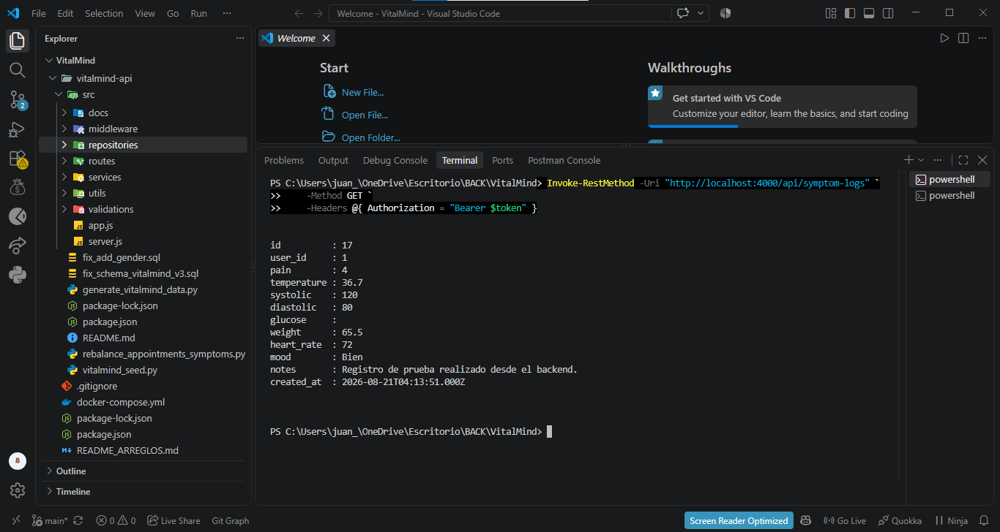
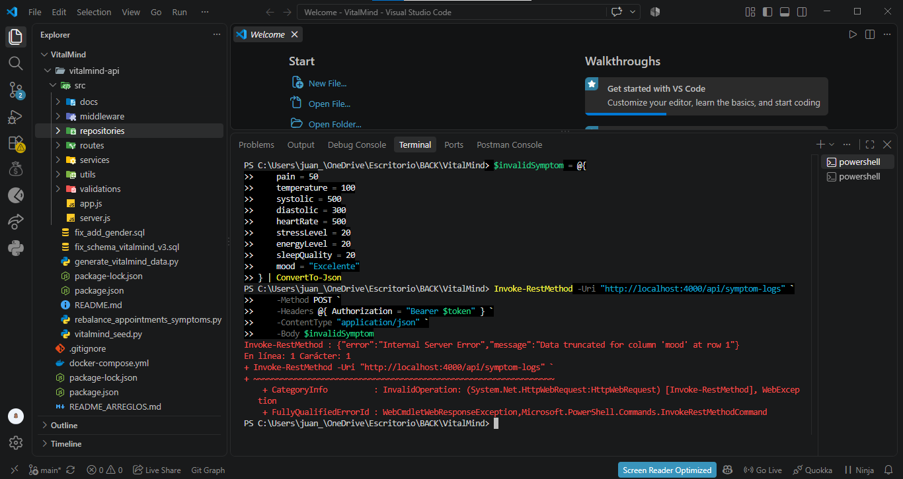
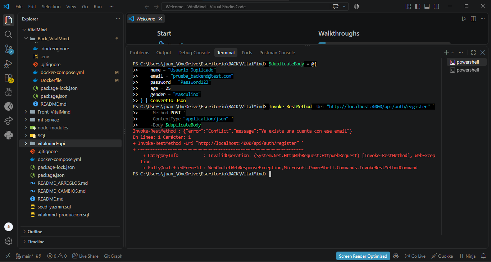
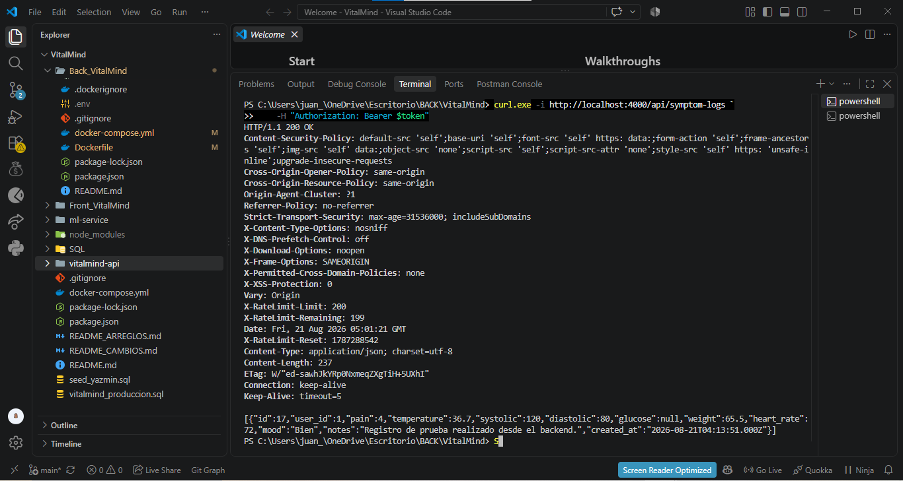
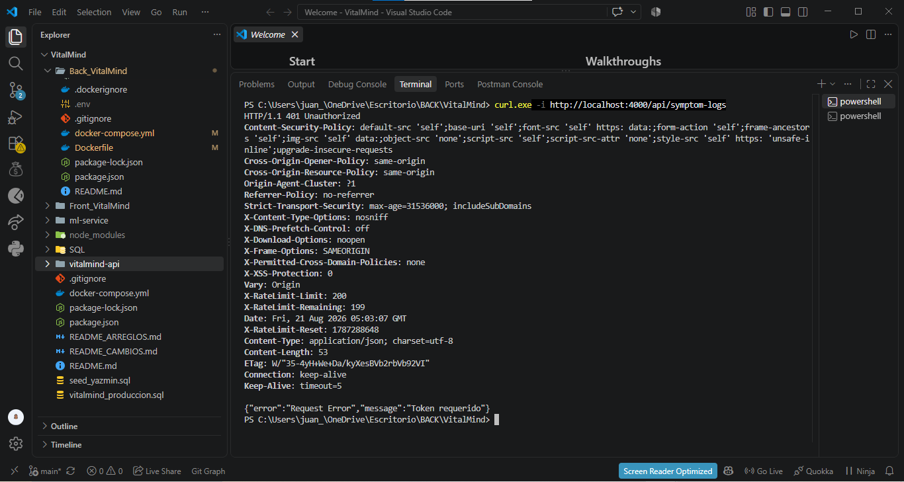
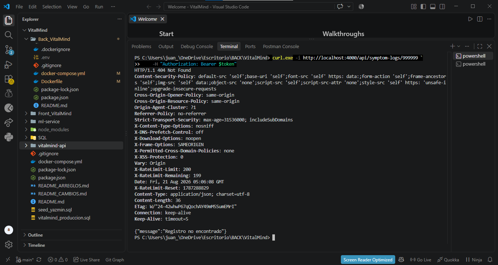
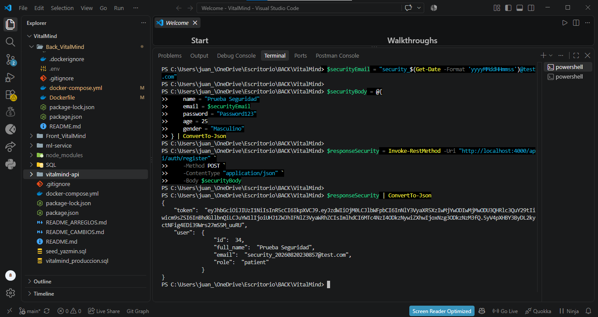

# Resultados de Pruebas de Backend

**Entorno de prueba:** VitalMind (Docker Compose)

**Responsable:** Citlalli Pérez Dionicio

**Servicios probados:** Backend + MySQL

---

## Caso 1: Estado del entorno

**Resultado:** OK

**Detalle:** Se verificó que los contenedores necesarios para la ejecución del sistema se encontraran activos (ml-service, frontend, backend, mysql).

### Evidencia

---

## Caso 2: Conexión Backend - MySQL

**Resultado:** OK (con observación)

**Detalle:** Se verificó que el Backend iniciara correctamente y estableciera conexión con MySQL (`MySQL: connected`).

**Observación:** En los logs revisados también se detectó que el proceso del backend se detuvo y se reinició de forma automática (`npm error command failed`, `signal SIGTERM`) durante la sesión de pruebas. Además, se observaron en el mismo log peticiones reales con código `401` en `/api/auth/login` y `500` en `/api/auth/register`, coincidiendo con los bugs documentados en los Casos 4 y 9 de este mismo reporte.

### Evidencia

---

## Caso 3: Estructura de usuarios

**Resultado:** OK

**Detalle:** Se verificó la estructura de la tabla `users` y la existencia del campo `gender`.

### Evidencia

---

## Caso 4: Validación de datos (BUG detectado)

**Resultado:** FALLÓ (parcialmente)

**Detalle:** Se envió una solicitud de registro con un campo mal nombrado (`full_name` en vez de `name`) para comprobar que el Backend detectara campos requeridos faltantes.

El Backend sí detectó que el campo `name` era requerido y no estaba presente, pero respondió con código **500 Internal Server Error** en lugar de **400 Bad Request**. Un error de validación de datos del cliente debería manejarse como una petición mal formada (400), no como un error interno del servidor (500).

**Impacto:** Documentado y trasladado a `fix/api-errors` para su corrección.

### Evidencia

---

## Caso 5: Registro de usuario

**Resultado:** OK

**Detalle:** Se realizó correctamente el registro de un usuario mediante `POST /api/auth/register`, con todos los campos requeridos completos.

### Evidencia

---

## Caso 6: Persistencia de datos

**Resultado:** OK

**Detalle:** Se verificó directamente en MySQL que el usuario registrado por medio del Backend fuera almacenado correctamente con todos sus campos.

### Evidencia

---

## Caso 7: Login correcto

**Resultado:** OK

**Detalle:** Se verificó el inicio de sesión utilizando credenciales válidas y se confirmó la generación del token JWT.

### Evidencia

---

## Caso 8: Login con credenciales inválidas

**Resultado:** OK

**Detalle:** Se verificó que el Backend rechazara credenciales incorrectas mediante una respuesta de error controlada (`401 Unauthorized`, `"Credenciales inválidas"`).

### Evidencia

---

## Caso 9: Protección de endpoints

**Resultado:** OK

**Detalle:** Se verificó que el endpoint `/api/recommendations` rechazara solicitudes sin token de autenticación, respondiendo `401 Unauthorized` con el mensaje `"Token requerido"`.

### Evidencia

---

## Caso 10: Registro de síntomas (BUG adicional detectado)

**Resultado:** OK (con bug detectado en prueba negativa)

**Detalle:** Se probó de forma aislada el endpoint `POST /api/symptom-logs` utilizando autenticación JWT. Se realizó un registro con datos válidos y posteriormente se consultó el listado para verificar su persistencia correcta.

También se realizó una prueba negativa enviando valores fuera de los rangos permitidos (ej. `systolic: 500`, `heartRate: 500`). El backend **no validó los datos antes de enviarlos a la base de datos**: respondió con `500 Internal Server Error` y expuso el mensaje interno de MySQL (`"Data truncated for column 'mood' at row 1"`), en vez de rechazar la solicitud con `400 Bad Request` de forma controlada.

**Impacto:** Igual que en el Caso 4, esto expone detalles internos del motor de base de datos al cliente y evidencia falta de validación previa. Documentado y trasladado a `fix/api-errors`.

### Evidencia

---

## Caso 11: Consulta de medicamentos

**Resultado:** OK

**Detalle:** Se probó de forma aislada el endpoint `GET /api/medications` utilizando autenticación JWT.

La solicitud realizada sin autenticación fue correctamente rechazada con `401 Unauthorized`, mientras que la solicitud autenticada respondió correctamente con `200 OK`.

Durante esta prueba aislada no se reprodujo el error `500 Internal Server Error` identificado previamente durante las pruebas de integración.

### Evidencia

---

## Caso 12: Registro con correo duplicado

**Resultado:** OK

**Detalle:** Se intentó registrar un nuevo usuario utilizando un correo electrónico que ya se encontraba registrado en la base de datos.

El Backend detectó correctamente la duplicidad y rechazó la solicitud mediante una respuesta **409 Conflict**, mostrando el mensaje `"Ya existe una cuenta con ese email"`.

Esto confirma que el Backend maneja de forma controlada los registros duplicados y evita la creación de cuentas con correos electrónicos existentes.

### Evidencia

---

## Caso 13: Token inválido o malformado

**Resultado:** OK

**Detalle:** Se realizó una solicitud a un endpoint protegido utilizando un token JWT inválido/malformado.

El Backend rechazó correctamente la solicitud mediante una respuesta `401 Unauthorized` y devolvió el mensaje `"Token inválido o expirado"`.

Esto confirma que el middleware de autenticación valida correctamente los tokens recibidos y evita el acceso a recursos protegidos cuando la credencial no es válida.

### Evidencia

---

## Caso 14: Consulta de registros de síntomas

**Resultado:** OK

**Detalle:** Se verificó de forma aislada el endpoint `GET /api/symptom-logs` utilizando autenticación JWT. El Backend respondió `200 OK` y devolvió correctamente los registros asociados al usuario autenticado.

### Evidencia

---

## Caso 15: Protección de registros de síntomas

**Resultado:** OK

**Detalle:** Se verificó que el endpoint `GET /api/symptom-logs` rechazara solicitudes sin autenticación JWT. El Backend respondió correctamente con `401 Unauthorized`.

### Evidencia

---

## Caso 16: Consulta de síntoma por ID

**Resultado:** OK

**Detalle:** Se verificó de forma aislada el endpoint `GET /api/symptom-logs/:id` utilizando autenticación JWT. Se consultó el registro con ID `17` y el Backend respondió `200 OK`, devolviendo correctamente la información almacenada del registro.

### Evidencia

---

## Caso 17: Consulta de síntoma inexistente

**Resultado:** OK

**Detalle:** Se verificó el comportamiento del endpoint `GET /api/symptom-logs/:id` al solicitar un registro que no existe. El Backend respondió correctamente con `404 Not Found` y el mensaje `"Registro no encontrado"`.

Esto confirma que la API diferencia correctamente entre un recurso existente y uno inexistente, evitando responder con un error interno `500`.

### Evidencia

---

## Caso 18: Verificación de operaciones CRUD de síntomas

**Resultado:** PARCIAL

**Detalle:** Se revisaron las rutas disponibles para la gestión de registros de síntomas. Se confirmó la implementación de las operaciones de creación (`POST`), consulta general (`GET`), consulta por ID (`GET /:id`) y consulta de datos para gráfica (`GET /chart`).

No se encontraron endpoints `PUT` ni `DELETE`, por lo que las operaciones de actualización y eliminación no se encuentran implementadas actualmente.

**Observación:** La funcionalidad de síntomas actualmente permite crear y consultar registros, pero no cuenta con operaciones de actualización o eliminación. Por este motivo, el CRUD no se encuentra completo.

### Evidencia

---

## Caso 19: Protección de credenciales en registro

**Resultado:** OK

**Detalle:** Se verificó que la respuesta de `POST /api/auth/register` no expusiera información sensible relacionada con las credenciales del usuario.

La respuesta incluyó únicamente información necesaria del usuario (`id`, `full_name`, `email` y `role`) junto con el token de autenticación. No se encontró ningún campo `password` ni `password_hash` en la respuesta JSON.

### Evidencia

---
## Resumen general

| Caso | Resultado |
|---|---|
| 1. Estado del entorno | OK |
| 2. Conexión Backend - MySQL | OK (con observación) |
| 3. Estructura de usuarios | OK |
| 4. Validación de datos | FALLÓ (bug 500 en vez de 400) |
| 5. Registro de usuario | OK |
| 6. Persistencia en MySQL | OK |
| 7. Login correcto | OK |
| 8. Login inválido | OK |
| 9. Protección de endpoints | OK |
| 10. Registro de síntomas | OK |
| 11. Consulta de medicamentos | OK |
| 12. Correo duplicado | OK |
| 13. Token inválido | OK |
| 14. Operaciones de síntomas | OK (parcial) |
| 15. Protección de síntomas | OK |
| 16. Contraseña débil | FALLÓ (bug 500 en vez de 400) |

### Resultado final

Las pruebas realizadas sobre el Backend de VitalMind fueron satisfactorias en los casos funcionales evaluados.

Se verificó el funcionamiento del entorno, la comunicación entre el Backend y MySQL, la estructura de usuarios, el registro y autenticación de usuarios, la persistencia de información, el registro de síntomas, la consulta de medicamentos y la protección de endpoints mediante autenticación JWT.

También se realizaron pruebas negativas para validar el comportamiento del Backend ante datos incorrectos, credenciales inválidas, correos duplicados, ausencia de autenticación y tokens inválidos.

Durante las pruebas se detectaron dos ocurrencias del mismo tipo de bug en el manejo de
errores de validación: en el registro de usuario (Caso 4) y en el registro de síntomas
(Caso 10), donde una solicitud con datos incorrectos genera `500 Internal Server Error`
en lugar de `400 Bad Request`, exponiendo en el segundo caso el mensaje interno de MySQL.
Esto sugiere que la falta de validación previa a nivel de aplicación es un patrón
recurrente en el Backend, no un caso aislado. Ambas incidencias fueron documentadas y
trasladadas a la rama `fix/api-errors` para su corrección.

Asimismo, el error `500 Internal Server Error` identificado previamente en la consulta de medicamentos durante las pruebas de integración no se reprodujo durante la prueba aislada del Backend. La solicitud autenticada al endpoint `GET /api/medications` respondió correctamente con `200 OK`.

### Evidencia final del entorno

En general, las pruebas permitieron confirmar que el Backend funciona correctamente en los escenarios evaluados y que cuenta con mecanismos de autenticación, validación y manejo controlado de solicitudes inválidas.