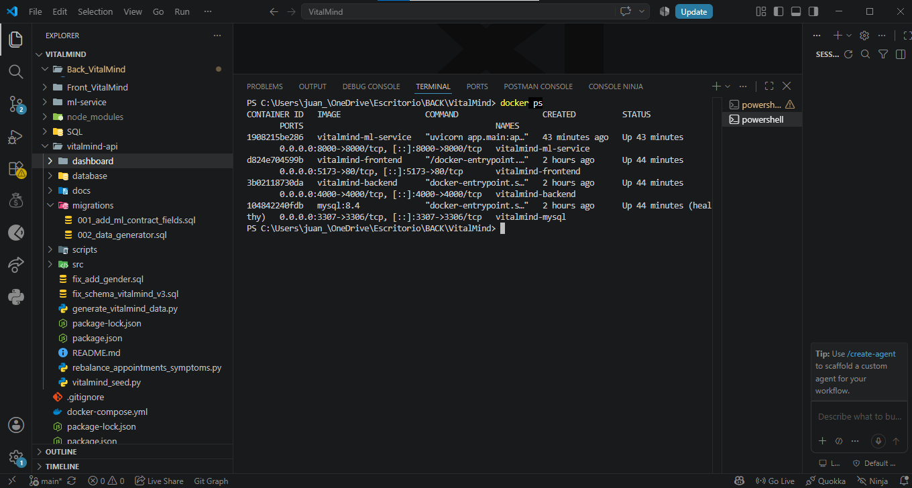
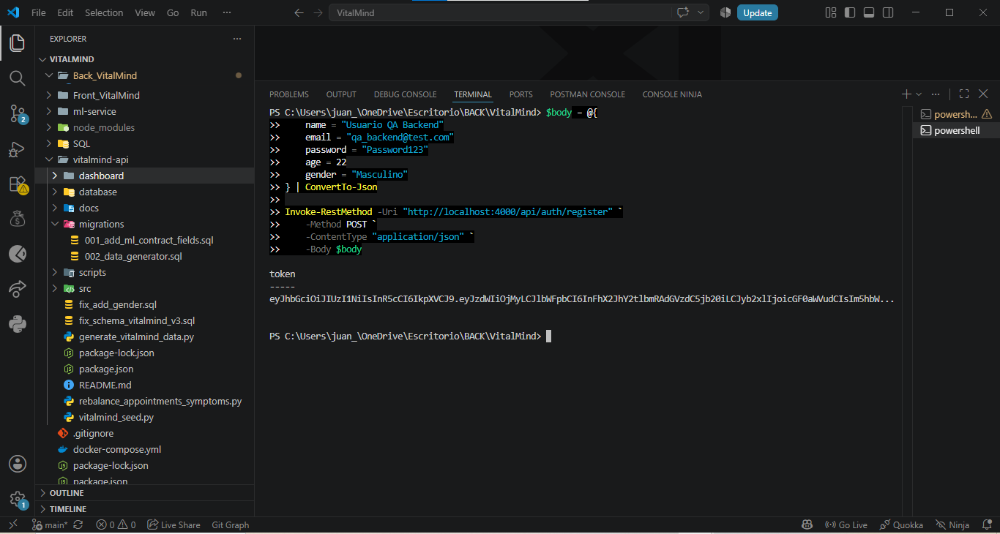
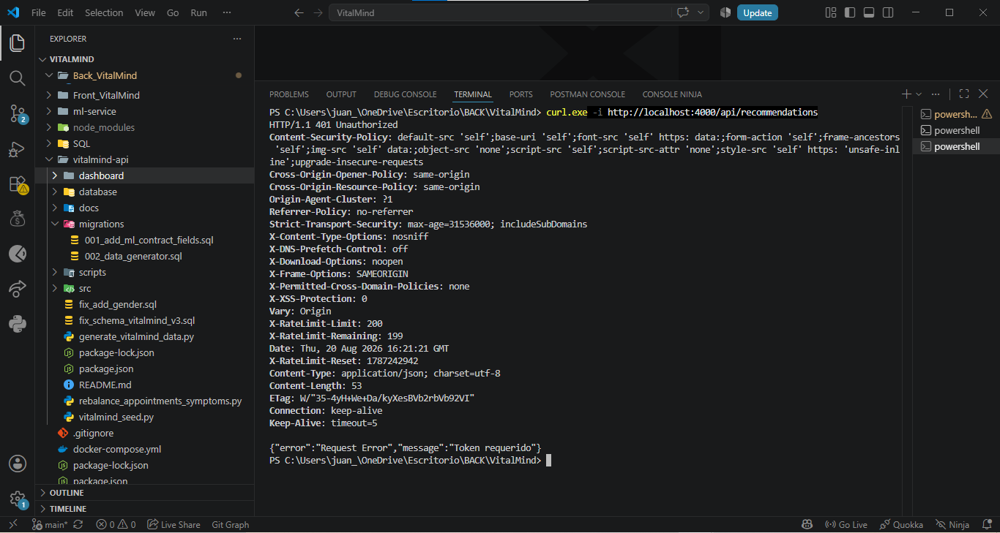
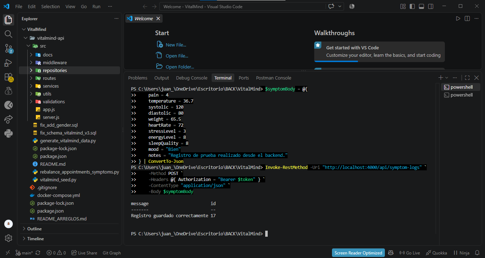
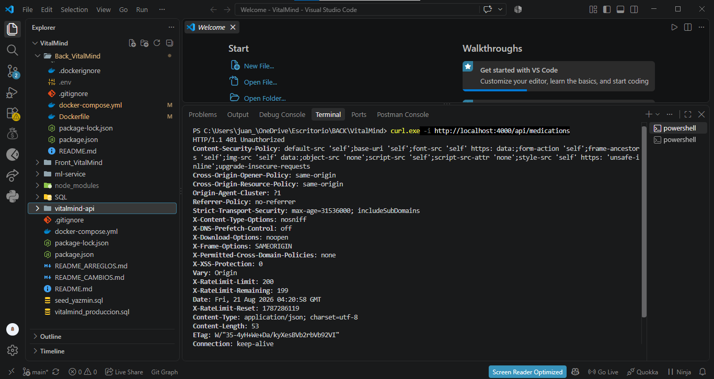

# Resultados de Pruebas de Backend

**Entorno de prueba:** VitalMind (Docker Compose)

**Responsable:** Citlalli Pérez Dionicio

**Servicios probados:** Backend + MySQL

---

## Caso 1: Estado del entorno

**Resultado:** OK

**Detalle:** Se verificó que los contenedores necesarios para la ejecución del sistema se encontraran activos (ml-service, frontend, backend, mysql).

### Evidencia

---

## Caso 2: Conexión Backend - MySQL

**Resultado:** OK (con observación)

**Detalle:** Se verificó que el Backend iniciara correctamente y estableciera conexión con MySQL (`MySQL: connected`).

**Observación:** En los logs revisados también se detectó que el proceso del backend se detuvo y se reinició de forma automática (`npm error command failed`, `signal SIGTERM`) durante la sesión de pruebas. Además, se observaron en el mismo log peticiones reales con código `401` en `/api/auth/login` y `500` en `/api/auth/register`, coincidiendo con los bugs documentados en los Casos 4 y 9 de este mismo reporte.

### Evidencia

---

## Caso 3: Estructura de usuarios

**Resultado:** OK

**Detalle:** Se verificó la estructura de la tabla `users` y la existencia del campo `gender`.

### Evidencia

---

## Caso 4: Validación de datos (BUG detectado)

**Resultado:** FALLÓ (parcialmente)

**Detalle:** Se envió una solicitud de registro con un campo mal nombrado (`full_name` en vez de `name`) para comprobar que el Backend detectara campos requeridos faltantes.

El Backend sí detectó que el campo `name` era requerido y no estaba presente, pero respondió con código **500 Internal Server Error** en lugar de **400 Bad Request**. Un error de validación de datos del cliente debería manejarse como una petición mal formada (400), no como un error interno del servidor (500).

**Impacto:** Documentado y trasladado a `fix/api-errors` para su corrección.

### Evidencia

---

## Caso 5: Registro de usuario

**Resultado:** OK

**Detalle:** Se realizó correctamente el registro de un usuario mediante `POST /api/auth/register`, con todos los campos requeridos completos.

### Evidencia

---

## Caso 6: Persistencia de datos

**Resultado:** OK

**Detalle:** Se verificó directamente en MySQL que el usuario registrado por medio del Backend fuera almacenado correctamente con todos sus campos.

### Evidencia

---

## Caso 7: Login correcto

**Resultado:** OK

**Detalle:** Se verificó el inicio de sesión utilizando credenciales válidas y se confirmó la generación del token JWT.

### Evidencia

---

## Caso 8: Login con credenciales inválidas

**Resultado:** OK

**Detalle:** Se verificó que el Backend rechazara credenciales incorrectas mediante una respuesta de error controlada (`401 Unauthorized`, `"Credenciales inválidas"`).

### Evidencia

---

## Caso 9: Protección de endpoints

**Resultado:** OK

**Detalle:** Se verificó que el endpoint `/api/recommendations` rechazara solicitudes sin token de autenticación, respondiendo `401 Unauthorized` con el mensaje `"Token requerido"`.

### Evidencia

---

## Caso 10: Registro de síntomas

**Resultado:** OK

**Detalle:** Se probó de forma aislada el endpoint `POST /api/symptom-logs` utilizando autenticación JWT. Se realizó un registro con datos válidos y posteriormente se consultó el listado para verificar su persistencia. También se realizó una prueba negativa utilizando valores fuera de los rangos permitidos para comprobar el manejo de validaciones.

### Evidencia

---

## Caso 11: Consulta de medicamentos

**Resultado:** OK

**Detalle:** Se probó de forma aislada el endpoint `GET /api/medications` utilizando autenticación JWT.

La solicitud realizada sin autenticación fue correctamente rechazada con `401 Unauthorized`, mientras que la solicitud autenticada respondió correctamente con `200 OK`.

Durante esta prueba aislada no se reprodujo el error `500 Internal Server Error` identificado previamente durante las pruebas de integración.

### Evidencia

---

## Caso 12: Registro con correo duplicado

**Resultado:** OK

**Detalle:** Se intentó registrar un nuevo usuario utilizando un correo electrónico que ya se encontraba registrado en la base de datos.

El Backend detectó correctamente la duplicidad y rechazó la solicitud mediante una respuesta **409 Conflict**, mostrando el mensaje `"Ya existe una cuenta con ese email"`.

Esto confirma que el Backend maneja de forma controlada los registros duplicados y evita la creación de cuentas con correos electrónicos existentes.

### Evidencia

---

## Caso 13: Token inválido o malformado

**Resultado:** _[pendiente]_

**Detalle:** Se probará el acceso a un endpoint protegido enviando un token corrupto/malformado (distinto de no enviar token), verificando que el Backend responda `401` de forma controlada.

### Evidencia

_[pendiente]_

---

## Resumen general

| Caso | Resultado |
|---|---|
| 1. Estado del entorno | OK |
| 2. Conexión Backend - MySQL | OK (con observación) |
| 3. Estructura de usuarios | OK |
| 4. Validación de datos | FALLÓ (bug 500 en vez de 400) |
| 5. Registro de usuario | OK |
| 6. Persistencia en MySQL | OK |
| 7. Login correcto | OK |
| 8. Login inválido | OK |
| 9. Protección de endpoints | OK |
| 10. Registro de síntomas | Pendiente |
| 11. Medicamentos (bug) | Pendiente |
| 12. Correo duplicado | Pendiente |
| 13. Token inválido | Pendiente |

### Resultado final

_[se completa al finalizar todos los casos]_

Hasta ahora, las pruebas confirman que el Backend se comunica correctamente con MySQL, y que el registro, login y protección de endpoints funcionan como se espera. Se detectó un bug real en el manejo de errores de validación (Caso 4: responde 500 en vez de 400), documentado en `fix/api-errors` para su corrección.