# Resultados de Pruebas de Backend

**Entorno de prueba:** VitalMind (Docker Compose)

**Responsable:** Citlalli Pérez Dionicio

**Servicios probados:** Backend + MySQL

---

## Caso 1: Estado del entorno

**Resultado:** OK

**Detalle:** Se verificó que los contenedores necesarios para la ejecución del sistema se encontraran activos (ml-service, frontend, backend, mysql).

### Evidencia

---

## Caso 2: Conexión Backend - MySQL

**Resultado:** OK (con observación)

**Detalle:** Se verificó que el Backend iniciara correctamente y estableciera conexión con MySQL (`MySQL: connected`).

**Observación:** En los logs revisados también se detectó que el proceso del backend se detuvo y se reinició de forma automática (`npm error command failed`, `signal SIGTERM`) durante la sesión de pruebas. Además, se observaron en el mismo log peticiones reales con código `401` en `/api/auth/login` y `500` en `/api/auth/register`, coincidiendo con los bugs documentados en este reporte.

### Evidencia

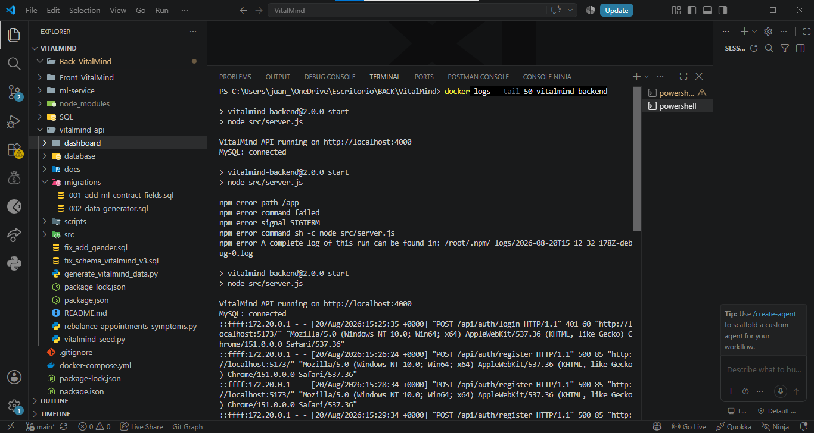

---

## Caso 3: Estructura de usuarios

**Resultado:** OK

**Detalle:** Se verificó la estructura de la tabla `users` y la existencia del campo `gender`.

### Evidencia

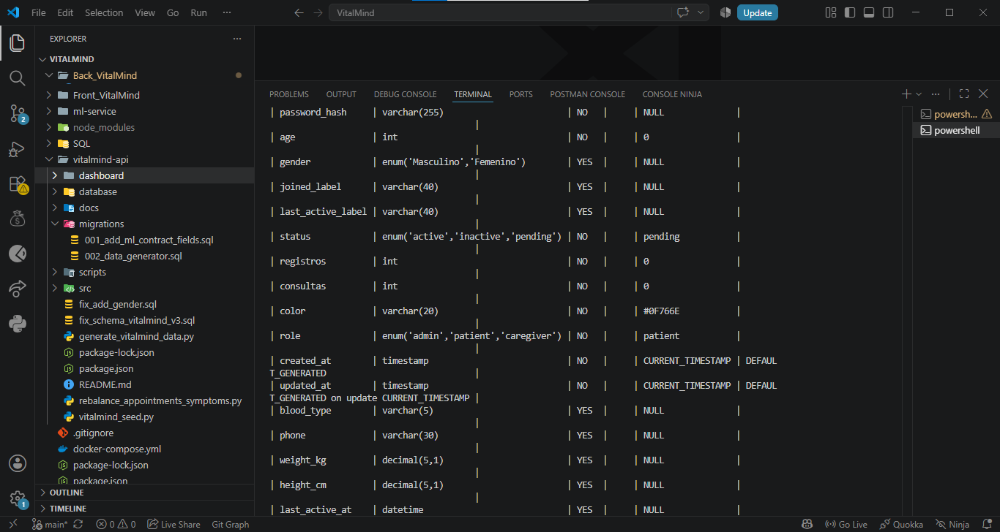

---

## Caso 4: Validación de datos - campo faltante (BUG detectado)

**Resultado:** FALLÓ (parcialmente)

**Detalle:** Se envió una solicitud de registro con un campo mal nombrado (`full_name` en vez de `name`) para comprobar que el Backend detectara campos requeridos faltantes.

El Backend sí detectó que el campo `name` era requerido y no estaba presente, pero respondió con código **500 Internal Server Error** en lugar de **400 Bad Request**.

**Impacto:** Documentado y trasladado a `fix/api-errors` para su corrección.

### Evidencia

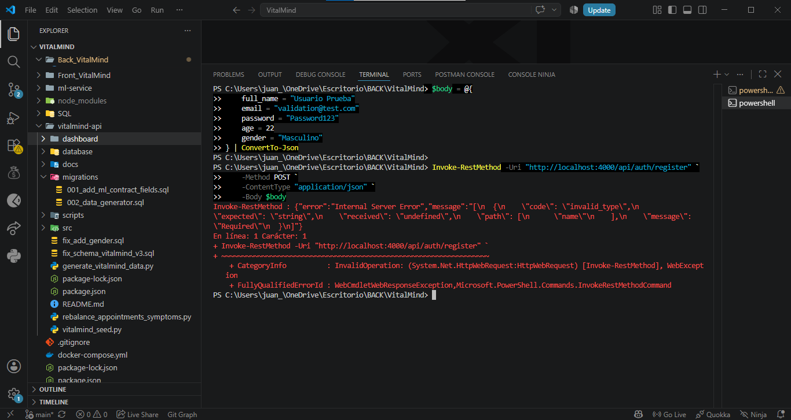

---

## Caso 5: Registro de usuario

**Resultado:** OK

**Detalle:** Se realizó correctamente el registro de un usuario mediante `POST /api/auth/register`, con todos los campos requeridos completos.

### Evidencia

---

## Caso 6: Persistencia de datos

**Resultado:** OK

**Detalle:** Se verificó directamente en MySQL que el usuario registrado por medio del Backend fuera almacenado correctamente con todos sus campos.

### Evidencia

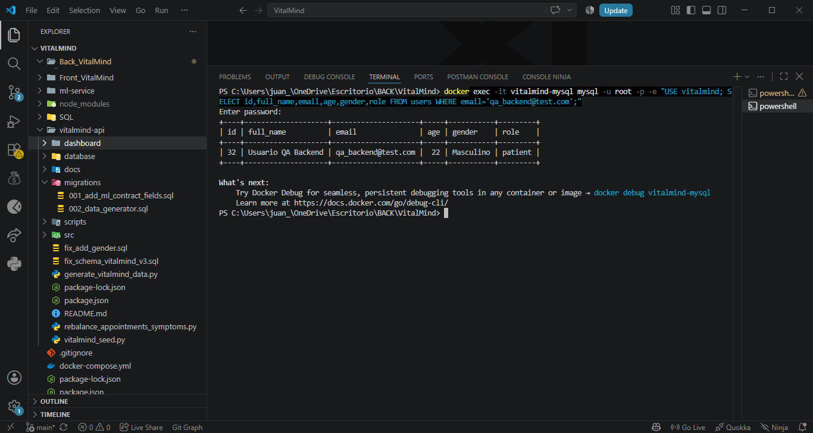

---

## Caso 7: Login correcto

**Resultado:** OK

**Detalle:** Se verificó el inicio de sesión utilizando credenciales válidas y se confirmó la generación del token JWT.

### Evidencia

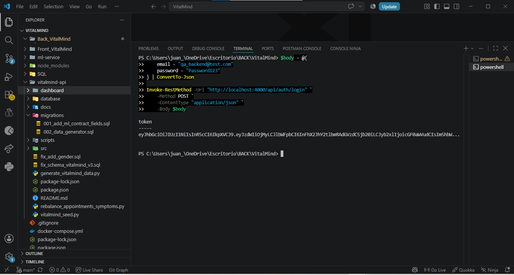

---

## Caso 8: Login con credenciales inválidas

**Resultado:** OK

**Detalle:** Se verificó que el Backend rechazara credenciales incorrectas mediante una respuesta de error controlada (`401 Unauthorized`, `"Credenciales inválidas"`).

### Evidencia

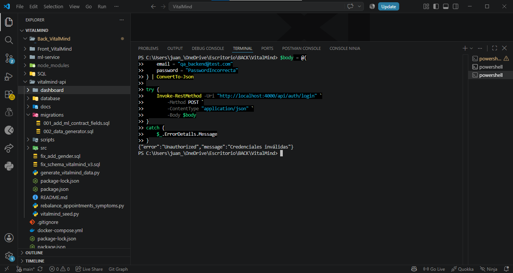

---

## Caso 9: Protección de endpoints

**Resultado:** OK

**Detalle:** Se verificó que el endpoint `/api/recommendations` rechazara solicitudes sin token de autenticación, respondiendo `401 Unauthorized` con el mensaje `"Token requerido"`.

### Evidencia

---

## Caso 10: Registro de síntomas - datos fuera de rango (BUG adicional detectado)

**Resultado:** OK (con bug detectado en prueba negativa)

**Detalle:** Se probó de forma aislada el endpoint `POST /api/symptom-logs` utilizando autenticación JWT. Se realizó un registro con datos válidos y posteriormente se consultó el listado para verificar su persistencia correcta.

También se realizó una prueba negativa enviando valores fuera de los rangos permitidos (ej. `systolic: 500`, `heartRate: 500`). El backend respondió con `500 Internal Server Error` y expuso el mensaje interno de MySQL (`"Data truncated for column 'mood' at row 1"`), en vez de rechazar la solicitud con `400 Bad Request`.

**Impacto:** Documentado y trasladado a `fix/api-errors`.

### Evidencia

---

## Caso 11: Consulta de medicamentos

**Resultado:** OK

**Detalle:** Se probó de forma aislada el endpoint `GET /api/medications` utilizando autenticación JWT. La solicitud sin autenticación fue rechazada con `401 Unauthorized`, mientras que la solicitud autenticada respondió correctamente con `200 OK`.

Durante esta prueba aislada no se reprodujo el error `500 Internal Server Error` identificado previamente durante las pruebas de integración.

### Evidencia

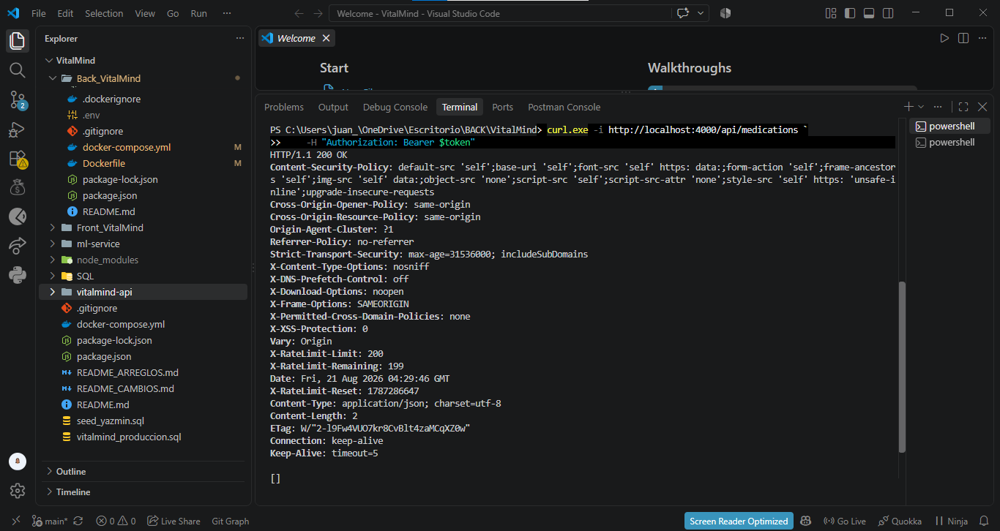

---

## Caso 12: Registro con correo duplicado

**Resultado:** OK

**Detalle:** Se intentó registrar un nuevo usuario utilizando un correo electrónico que ya se encontraba registrado. El Backend rechazó la solicitud con `409 Conflict`, mostrando el mensaje `"Ya existe una cuenta con ese email"`.

### Evidencia

---

## Caso 13: Token inválido o malformado

**Resultado:** OK

**Detalle:** Se realizó una solicitud a un endpoint protegido utilizando un token JWT inválido/malformado. El Backend respondió `401 Unauthorized` con el mensaje `"Token inválido o expirado"`.

### Evidencia

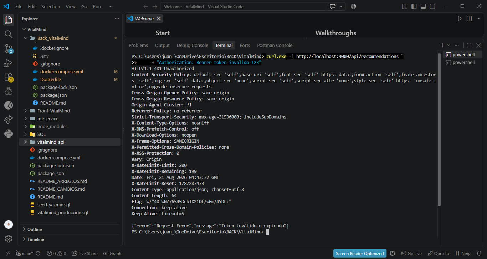

---

## Caso 14: Consulta de registros de síntomas

**Resultado:** OK

**Detalle:** Se verificó de forma aislada el endpoint `GET /api/symptom-logs` utilizando autenticación JWT. El Backend respondió `200 OK` y devolvió correctamente los registros asociados al usuario autenticado.

### Evidencia

---

## Caso 15: Protección de registros de síntomas

**Resultado:** OK

**Detalle:** Se verificó que el endpoint `GET /api/symptom-logs` rechazara solicitudes sin autenticación JWT, respondiendo `401 Unauthorized` con el mensaje `"Token requerido"`.

### Evidencia

---

## Caso 16: Validación de contraseña débil (BUG adicional detectado)

**Resultado:** FALLÓ (parcialmente)

**Detalle:** Se intentó registrar un usuario con una contraseña débil (`"123"`, menor a 6 caracteres) para comprobar que el Backend rechazara contraseñas inseguras.

El Backend sí detectó correctamente que la contraseña no cumplía el mínimo de 6 caracteres (`"String must contain at least 6 character(s)"`), pero respondió con **500 Internal Server Error** en lugar de **400 Bad Request**.

**Impacto:** Esta es la tercera ocurrencia del mismo patrón de bug (ver Casos 4 y 10), lo que confirma que se trata de un problema sistémico: los errores de validación (probablemente generados por una librería como Zod) no están siendo capturados por un manejador de errores global, y se propagan como errores internos del servidor. Documentado y trasladado a `fix/api-errors`.

### Evidencia

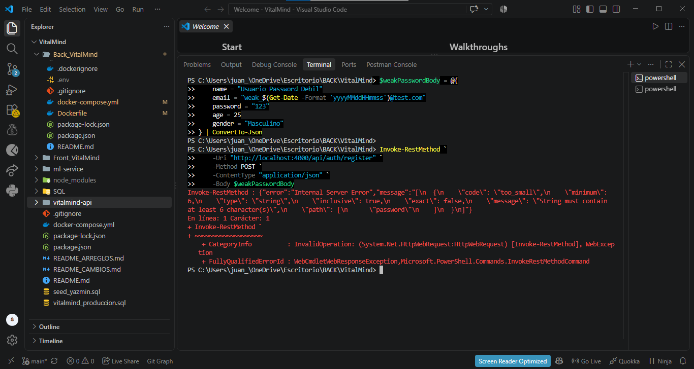

---

## Caso 17: Consulta de síntoma por ID

**Resultado:** OK

**Detalle:** Se verificó de forma aislada el endpoint `GET /api/symptom-logs/:id` utilizando autenticación JWT. Se consultó el registro con ID `17` y el Backend respondió `200 OK`, devolviendo correctamente la información almacenada del registro.

### Evidencia

---

## Caso 18: Consulta de síntoma inexistente

**Resultado:** OK

**Detalle:** Se verificó el comportamiento del endpoint `GET /api/symptom-logs/:id` al solicitar un registro que no existe (ID `999999`). El Backend respondió correctamente con `404 Not Found` y el mensaje `"Registro no encontrado"`, sin exponer un error interno `500`.

### Evidencia

---

## Caso 19: Verificación de operaciones CRUD de síntomas

**Resultado:** PARCIAL

**Detalle:** Se revisaron las rutas disponibles para la gestión de registros de síntomas directamente en el código fuente del contenedor. Se confirmó la implementación de las operaciones de creación (`POST /`), consulta general (`GET /`), consulta por ID (`GET /:id`) y consulta de datos para gráfica (`GET /chart`).

No se encontraron endpoints `PUT` ni `DELETE`, por lo que las operaciones de actualización y eliminación de registros de síntomas no están implementadas actualmente.

### Evidencia

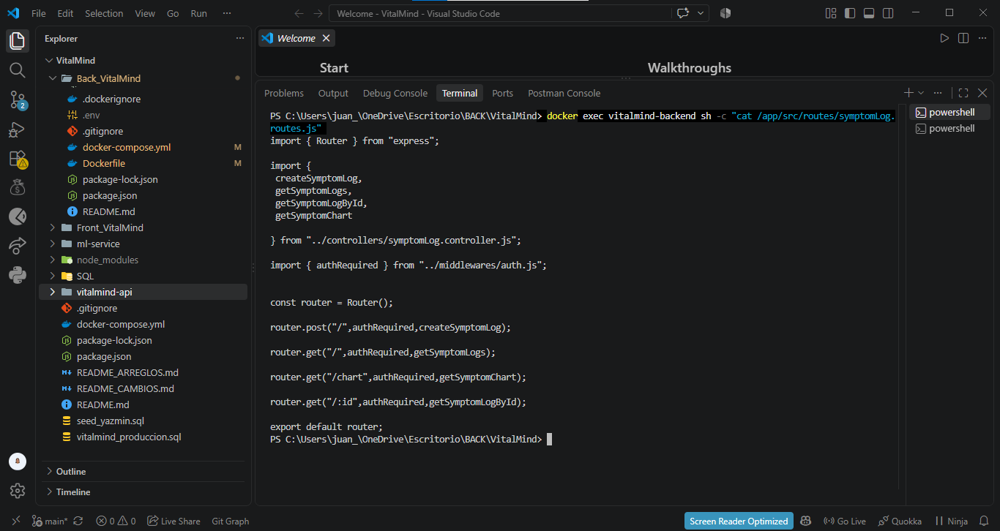

---

## Caso 20: Protección de credenciales en registro

**Resultado:** OK

**Detalle:** Se verificó que la respuesta de `POST /api/auth/register` no expusiera información sensible relacionada con las credenciales del usuario. La respuesta incluyó únicamente `id`, `full_name`, `email` y `role` junto con el token de autenticación. No se encontró ningún campo `password` ni `password_hash`.

**Observación:** El campo de nombre en esta respuesta se llama `full_name`, mientras que en la respuesta de login (Caso 21) el mismo dato se llama `name`. Es una inconsistencia menor de nomenclatura entre ambos endpoints, no un problema de seguridad.

### Evidencia

---

## Caso 21: Protección de credenciales en login

**Resultado:** OK

**Detalle:** Se verificó que la respuesta de `POST /api/auth/login` no expusiera información sensible relacionada con las credenciales del usuario. La respuesta incluyó el token JWT y los datos básicos del usuario (`id`, `name`, `email` y `role`). No se encontró ningún campo `password` ni `password_hash`.

### Evidencia

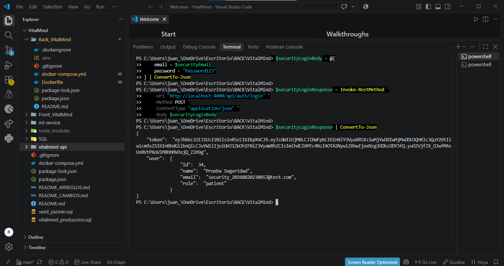

---

## Resumen general

| Caso | Resultado |
|---|---|
| 1. Estado del entorno | OK |
| 2. Conexión Backend - MySQL | OK (con observación) |
| 3. Estructura de usuarios | OK |
| 4. Validación de datos (campo faltante) | FALLÓ (bug 500 en vez de 400) |
| 5. Registro de usuario | OK |
| 6. Persistencia en MySQL | OK |
| 7. Login correcto | OK |
| 8. Login inválido | OK |
| 9. Protección de endpoints | OK |
| 10. Registro de síntomas (rango inválido) | FALLÓ (bug 500 en vez de 400) |
| 11. Consulta de medicamentos | OK |
| 12. Correo duplicado | OK |
| 13. Token inválido | OK |
| 14. Consulta de registros de síntomas | OK |
| 15. Protección de registros de síntomas | OK |
| 16. Contraseña débil | FALLÓ (bug 500 en vez de 400) |
| 17. Consulta de síntoma por ID | OK |
| 18. Síntoma inexistente | OK |
| 19. CRUD de síntomas | PARCIAL (sin PUT/DELETE) |
| 20. Credenciales no expuestas (registro) | OK |
| 21. Credenciales no expuestas (login) | OK |

### Resultado final

Las pruebas realizadas sobre el Backend de VitalMind fueron satisfactorias en la mayoría de los escenarios funcionales evaluados: comunicación con MySQL, registro y autenticación de usuarios, persistencia de información, consulta de síntomas y medicamentos, protección de endpoints mediante JWT, manejo de correos duplicados y no exposición de credenciales en las respuestas.

Se detectaron **tres ocurrencias del mismo patrón de bug** en el manejo de errores de validación: al registrar un usuario con un campo faltante (Caso 4), al registrar un síntoma con valores fuera de rango (Caso 10), y al registrar una contraseña débil (Caso 16). En los tres casos, el Backend detecta correctamente el dato inválido, pero responde `500 Internal Server Error` en lugar de `400 Bad Request`, y en el Caso 10 llega a exponer el mensaje interno de MySQL. Esto indica un problema sistémico: probablemente falta un manejador de errores global que capture las excepciones de validación (posiblemente de Zod) y las convierta en respuestas `400` controladas. Las tres incidencias fueron documentadas y trasladadas a la rama `fix/api-errors`.

Se revisaron también las operaciones CRUD del módulo de síntomas (Caso 19), confirmando que solo están implementadas las operaciones de creación y consulta; actualización y eliminación no existen actualmente.

Como observación menor, se detectó una inconsistencia de nomenclatura entre los endpoints de registro y login: el primero devuelve el nombre del usuario como `full_name` y el segundo como `name` (Caso 20).

### Evidencia final del entorno

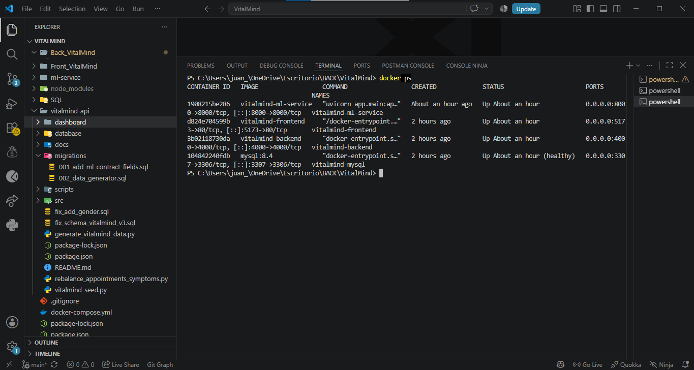