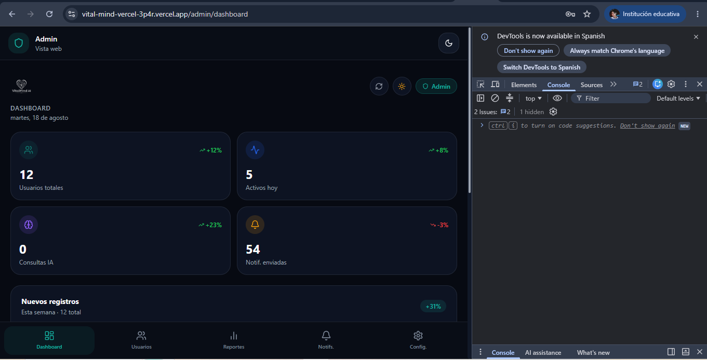
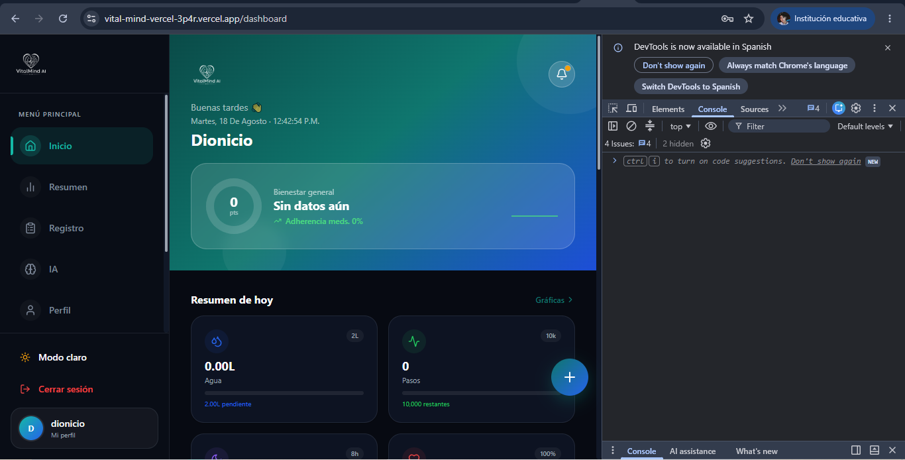
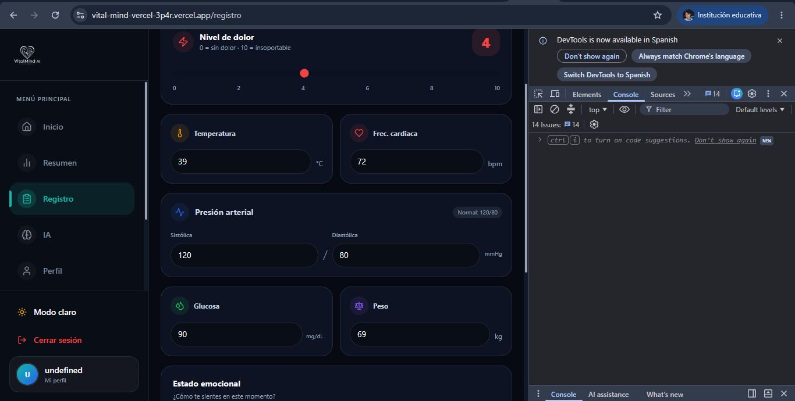
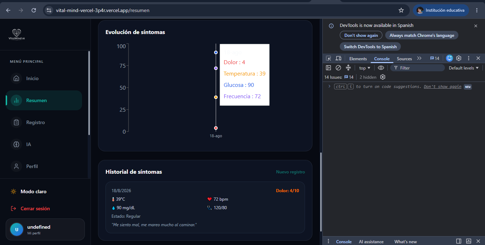
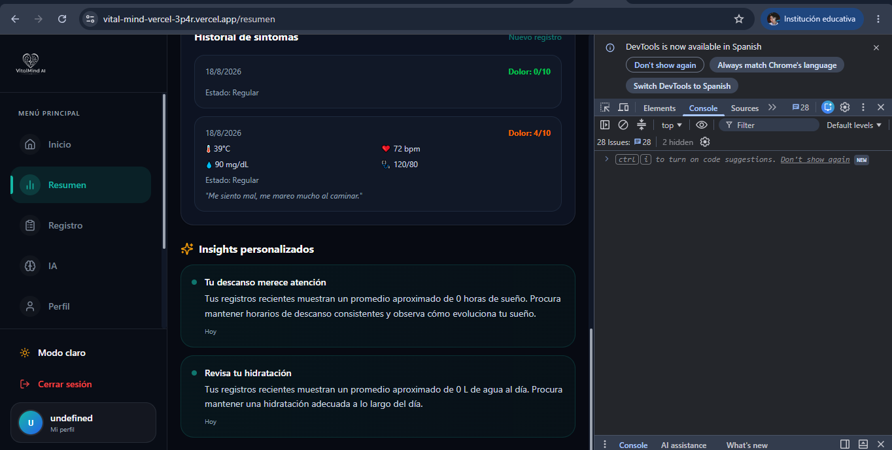
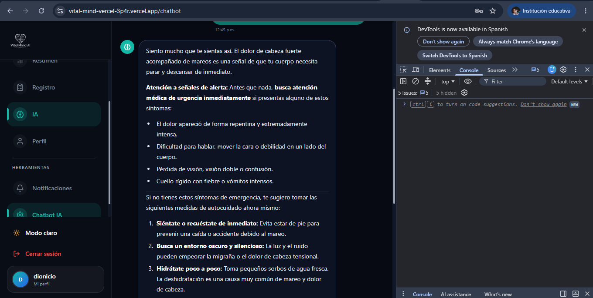

# Resultados de Pruebas de Integración

**Entorno de prueba:** VitalMind_Vercel (Docker Compose)

**Responsable:** Citlalli Pérez Dionicio

**Servicios probados:** Frontend + Backend + ml-service + MySQL

---

## Caso 1: Login / Autenticación

**Resultado:** OK

**Detalle:** Se verificó el inicio de sesión con una cuenta de administrador y una cuenta de usuario. Ambos accesos funcionaron correctamente y cada usuario fue redirigido al dashboard correspondiente según su rol.

- Administrador → `/admin/dashboard`
- Usuario → `/dashboard`

No se detectaron errores durante la prueba.

### Evidencia

---

## Caso 2: Registro de síntomas

**Resultado:** OK

**Detalle:** Se completó el formulario de registro de síntomas con datos de prueba correspondientes a temperatura, glucosa, ritmo cardiaco, presión arterial, nivel de dolor y comentario.

El registro se guardó correctamente y los datos aparecieron posteriormente en la sección de Resumen/Historial de síntomas.

No se detectaron errores durante la prueba.

### Evidencia

---

## Caso 3: Dashboard e Insights de IA

**Resultado:** OK

**Detalle:** Se verificó que la información registrada por el usuario se mostrara correctamente en el dashboard y en la sección de Resumen.

La sección de Insights generados por IA mostró recomendaciones relacionadas con los datos del usuario, confirmando el funcionamiento del flujo de integración entre el Frontend, Backend y la lógica de IA.

También se verificó la sección de Evolución y la visualización de la información generada a partir de los registros del usuario.

No se detectaron errores durante la prueba.

### Evidencia

---

## Caso 4: Chatbot (IA)

**Resultado:** OK

**Detalle:** Se realizaron consultas al chatbot desde el Frontend. El sistema recibió las preguntas y generó respuestas correctamente.

Se verificó la comunicación entre el Frontend, Backend y el servicio de IA durante la interacción con el chatbot.

No se detectaron errores que impidieran el funcionamiento del chatbot.

### Evidencia

---

## Caso 5: Flujo completo de integración

**Resultado:** OK

**Detalle:** Se verificó el flujo completo del sistema desde el registro de información del usuario hasta su procesamiento y visualización.

El flujo comprobado fue:

Frontend → Backend → MySQL / ML-Service → Backend → Frontend

Los datos registrados fueron procesados correctamente y la información correspondiente se mostró en las secciones del sistema.

---

## Resumen general

| Caso | Resultado |
|---|---|
| Login / Autenticación | OK |
| Registro de síntomas | OK |
| Dashboard / Insights IA | OK |
| Chatbot | OK |
| Flujo completo de integración | OK |

### Resultado final

Las pruebas de integración realizadas en el entorno actualizado de VitalMind fueron satisfactorias.

Se confirmó que el Frontend, Backend, base de datos y microservicio de IA pueden comunicarse correctamente y funcionar como un flujo integrado de extremo a extremo.